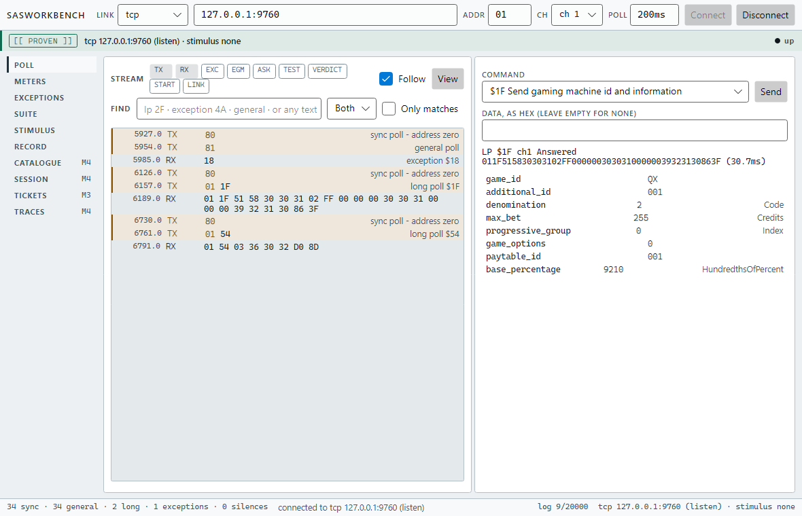
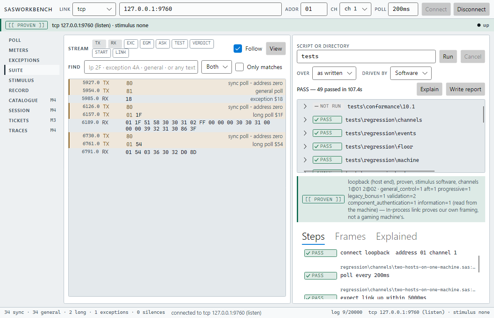
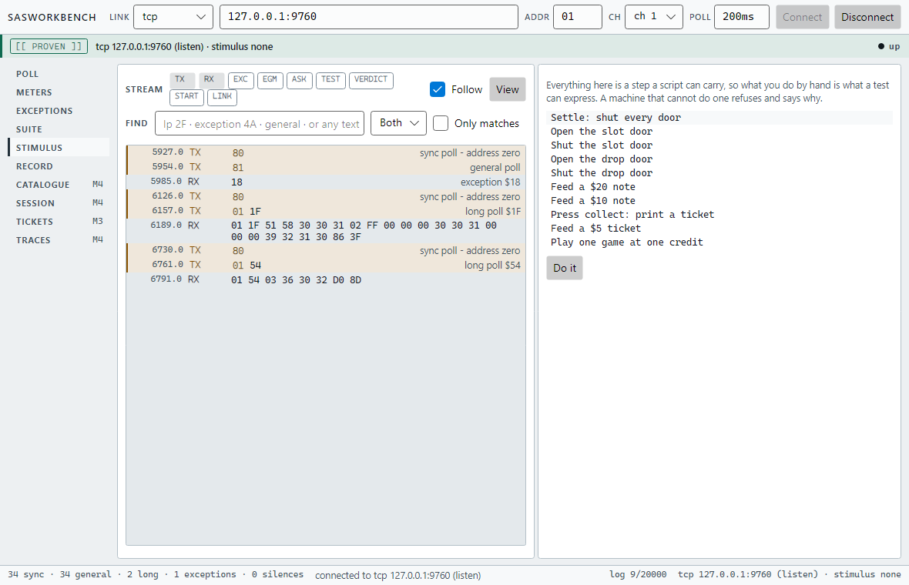
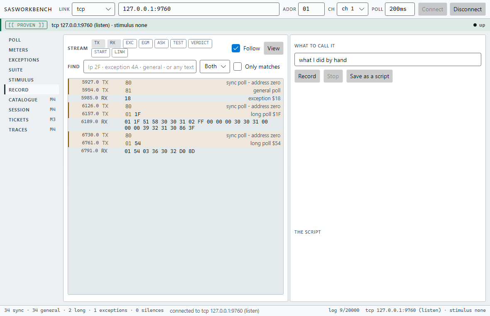
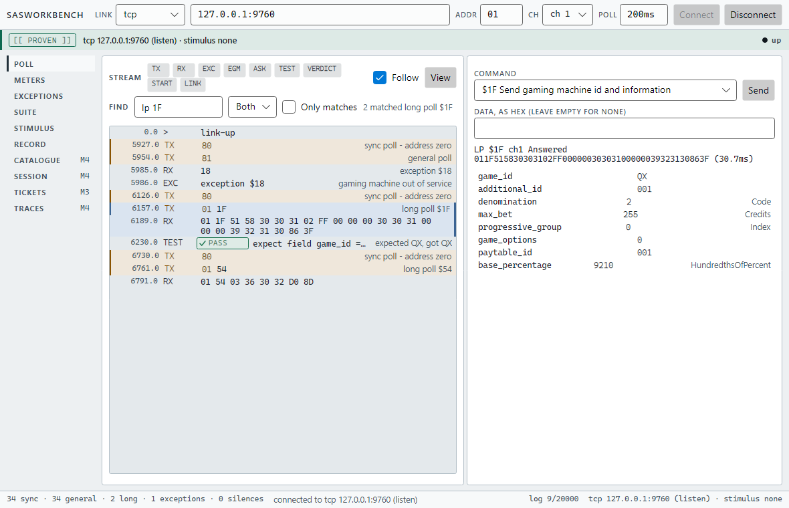

**SasWorkbench**

**Guida utente**

Documento 303-0XX-IT, versione 1.2

**Storia delle revisioni**

| Versione | Data | Commenti | Autore |
| --- | --- | --- | --- |
| 1.0 | 29/10/2026 | Prima emissione. Descrive SasWorkbench 0.2.1. | Alessio Brizi |
| 1.1 | 31/10/2026 | Descrive SasWorkbench 0.2.2: la condizione `when` di `host send lp` e `sasctl nvram denomination`; corretto lo stato delle release. | Alessio Brizi |
| 1.2 | 09/11/2026 | Descrive SasWorkbench 0.2.3: i passi `host warm up`, hand pay, power cycle e memory fault, nuovi stimoli manuali e `sasctl nvram games`. | Alessio Brizi |

# Informazioni su questo documento

## Scopo

Questa guida spiega come usare SasWorkbench 0.2.3 per provare una macchina da gioco sul protocollo
SAS. Copre l'installazione, il collegamento seriale e TCP, l'esecuzione delle suite, i report, la
finestra e la lettura di una run registrata, byte per byte.

La guida descrive anche la prima misura fatta su una scheda Quixant, il 29/10/2026. Con la 0.2.0
quella misura è fallita, e ha portato a due correzioni del trasporto seriale nella 0.2.1. Con la
versione 0.2.1, lo stesso giorno, la stessa prova è passata. Una delle due cause è confermata dai dati;
l'altra è dedotta e non è stata misurata, come spiega il capitolo "La prima misura su una scheda".

## Destinatari

La guida è scritta per gli ingegneri e i tester dell'azienda che usano SasWorkbench in due modi:

- contro la macchina demo, sullo stesso PC, attraverso un collegamento TCP;
- contro una scheda Quixant con QSP, attraverso una porta seriale.

Il lettore conosce già i long poll, i general poll e le eccezioni SAS. Non serve conoscere il codice
sorgente di SasWorkbench.

## Che cosa non copre

La guida non spiega il protocollo SAS. Per il significato di un comando, di un campo o di
un'eccezione fa fede la specifica IGT SAS 6.02.

La guida non spiega QSP né il menu audit della macchina. Per questi argomenti vedi le guide 303-030
e 303-033.

La guida non spiega come si scrive il codice di SasWorkbench né come si prepara una release.

## Come leggere la guida

Se usi SasWorkbench per la prima volta, leggi nell'ordine i capitoli da "Che cos'è SasWorkbench" a
"Primi passi". Poi passa a "Eseguire le suite".

Se lavori su una scheda, leggi anche "Il collegamento seriale" e "La prima misura su una scheda"
prima di fidarti di un risultato.

Se devi capire perché un test è fallito, vai a "Leggere una run registrata" e a "Risoluzione dei
problemi".

Le appendici sono riferimenti da consultare: i comandi e le opzioni, il linguaggio degli script, le
capacità che un test può richiedere, gli esiti e i report.

## Convenzioni

### Notazione dei byte

Un byte esadecimale si scrive con il segno del dollaro: `$1F` è il long poll 31 decimale. Nei
comandi e negli script lo stesso byte si scrive spesso come `1F`.

SAS usa un nono bit, il bit di wakeup, che segna il byte di indirizzo. Nell'output dei comandi
SasWorkbench scrive ogni byte con il suo nono bit davanti, separato da un punto:

| Notazione | Significato |
| --- | --- |
| `1.81` | byte `$81` con il bit di wakeup a 1: un indirizzo |
| `0.1F` | byte `$1F` con il bit di wakeup a 0: un dato |
| `1.80` | poll di sincronizzazione: general poll dell'indirizzo zero |

Una sequenza come `1.01 0.1F` è quindi il long poll `$1F` all'indirizzo `$01`: il primo byte porta
il bit di wakeup, il secondo no. In questa guida un byte così scritto si chiama anche simbolo.

### Durate e tempi

Le durate si scrivono come le accetta SasWorkbench: `200ms`, `5s`, `2m`. Un numero senza unità è in
millisecondi. Nell'output i tempi sono in millisecondi, con un decimale.

### Testo sullo schermo

I nomi dei comandi, le opzioni, le etichette della finestra, i messaggi e i nomi dei file restano in
inglese, esattamente come li stampa il programma. Per esempio: `sasctl run`, `--stimulus none`,
`Connect`, POLL.

Le etichette della finestra in maiuscolo sono scritte senza virgolette (POLL, SUITE). I pulsanti e i
testi da digitare sono scritti in carattere a spaziatura fissa (`Send`, `127.0.0.1:9760`).

Gli esempi di output sono copiati da esecuzioni reali. Dove una riga era più lunga della pagina è
stata accorciata o divisa, e il punto in cui manca del testo è segnato con `...`. I percorsi delle
cartelle delle run sono abbreviati.

## Che cosa è verificato

Questa guida distingue sempre tra ciò che è stato misurato e ciò che non lo è.

Il collegamento seriale della 0.2.1 è stato provato il 29/10/2026 su una scheda Quixant IQ-2, sulla
porta COM6, una UART di scheda servita dal driver `serial.sys`. Su quella porta il controllo del
collegamento passa e i long poll ricevono risposta. Il capitolo "La prima misura su una scheda"
riporta i numeri prima e dopo la correzione.

Non sono ancora stati misurati:

- un adattatore USB-seriale;
- altri tipi di porta seriale, per esempio una UART dedicata a SAS.

I report e la finestra della 0.2.3 continuano a segnare il collegamento seriale come UNVERIFIED. La
loro frase di avvertenza dice che è stata misurata solo la UART di scheda della IQ-2, e SasWorkbench
non sa distinguere quella porta da un adattatore USB. La prova del 29/10 riguarda una sola scheda,
una sola porta e una sola configurazione.

%%PAGEBREAK

# Che cos'è SasWorkbench

## Un host SAS scriptabile

SasWorkbench è un host SAS 6.02. Fa quello che fa un sistema di sala: manda general poll e long poll
a una macchina, legge le risposte e le decodifica campo per campo. In più fa asserzioni: confronta
ciò che la macchina risponde con ciò che uno script si aspetta, e scrive un esito.

SasWorkbench ha due interfacce, nella stessa cartella:

- `sasctl`, il programma a riga di comando, che esegue gli script e scrive i report;
- `SasWorkbench.exe`, la finestra, per mandare richieste a mano, guardare il traffico ed eseguire una
  suite.

SasWorkbench contiene anche una macchina da gioco software. Serve a provare SasWorkbench stesso, in
modo veloce e senza hardware.

## Che cosa non è

SasWorkbench non è uno sniffer. Non ascolta il traffico tra un altro host e una macchina: è lui
l'host, e parla solo con la macchina a cui è collegato.

La macchina software non è l'oggetto del test. I due capi di una run contro di essa sono codice di
SasWorkbench, quindi un PASS dice solo che i due capi sono d'accordo tra loro. L'aiuto di `sasctl`
lo dice così: "It is a fixture for fast tests, not the thing under test."

## I collegamenti

SasWorkbench raggiunge una macchina in tre modi.

| Collegamento | Opzione di `sasctl run` | Che cosa collega |
| --- | --- | --- |
| loopback | `--loopback` | la macchina software, nello stesso processo |
| tcp | `--tcp <host:port>` | una macchina che chiama l'host via TCP, per esempio la demo |
| serial | `--serial <port>` | una macchina su una porta seriale, per esempio una scheda |

Sul collegamento TCP ogni simbolo SAS viaggia come una parola che porta anche il nono bit. Il
comando `sasctl probe` lo descrive con "nine-bit symbols, one word per symbol".

Sul collegamento seriale il nono bit viaggia come bit di parità. Il capitolo "Il collegamento
seriale" spiega come.

## Quanto vale un collegamento

Ogni report dice su quale collegamento è stato ottenuto e quanto vale. Questa informazione si chiama
riga di provenienza. Il valore è l'affermazione del collegamento su quanto fedelmente trasporta SAS,
bit di wakeup compreso. È uno di due:

| Valore | Significato | Dove si vede |
| --- | --- | --- |
| PROVEN | il collegamento trasporta SAS in modo fedele, bit di wakeup compreso | loopback, tcp |
| UNVERIFIED | il collegamento non è stato misurato: un PASS va trattato come non provato | serial |

PROVEN non dice che cosa la run prova sulla macchina. Lo dice la frase di avvertenza che accompagna
ogni valore. Per il loopback è "In-process link: proves our own framing, not a gaming machine's.":
il collegamento è fedele, ma l'altro capo è la macchina software. Per la seriale è "Measured only on
a Quixant IQ-2's on-board UART (serial.sys, 19200 baud); USB adapters are unmeasured, so treat a pass
over one as untested."

Nella 0.2.3 la seriale porta ancora l'etichetta UNVERIFIED, anche dopo la prova del 29/10/2026 su
una UART di scheda. La sezione "Che cosa è verificato" spiega perché.

La riga di provenienza compare nella console alla fine di una run, in ogni report e nella finestra.
Questo è un esempio reale, dalla console di una run in loopback:

```
  over loopback (host end), proven, stimulus software, channels 1@01 · general_control=1
  aft=1 progressive=1 legacy_bonus=1 validation=1 component_authentication=1 information=1
  (read from the machine) - In-process link: proves our own framing, not a gaming machine's.
```

La riga dice il collegamento, il suo valore, lo stimolo usato, l'indirizzo per canale (`1@01`), a
quale canale appartiene ogni categoria e da dove viene questa informazione: letta dalla macchina o
dichiarata dal test.

Non citare mai una run in loopback come prova su una macchina. La riga di provenienza esiste per
impedirlo.

## Gli alberi di test

Gli script sono file di testo con estensione `.sas`, nella cartella `tests/` del repository. Sono
divisi in tre alberi.

| Albero | Che cosa prova | Test |
| --- | --- | --- |
| `tests/regression/` | il comportamento di SasWorkbench stesso: collegamento, canali, meter, ticket, polling | 50 in 21 file |
| `tests/conformance/` | casi del corpus del toolkit di conformità GSA, revisione 1.2 | 3 in 3 file |
| `tests/validation/` | casi scritti dai documenti di test EGM, revisione 1.00, e due argomenti mirati | 229 in 36 file |

Dentro `tests/validation/`, la cartella `egm-test-scripts-v1.00/` contiene 181 test in 28 file.

I numeri della tabella vengono da `sasctl run <albero> --list` sulla versione 0.2.3.

La cartella `tests/regression/wire/` contiene un solo test: il collegamento sale e la macchina si
identifica. È il primo test da eseguire su un collegamento nuovo.

## La versione 0.2.3 e il suo stato

Questa guida descrive SasWorkbench 0.2.3. Rispetto alla 0.2.2, nella 0.2.3 cambiano queste cose:

- uno script può far sì che la macchina debba un hand pay con `egm handpay <centesimi>` o
  `egm handpay jackpot <centesimi>`, azzerarlo con `egm handpay reset`, e chiedere un power cycle con
  `egm power cycle` o un memory fault con `egm memory fault <tipo>` (Appendice B, "Stimoli");
- lo stimolo `manual` offre anche la porta principale, il pulsante di servizio, gli hand pay, i
  power cycle e i memory fault; lo stimolo `software` offre gli hand pay; lo stimolo `qpm` offre un
  hand pay da cashout e il suo reset quando la demo dichiara i pulsanti necessari (Appendice C);
- `host warm up <durata>` lascia a una macchina appena avviata il tempo di riportare le sue
  eccezioni di avvio, una volta per macchina in una run, e molti casi in sequenza iniziano
  con questo passo (Appendice B, "Polling");
- il long poll `$80` si può scrivere con campi per nome (`with progressive_group=… level=… amount=…`);
  durante una sequenza, `host send lp ... to 00` manda un long poll che può essere mandato in
  broadcast, come `$80`, e un messaggio `to` un indirizzo che l'host non interroga passa solo se
  nessuna macchina risponde (Appendice B, "Invio
  di messaggi");
- `host send sync` scarta prima i byte che una risposta in ritardo ha lasciato sulla linea, e il
  log li registra;
- `sasctl nvram games` elenca le denominazioni dei giochi di una fixture, e
  `sasctl nvram games enable` accende quelle che l'unità contabile divide; `sasctl nvram` rifiuta
  un'opzione che l'azione non legge, prima di leggere o scrivere qualunque cosa (sezione "qpm e
  nvram");
- le fixture `golden` e `secure-enhanced` sono nella disposizione di memoria 19, per la demo
  compilata su QSP v2.3.6.34, contano in 5 centesimi e hanno i giochi accesi; le copie per la
  disposizione 15, per una demo compilata su QSP v2.3.6.1, sono in `fixtures/nvram/arrangement-15/`;
- la macchina software ha una coda di eccezioni profonda 64, applica l'implied NACK e il loop
  break, può tenere un hand pay, e riporta una base percentage di 9211; dopo il reset di un hand pay
  riporta l'eccezione `$52` solo quando la sua lettura del long poll `$1B` è stata confermata;
- in `tests/validation`, i casi sulla coda, sull'implied acknowledgement e sulla sincronizzazione e
  i casi dei ticket in validazione secure-enhanced ora hanno i passi scritti; un caso scritto solo
  come note viene saltato con il motivo `no steps are written yet; the case holds only its notes`.

La 0.2.2 ha cambiato queste cose, rispetto alla 0.2.1:

- `host send lp` può chiudersi con una condizione, `when <capacità> == <valore>`: se la capacità ha
  un altro valore, non viene mandato nulla e il passo non è un'asserzione (Appendice B, "Invio di
  messaggi");
- `sasctl nvram denomination` riscrive una fixture perché conti in un'altra denominazione contabile,
  e `sasctl nvram show` stampa l'`accounting unit` della memoria della macchina e della fixture
  (sezione "qpm e nvram");
- `sasctl nvram` legge e scrive la memoria della demo compilata su QSP v2.3.6.1, disposizione di
  memoria 15; le fixture `golden` e `secure-enhanced` sono in questa disposizione e contano in 5
  centesimi, e le copie per la disposizione 7 sono in `fixtures/nvram/arrangement-7/`;
- un errore imprevisto dentro il polling non chiude più il programma: il polling si ferma, il
  collegamento va `down`, il poll in corso finisce `NotSent` con un motivo che inizia con
  `polling stopped after an unexpected`, e `sasctl` stampa i dettagli sull'uscita di errore;
- i casi di riscossione dei ticket di `tests/regression` mandano `$4C` solo a una macchina in
  validazione `secure_enhanced`, e l'ultimo caso chiude il suo ticket con un rifiuto `$71`, così il
  caso successivo non trova nessun ticket rimasto in sospeso;
- allo stesso modo, i casi 10.7.2, 10.7.3, 10.7.8 e 10.7.18 impostano prima l'identificativo di
  validazione con `$4C`, e AD-38, AD-39 e un caso a due host di `tests/regression` lo mandano con
  `when`; il caso 4.6 e il caso di sequenza di `tests/regression` mandano prima un poll di
  sincronizzazione, e un general poll a un altro indirizzo tra due general poll propri.

La 0.2.1 ha cambiato il trasporto seriale, rispetto alla 0.2.0:

- prima di ogni cambio di parità la linea viene svuotata sul filo;
- un byte ricevuto con un errore di parità resta il byte ricevuto, invece di essere sostituito.

Con la 0.2.0 una scheda collegata in seriale sembrava non rispondere ai long poll. Con la 0.2.1,
sulla stessa scheda, risponde. Il capitolo "Il collegamento seriale" spiega le due modifiche e il
motivo.

La 0.2.1 corregge anche alcuni difetti della riga di comando e della finestra:

- `sasctl run` accetta le opzioni prima o dopo i percorsi, e le legge tutte anche con `--list`;
- `sasctl run` rifiuta `--out` senza `--report` prima di far girare qualunque cosa;
- un test che aprirebbe la stessa porta seriale o lo stesso indirizzo TCP per due canali viene
  saltato, con il motivo, prima di aprire qualunque porta;
- nella finestra, `Follow` tiene in vista l'ultima riga della STREAM, una striscia dice quando la
  STREAM è ristretta a un test, e senza collegamento la banda non mostra nessun sigillo;
- `sweep` chiede il long poll `$7B` con entrambe le scadenze dei ticket a zero, quindi la richiesta
  non può cambiare le scadenze salvate nella macchina.

Le misure sulla scheda riportate in questa guida sono state fatte con una build precedente della
0.2.1, prima di queste correzioni. Da allora il trasporto seriale non è cambiato, salvo la sua frase
di avvertenza.

SasWorkbench è pubblicato come release su GitHub, ogni release con i pacchetti per Windows e Linux
e un file `SHA256SUMS`. La release 0.1.0 non contiene molte delle funzioni
descritte qui. Per usare le funzioni della 0.2.3, prendi la release 0.2.3 oppure compilala dal
sorgente, come spiega il capitolo "Installazione".

%%PAGEBREAK

# Installazione

## Requisiti

| Requisito | Dettaglio |
| --- | --- |
| Sistema operativo | Windows per il collegamento seriale. Su Linux x64 funzionano il loopback e il TCP. |
| .NET | .NET 10. Per compilare serve l'SDK; per eseguire un pacchetto serve il runtime. |
| Repository | una copia del repository SasWorkbench, con la cartella `tests/` |

Per controllare la versione di .NET installata:

```
dotnet --version
```

Il risultato deve iniziare con `10.`.

## Compilare dal sorgente

Apri un prompt nella cartella del repository e compila in Release:

```
dotnet build SasWorkbench.slnx --configuration Release
```

Al termine trovi i due programmi in questi percorsi:

| Programma | Percorso |
| --- | --- |
| `sasctl` | `src\SasWorkbench.Cli\bin\Release\net10.0\sasctl.exe` |
| la finestra | `src\SasWorkbench.Gui\bin\Release\net10.0\SasWorkbench.exe` |

Una build senza `--configuration Release` finisce in `bin\Debug\net10.0` invece che in
`bin\Release\net10.0`. Funziona allo stesso modo, ma è facile confondere le due copie: usa sempre la
stessa.

Puoi anche avviare `sasctl` senza cercare l'eseguibile:

```
dotnet run --project src/SasWorkbench.Cli -- <comando> <opzioni>
```

Negli esempi di questa guida il programma si chiama `sasctl`. Sostituisci il nome con il percorso
completo, oppure aggiungi la cartella al `PATH`.

## Dal pacchetto di una release

Ogni release porta due pacchetti: `SasWorkbench-<versione>-win-x64.zip` per Windows e
`SasWorkbench-<versione>-linux-x64.tar.gz` per Linux x64. Ogni pacchetto contiene la finestra e
`sasctl` nella stessa cartella e richiede il runtime .NET 10. Su Linux il collegamento seriale è
rifiutato; il loopback e il TCP funzionano.

Ogni release porta anche un file `SHA256SUMS`. Non usare la release 0.1.0 per le prove descritte in
questa guida.

## La cartella tests

Gli script non sono dentro i programmi: sono file nella cartella `tests/`. Se porti SasWorkbench su
un altro PC, per esempio sulla macchina sotto test, porta anche la cartella `tests/`.

La cosa più sicura è copiare tutto il repository. I comandi di questa guida partono dalla cartella
del repository e usano percorsi relativi come `tests/regression/wire`.

La finestra cerca la cartella `tests` partendo dalla cartella del suo eseguibile e risalendo verso
l'alto. Se la cartella non c'è, la riga di stato della finestra lo dice con
`No script or directory at 'tests'.`

## Verificare l'installazione

Controlla la versione:

```
sasctl --version
```

La risposta è il solo numero di versione:

```
0.2.3
```

Poi chiedi a `sasctl` che cosa può fare in questo ambiente:

```
sasctl probe
```

`probe` non apre nessun collegamento e non prova che una macchina risponda. Stampa quattro sezioni:

| Sezione | Contenuto |
| --- | --- |
| `Protocol this build knows` | quanti long poll, eccezioni e meter conosce la build, e quanti ne decodifica |
| `Links` | i tre collegamenti; per `serial`, l'elenco delle porte COM che Windows riporta |
| `What a test may require` | le capacità che un test può richiedere in questo ambiente |
| `Not available yet, and why` | ciò che `probe` non può sapere, con il motivo |

Se nella riga `serial` compare `no ports on this machine`, Windows non vede porte seriali.

`probe` accetta solo le opzioni dello stimolo: `--stimulus`, `--egm-resources` e `--qpm-shm`. Non
accetta opzioni di collegamento come `--serial` o `--loopback`. Se ne scrivi una, il programma
stampa comunque il rapporto, poi l'avviso `warning: '--serial' is not an option of 'sasctl probe'` e
termina con codice 2.

%%PAGEBREAK

# Il collegamento seriale

Questo capitolo vale per le prove su una scheda. Leggilo prima di collegare il cavo.

## Parametri di linea

SasWorkbench apre la porta seriale sempre con questi parametri. Non si possono cambiare.

| Parametro | Valore |
| --- | --- |
| Velocità | 19200 baud |
| Bit di dati | 8 |
| Parità | Mark per un byte di indirizzo, Space per un byte di dati, cambiata byte per byte |
| Bit di stop | 1 |
| Controllo di flusso | nessuno |
| DTR e RTS | spenti |

La porta si apre con parità Space. Un carattere sul filo occupa 11 bit: start, otto bit di dati,
parità e stop. A 19200 baud un carattere dura circa 0,57 ms.

## Il bit di wakeup

SAS usa nove bit per carattere. Il nono bit, il bit di wakeup, vale 1 solo sul byte di indirizzo con
cui l'host apre un messaggio. Una porta seriale di un PC ha otto bit di dati più un bit di parità.

SasWorkbench usa il bit di parità come nono bit:

- per un byte con il bit di wakeup imposta la parità Mark, cioè un bit di parità sempre a 1;
- per un byte di dati imposta la parità Space, cioè un bit di parità sempre a 0.

Quindi la porta cambia parità dentro un messaggio. Il long poll `$1F` è di due soli byte,
`1.01 0.1F`, senza CRC: il byte `01` parte con parità Mark, poi la porta passa a Space e parte `1F`.
Altri long poll portano anche un CRC di due byte, con parità Space: per esempio il long poll `$01`
sul filo è `1.01 0.01 0.51 0.08`. Un general poll `1.81` è un solo byte con parità Mark.

In ricezione il nono bit non serve: una macchina non imposta mai il bit di wakeup nelle sue risposte.

Questo schema funziona solo se ogni byte lascia la porta con la parità che gli spetta. Un adattatore
che accumula le scritture e le spedisce insieme rompe lo schema. Il guasto si presenta come una
macchina che non risponde mai.

## Solo su Windows

Il collegamento seriale funziona solo su Windows. Sugli altri sistemi la libreria seriale di .NET
scarta le parità Mark e Space senza segnalare errori. Il bit di wakeup non arriverebbe mai alla
macchina.

Per questo SasWorkbench rifiuta la seriale fuori da Windows, con questo messaggio:

```
Serial SAS is refused on this platform: mark and space parity are discarded without
error here, so the wakeup bit would never reach the gaming machine. Use the TCP transport,
or run the serial link on Windows.
```

Fuori da Windows usa il collegamento TCP.

## Le porte

`sasctl probe` elenca le porte COM che Windows riporta. Esegui `probe` prima e dopo aver collegato
un adattatore: la porta nuova è quella dell'adattatore.

I nomi da COM10 in su funzionano, per esempio `--serial COM12`.

Una porta può essere aperta da un solo programma alla volta. Se la porta è già aperta, il test viene
saltato con un motivo come `Cannot open COM6: Access to the path 'COM6' is denied.`

### Adattatori USB

Con un adattatore USB-seriale il cambio di parità byte per byte non è affidabile in generale. Nessun
adattatore è ancora stato misurato con SasWorkbench. L'unico caso misurato è la UART di scheda della
prova del 29/10/2026.

I consigli che seguono vengono dalle ricerche del progetto e non sono verificati. Se devi usare un
adattatore:

- scegli un adattatore FTDI originale, per esempio FT232R o FT232H;
- imposta il suo Latency Timer a 1 ms, poi chiudi e riapri la porta;
- evita gli adattatori con chip CH340, PL2303 o CP210x, e quelli che usano il driver CDC
  `usbser.sys`.

Il Latency Timer di un adattatore FTDI si trova nel registro di Windows, sotto la chiave
`HKLM\SYSTEM\CurrentControlSet\Enum\FTDIBUS\<id>\0000\Device Parameters`, valore `LatencyTimer`.
Il valore predefinito è 16 ms.

Il Latency Timer accorcia il tempo con cui le risposte della macchina arrivano al PC. Non decide
l'ordine dei byte in trasmissione: da solo non garantisce che ogni byte parta con la parità giusta.

### UART di scheda

La prova del 29/10/2026 ha usato due porte della stessa scheda IQ-2, COM5 e COM6, servite dal driver
`serial.sys` di Windows e collegate tra loro con un cavo. COM5 era la porta SAS di QSP, COM6 quella
di SasWorkbench.

Su COM6 la 0.2.0 non funzionava e la 0.2.1 funziona. È l'unica porta su cui la seriale di
SasWorkbench è stata misurata. Le schede Quixant non hanno tutte lo stesso tipo di porta: alcune hanno
una UART dedicata a SAS. Quello che questa guida dice della prova vale per quella porta di quella
scheda.

## Che cosa cambia in 0.2.1

La 0.2.1 cambia due comportamenti del trasporto seriale.

| Comportamento | 0.2.0 | 0.2.1 |
| --- | --- | --- |
| Cambio di parità | dopo aver svuotato il buffer di scrittura, senza aspettare che il byte esca sul filo | dopo che la coda del driver è vuota, più due tempi di carattere |
| Byte ricevuto con errore di parità | sostituito con `?`, cioè `$3F` | tenuto come è stato ricevuto |

### Lo svuotamento prima del cambio di parità

Già la 0.2.0, prima di ogni cambio di parità, svuotava il buffer di scrittura. Non aspettava però che
la coda del driver si svuotasse, né che il byte lasciasse la UART. Dopo il byte di indirizzo di un
long poll la porta passava quindi a Space mentre l'indirizzo poteva essere ancora nella UART. Con
ogni probabilità l'indirizzo partiva con la parità sbagliata: una macchina che riceve l'indirizzo
senza bit di wakeup non lo riconosce come indirizzo e non risponde. Questa causa è dedotta, non
misurata sul filo.

Con la 0.2.1, prima di ogni cambio di parità, SasWorkbench esegue questi passi:

1. svuota il buffer di scrittura, come la 0.2.0;
2. aspetta che la coda di trasmissione del driver sia vuota, per al massimo 100 ms;
3. aspetta altri due tempi di carattere, circa 1,15 ms a 19200 baud;
4. cambia la parità e scrive il byte successivo.

La coda del driver si svuota quando la UART ha preso il byte, non quando il byte è sul filo. I due
tempi di carattere coprono un byte ancora nel registro della UART e un byte in uscita.

Lo svuotamento dipende dalla parità in cui la porta si trova, non dal messaggio. Prima di ogni byte
SasWorkbench confronta la parità che serve con quella attuale, e attende solo se sono diverse. Per
esempio, il poll di sincronizzazione che segue un long poll trova la porta in Space, deve passare a
Mark, e quindi attende. Il general poll che segue un poll di sincronizzazione trova la porta già in
Mark e parte senza attese.

### Il byte con errore di parità

Dopo un general poll la porta resta in parità Mark, perché il messaggio è un solo byte con il bit di
wakeup. La risposta della macchina ha il nono bit a 0. Letta in parità Mark, ogni suo byte ha quindi
un errore di parità.

Con la 0.2.0 .NET sostituiva ogni byte con errore di parità con il carattere `?`, cioè `$3F`. Per
questo ogni risposta a un general poll si leggeva `3F`, e SasWorkbench la riportava come
l'eccezione `$3F`. Con la 0.2.1 la sostituzione è spenta e il byte resta quello ricevuto.

### Come è stata verificata

La correzione è verificata in due modi.

Il primo sono quattro nuovi test di unità. Controllano che la linea si svuoti prima di ogni cambio
di parità, che un messaggio che non richiede un cambio di parità non si svuoti, che la porta si crei
con la sostituzione spenta e che un carattere duri undici tempi di bit. I test della seriale passano,
7 su 7.

Il secondo è la prova sulla scheda. Il 29/10/2026 la stessa scheda IQ-2 è stata provata con la
versione 0.2.1, sulle stesse porte usate con la 0.2.0.

| Prova sulla scheda | 0.2.0 | 0.2.1 |
| --- | --- | --- |
| Controllo del collegamento | FAIL, exit 1 | PASS, exit 0 |
| Risposta a un general poll | `3F` | `00`, nessuna eccezione in coda |
| Sweep: risposte / silenzi / illeggibili | 7 / 78 / 0 | 76 / 9 / 0 |

Per confronto, la demo via TCP il 17/10 aveva dato 77 / 8 / 0 nella stessa sweep.

La prova sulla scheda conferma la causa dei `3F`. Per i long poll conferma che le due correzioni
insieme funzionano, non quale delle due sia servita: la 0.2.1 le ha introdotte insieme.

La 0.2.3 continua a segnare il collegamento seriale come UNVERIFIED. La frase di avvertenza nomina
l'unica porta misurata, la UART di scheda della IQ-2, e dice che gli adattatori USB non sono stati
misurati.

## Impostazioni sulla macchina

Due impostazioni stanno nella memoria della macchina. Si cambiano dal suo menu audit, non dal
collegamento SAS:

- l'indirizzo SAS di ogni canale;
- il canale a cui appartiene ogni categoria SAS.

Il menu audit di QSP è descritto nelle guide 303-030 e 303-033.

Per una prova con un solo host su una sola porta, procedi così:

1. imposta l'indirizzo del canale 1, di solito `01`;
2. assegna tutte le categorie al canale 1;
3. usa lo stesso indirizzo in SasWorkbench, con `--address 01`.

Una porta seriale è un canale. Un host sul canale 2 richiede una seconda porta e un secondo cavo.

## I gate per categoria

SAS divide alcuni long poll e alcune eccezioni in sette categorie. Ogni categoria appartiene a un
solo canale. La libreria della macchina applica due regole:

- un long poll di una categoria non assegnata al canale non riceve risposta: la macchina tace, non
  manda un NACK;
- un'eccezione di una categoria non assegnata al canale non arriva all'host di quel canale.

Un canale senza una categoria riporta anche a zero i bit di quella categoria nella risposta al long
poll `$A0`, che descrive le funzioni abilitate.

Il silenzio di un long poll può quindi essere un'impostazione della macchina, non un guasto. Prima di
cercare un problema di collegamento, controlla a quale canale appartiene la categoria del comando.

La tabella seguente riporta l'output di `sasctl catalogue channels` della 0.2.3. I dati sono letti
dalla libreria della macchina.

| Categoria | Long poll con gate | Eccezioni filtrate | Bit di `$A0` azzerati |
| --- | --- | --- | --- |
| `general_control` | `$03 $04 $05 $06 $07 $0A $0B $94 $A8` | nessuna | nessuno |
| `aft` | `$72 $73 $74 $75 $76` | `$66 $69 $6A $6B $6C $6D $6E $6F` | byte 0: `$02`<br>byte 1: `$40` |
| `progressive` | `$80 $85 $86 $87` | `$56` | byte 2: `$02` |
| `legacy_bonus` | `$2E $8A $8B $90` | `$7C` | byte 0: `$05` |
| `validation` | `$4C $4D $57 $58 $70 $71 $7B $7C $7D` | `$3F $57 $67 $68` | byte 0: `$F0` |
| `component_authentication` | `$6E` | `$8E $8F` | byte 1: `$10` |
| `information` | `$2C $4F $8E $8F $A4 $AA` | nessuna | nessuno |

In tutto, 38 long poll su 124 hanno un gate e 16 eccezioni su 122 sono filtrate. Tutti gli altri
comandi ricevono risposta su ogni canale aperto.

Per esempio, il long poll `$3D` (informazioni sul ticket di cashout) non ha gate. Un host su un
canale senza la categoria `validation` riceve comunque il numero di validazione e l'importo reali
del ticket.

Una categoria assegnata a un canale senza indirizzo non raggiunge nessun host. Il menu della
macchina non permette di crearla, ma una configurazione scritta in altro modo sì.

%%PAGEBREAK

# Primi passi

Questo capitolo porta da un'installazione nuova a un primo PASS. Esegui i comandi dalla cartella del
repository.

## Che cosa offre l'ambiente

Esegui `sasctl probe`, come descritto in "Verificare l'installazione". Su una scheda o su un PC con
un adattatore, controlla che la porta da usare compaia nella riga `serial`.

Il 29/10/2026, sulla scheda IQ-2, `probe` della 0.2.0 ha elencato le porte da COM1 a COM6.

## Il controllo del solo collegamento

Il primo test su un collegamento nuovo è sempre `tests/regression/wire`. Contiene un solo test:

```
test "the link comes up and the machine identifies itself" {
  tag @wire-only

  host connect loopback address 01
  host poll every 200ms

  host expect link up within 5s

  host send lp 1F
  host expect field game_id == QX
  host expect field base_percentage of lp 1F >= 7500
  host expect field sas_version of lp 54 == 602
}
```

Il test fa cinque verifiche:

- il collegamento sale entro 5 secondi;
- il long poll `$1F` riceve risposta;
- il campo `game_id` vale `QX`;
- il campo `base_percentage` vale almeno 7500;
- il long poll `$54` riporta la versione SAS 602.

Lo script dice `host connect loopback`. Le opzioni `--serial`, `--tcp` e `--loopback` di `sasctl run`
sostituiscono il collegamento di ogni `host connect`, quindi lo stesso script serve per ogni
collegamento.

Su una scheda, con la porta COM6 e l'indirizzo 01, il comando è:

```
sasctl run tests/regression/wire --serial COM6 --address 01 --report html,junit,jsonl
```

I report vanno in una cartella nuova sotto `runs/`. Il risultato atteso è PASS, con codice di
uscita 0. Questa è la console di una run riuscita, in loopback, con il percorso dei report
accorciato:

```
  PASS  the link comes up and the machine identifies itself (0.6s, 5 assert(s))

  over loopback (host end), proven, stimulus software, channels 1@01 · ... - In-process
  link: proves our own framing, not a gaming machine's.
  PASS  1 passed in 0.7s

  wrote ...\run.html
  wrote ...\run.junit.xml
  wrote ...\run.jsonl
```

Sulla scheda IQ-2, con la 0.2.1, lo stesso test è passato in 0,6 secondi.

I valori `QX`, 7500 e 602 sono quelli della macchina software e della demo. Una macchina con un altro
identificativo fallisce i passi su `game_id` o su `base_percentage` anche con un collegamento sano.
In quel caso guarda i passi `expect link up` e `send lp 1F`: se passano, il collegamento funziona.

### Se il collegamento non sale

Controlla in questo ordine:

1. la porta esiste: `sasctl probe` la elenca;
2. nessun altro programma tiene aperta la porta;
3. l'adattatore, se c'è, cambia la parità byte per byte (vedi "Adattatori USB": nessun adattatore è stato misurato);
4. l'indirizzo in `--address` è quello impostato nella macchina;
5. la macchina è accesa, ha finito l'avvio ed è uscita dal menu audit;
6. la versione di SasWorkbench è la 0.2.1 o successiva: con la 0.2.0, sulla scheda provata il 29/10, i long poll restavano senza risposta.

In alcune configurazioni di QSP la porta SAS si attiva solo all'uscita dal menu audit.

Un collegamento `Up` dice solo che la macchina risponde ai general poll. Con la 0.2.0 la scheda
risultava `Up` anche se ogni risposta si leggeva `3F`. Controlla sempre anche il primo long poll.

## Contro la demo via TCP

Sul collegamento TCP la macchina chiama l'host. SasWorkbench resta in ascolto su un indirizzo e una
porta, e la macchina si collega. `sasctl run` è sempre in ascolto: non ha un'opzione per chiamare la
macchina.

L'indirizzo usato dalla demo è `127.0.0.1:9760`. È anche il valore predefinito della finestra.

La demo deve essere una build preparata per parlare SAS via TCP con SasWorkbench. Le note operative
del progetto SasWorkbench descrivono come prepararla. Due punti contano per questa guida:

- la demo va compilata in Release: una build Debug richiede una licenza che la chiave di sviluppo
  non contiene, e la macchina va in blocco di licenza e non accetta denaro;
- la demo, una volta avviata, chiama l'host e riprova finché non lo trova.

Per il primo controllo, procedi così:

1. avvia la demo;
2. esegui `sasctl run tests/regression/wire --tcp 127.0.0.1:9760 --address 01`;
3. controlla che il risultato sia PASS.

Se la macchina non si collega entro 10 secondi, ogni test viene saltato con un motivo come questo:

```
no gaming machine connected to tcp 127.0.0.1:9760 (listen) within 10s
```

Una demo lenta ad avviarsi richiede più tempo: usa per esempio `--wait-for-machine 30s`.

Contro la demo, e solo contro la demo, lo stimolo può essere `qpm`. Con `qpm` SasWorkbench comanda
le periferiche simulate della demo: porte, pulsanti, banconote e ticket. Il capitolo "Eseguire le
suite" spiega gli stimoli.

## Contro la macchina software

La macchina software non richiede hardware né altri programmi. Si usa con `--loopback` e con lo
stimolo `software`:

```
sasctl run tests/regression --loopback --stimulus software
```

Senza `--stimulus software` ogni test in loopback viene saltato.

Il loopback serve a controllare SasWorkbench e gli script. Non dice nulla su una macchina reale.

%%PAGEBREAK

# Eseguire le suite

## Il comando run

`sasctl run` esegue uno script, oppure tutti gli script sotto una cartella:

```
sasctl run <percorso> [<percorso> ...] [opzioni]
```

Puoi dare più percorsi nello stesso comando. L'elenco completo delle opzioni è nell'Appendice A.

I percorsi possono stare prima o dopo le opzioni; gli esempi di questa guida li scrivono per primi.
Un'opzione senza valore, come `--loopback` o `--list`, non prende mai la parola che la segue, quindi
`sasctl run --loopback tests/regression` fa girare `tests/regression` in loopback.

Un'opzione che il comando non legge non viene ignorata. Il comando gira lo stesso, poi stampa un
avviso come `warning: '--serail' is not an option of 'sasctl run'`. L'avviso cambia il codice di
uscita solo se il comando sarebbe terminato con 0: in quel caso termina con 2. Una run con
fallimenti resta a 1, una run con tutti i test saltati resta a 3.

## Le opzioni di collegamento

Le opzioni di collegamento sostituiscono quello che scrivono gli script, in ogni passo
`host connect`. Così la stessa suite gira su ogni collegamento senza modificare i file.

| Opzione | Effetto |
| --- | --- |
| `--loopback` | la macchina software, nello stesso processo |
| `--tcp <host:port>` | ascolta su questo indirizzo e aspetta che la macchina chiami |
| `--serial <port>` | apre questa porta seriale |
| `--address <hh>` | l'indirizzo di poll, in esadecimale |
| `--channel <1-4>` | il canale da usare |

Si può scegliere un solo collegamento. Con due o più il comando risponde con questo errore:
`error: choose one of --tcp, --serial or --loopback, not several.`

Le opzioni non cambiano i giri di più indirizzi (`addresses`) scritti negli script.

Un test con due host, uno per canale, ha due passi `host connect`. Con `--serial` entrambi puntano
alla stessa porta, e una porta serve un solo canale. Il test viene allora saltato prima di aprire
qualunque porta, con questo motivo:

```
channels 1 and 2 would both open serial port COM6, and one link carries one channel; give each
channel a link of its own
```

Con `--tcp` succede lo stesso per l'indirizzo TCP. Il 29/10 tre test di `tests/regression` erano in
questo caso.

Due opzioni regolano i tempi:

| Opzione | Effetto | Valore predefinito |
| --- | --- | --- |
| `--poll <durata>` | intervallo tra i general poll | `200ms` |
| `--wait-for-machine <durata>` | quanto aspettare che la macchina chiami, via TCP | `10s` |

## Lo stimolo

Molti test devono far succedere qualcosa sulla macchina: inserire una banconota, aprire una porta,
premere il pulsante di cashout. Chi lo fa è lo stimolo, scelto con `--stimulus`.

| Stimolo | Chi agisce sulla macchina | Dove si usa |
| --- | --- | --- |
| `none` | nessuno. È il valore predefinito. | ovunque; è la scelta per una scheda senza nessuno presente |
| `manual` | una persona, a cui la console chiede ogni azione | una scheda o la demo, con qualcuno davanti alla macchina |
| `software` | la macchina software | solo con `--loopback` |
| `qpm` | le periferiche simulate della demo | solo con la demo |

### none

Con `none` nessuno agisce sulla macchina. Un test che dichiara di aver bisogno di uno stimolo viene
saltato, con il nome di ciò che manca. Tutti gli altri test girano.

È la scelta giusta per una suite lasciata girare su una scheda senza nessuno presente. Anche con
`none`, però, alcuni test mandano comandi che cambiano la macchina: leggi "Su una scheda" più avanti
in questo capitolo.

### manual

Con `manual` la console chiede a una persona di compiere l'azione, e aspetta:

```
  Please do this on the machine, then confirm: <passo>
  done? [y/N] (giving up in 120s)
```

Le risposte possibili sono tre:

- `y` seguito da Invio: l'azione è fatta e il test prosegue;
- qualsiasi altra risposta: l'azione è rifiutata, e il passo viene saltato con il motivo
  `a person declined or could not carry out '<passo>'`;
- nessuna risposta entro il tempo: la console scrive `nobody answered.` e il passo viene saltato
  con il motivo `nobody answered within 120s, so '<passo>' did not happen`.

Il tempo di attesa predefinito è 2 minuti. Si cambia con `--ask-for`, per esempio `--ask-for 5m`.
Conta solo la risposta scritta dopo la comparsa della domanda: le righe scritte prima vengono ignorate.

Lo stimolo `manual` offre queste azioni: banconota, ticket, partita, chiusura di tutte le porte
(settle), porta principale (slot door, `door.slot` o `door.main`), pulsanti di cashout e di servizio
(`button.collect`, `button.service`), hand pay, hand pay da jackpot e relativo reset, power cycle e
memory fault. Per un power cycle la console chiede alla persona di togliere l'alimentazione alla
macchina, ridarla e aspettare che abbia finito di avviarsi: conferma solo a quel punto.

### software

Con `software` agisce la macchina software: banconote, ticket, partite, pulsante di cashout, otto
porte, hand pay, cambio della denominazione contabile ed eventi in tempo reale. Si usa solo in
loopback.

### qpm

Con `qpm` SasWorkbench scrive nella regione di memoria condivisa delle periferiche simulate della
demo. Richiede `--egm-resources`, la cartella `Resources` della demo, dove la demo dichiara le sue
porte e i suoi pulsanti. La regione condivisa si cambia con `--qpm-shm`, se non è nel posto solito.

Con `qpm` un hand pay è una banconota seguita dal pulsante di cashout, e il suo reset è il keyswitch
di reset, se la demo dichiara questi pulsanti. L'Appendice B, "Stimoli", dice che cosa manda l'host
intorno a questi passi.

Le due opzioni hanno senso solo con `qpm`. Con un altro stimolo il comando risponde
`error: --qpm-shm and --egm-resources only mean something with --stimulus qpm.`

> Su una scheda non usare mai `--stimulus qpm`, `sasctl qpm` né `sasctl nvram`. Questi comandi scrivono nella regione condivisa delle periferiche simulate e nel file di memoria della demo. Su una scheda la demo non c'è, e il file di memoria nel percorso predefinito, `C:\ProgramData\quixant\launchpad\nvram.bin`, può essere quello della macchina sotto test.

Anche i comandi sicuri scrivono un file sul PC che li esegue. Ogni `sasctl probe`, e ogni
`sasctl run` che apre un collegamento, crea la cartella `C:\ProgramData\qpm_simulator\wallet` se
manca. È la cartella in cui la stampante simulata deposita i ticket, e le run in loopback vi
depositano i ticket stampati dalla macchina software. `--list` non la crea.

### Quando uno stimolo non è possibile

Se un passo di stimolo non può essere eseguito, il passo viene saltato e l'asserzione successiva di
solito fallisce. Per questo ogni test che usa uno stimolo dichiara la capacità che gli serve con
`requires`. Il test viene allora saltato prima di iniziare, con un motivo chiaro. L'Appendice C
elenca le capacità.

## Scegliere i test

### Le etichette

Ogni test può portare delle etichette, scritte nello script con `tag`. Due opzioni le usano:

| Opzione | Effetto |
| --- | --- |
| `--tag <nome>` | esegue solo i test con questa etichetta |
| `--skip-tag <nome>` | salta i test con questa etichetta |

Il nome si scrive con o senza `@`. Ogni opzione accetta una sola etichetta.

Queste sono le etichette più usate negli alberi di test della 0.2.3:

| Etichetta | Test che la portano |
| --- | --- |
| `@egm-test-scripts` | 181 |
| `@needs-stimulus` | 115 |
| `@needs-a-person` | 99 |
| `@chapter-10`, `@chapter-4`, `@chapter-11`, `@chapter-3` | 72, 60, 25, 24 |
| `@accounting-denomination` | 44 |
| `@destructive` | 25 |
| `@needs-configuration` | 18 |
| `@wire-only` | 17 |
| `@channel2` | 8 |
| `@finding` | 2 |

Per esempio, `--tag wire-only` esegue solo i test etichettati `@wire-only`, come il controllo del
collegamento.

### Su una scheda

L'etichetta `@destructive` segna i 25 test che cambiano la macchina in modo pesante: azzeramenti
della memoria o dei meter, riaccensioni, hand pay. Sono tutti in `tests/validation`. Quasi tutti
richiedono una persona alla macchina, con `--stimulus manual`, o una capacità che nessun ambiente
offre, quindi con `--stimulus none` vengono saltati. Su una scheda escludili comunque:

```
sasctl run tests/validation/egm-test-scripts-v1.00 --serial COM6 --skip-tag destructive
```

`--skip-tag destructive` non rende la run innocua. Restano test che mandano comandi che cambiano la
macchina:

- il caso 4.30.2 porta l'etichetta `@wire-only` e manda il long poll `$01` (stop del gioco) e poi `$02`
  (avvio del gioco); il 29/10 lo ha fatto anche sulla scheda;
- i test sugli eventi in tempo reale mandano `$0E`, ma solo se la run offre
  `stimulus.real_time_events`;
- i test sulla riscossione dei ticket mandano `$71`, ma solo se la run offre `stimulus.ticket`.

Prima di una run su una scheda elenca i test con `--list`, poi leggi negli script quali comandi
mandano: `--list` mostra i test, non i comandi.

### Elencare senza eseguire

`--list` legge gli script, applica le opzioni di collegamento e le etichette, ed elenca i test che
girerebbero. Non apre nessun collegamento. Per ogni test stampa il nome, le etichette e le capacità
richieste:

```
sasctl run tests/conformance --list

tests/conformance\10.1\10.1.1-standard-validation.sas
  10.1.1 standard validation configuration  @wire-only
      requires egm.validation == standard
      requires decoder.lpA0
...
3 test(s) in 3 file(s)
```

`--list` è anche il modo più veloce per trovare un errore di sintassi in uno script: un errore ferma
il comando con il file e la riga, e codice di uscita 2.

Con `--list` puoi tenere le altre opzioni di `run`: `--list` le legge e le controlla tutte, poi
elenca i test e si ferma. Per esempio `sasctl run tests/regression --list --stimulus software`
elenca i test e termina con codice 0.

Se nessun test corrisponde alle etichette, il comando risponde `error: no tests matched. Nothing was
run, which is not a pass.` e termina con codice 3.

## I report

Senza `--report`, `sasctl run` stampa i risultati sulla console e non scrive nessun file. Con
`--report` scrive uno o più report nella cartella data da `--out`.

| Formato | File | A che cosa serve |
| --- | --- | --- |
| `html` | `run.html` | una pagina da leggere, che contiene anche il registro completo |
| `junit` | `run.junit.xml` | il formato XML che leggono i server di build |
| `md` | `run.md` | Markdown, da incollare in una nota |
| `jsonl` | `run.jsonl` | il registro completo, un oggetto JSON per riga |
| `extended` | `run.log` | il registro spiegato pacchetto per pacchetto |

I formati si separano con una virgola: `--report html,junit,jsonl`. Senza `--out` la cartella è
`runs/<data>-<ora>`, per esempio `runs/20261029-103633`. `--out` senza `--report` viene rifiutato
prima della run, con `error: --out says where reports go, but no --report says which to write.` e
codice di uscita 2.

Chiedi sempre almeno `jsonl`. È il registro da cui gli altri comandi leggono una run: `explain`,
`find`, `replay`, `record` e `transactions`. Il report `extended` si può ottenere anche dopo, da
`run.jsonl`, con `sasctl explain`.

L'Appendice E descrive il contenuto di ogni formato.

## I codici di uscita

| Codice | Significato |
| --- | --- |
| 0 | ogni test eseguito è passato |
| 1 | almeno un test è fallito |
| 2 | il programma non ha potuto fare ciò che era richiesto |
| 3 | nulla è stato provato: ogni test è stato saltato |

Il codice 2 copre tre casi: un errore nella riga di comando o in uno script, una run in cui almeno
un test è terminato in errore (ERROR), e un'opzione non letta in un comando che altrimenti sarebbe
terminato con 0.

Il codice 3 non è un successo. Una suite che non ha potuto provare nulla non deve sembrare una suite
che ha provato tutto. Per esempio, una run in loopback senza `--stimulus software` termina con 3.

Alcuni comandi terminano sempre con 3 se tutto va bene, perché non fanno asserzioni: `sweep`,
`events` e `import`. Per loro 3 è il risultato normale.

In PowerShell il codice di uscita dell'ultimo comando è in `$LASTEXITCODE`.

## Leggere il riepilogo

Durante la run la console stampa una riga per test, con l'esito, il nome, la durata e il numero di
asserzioni. Per un test fallito stampa anche i passi falliti, con file e riga, valore atteso e
valore ottenuto.

Alla fine stampa la riga di provenienza, che inizia con `over`, e il riepilogo:

```
  PASS  1 passed in 0.7s
```

Il riepilogo conta i test per esito: `passed`, `failed`, `skipped`, `errored`. Dopo i fallimenti può
comparire `(N labelled a finding)`, spiegato più avanti.

L'esito della run segue regole fisse:

1. nessun test eseguito: SKIP;
2. almeno un test in errore: ERROR;
3. altrimenti, almeno un test fallito: FAIL;
4. altrimenti, nessun test passato: SKIP;
5. altrimenti: PASS.

L'Appendice D spiega come si calcola l'esito di un passo e di un test.

## Gli skip e il loro motivo

Uno skip ha sempre un motivo. Il motivo nomina ciò che mancava, con gli stessi nomi che stampa
`sasctl probe`.

Un test dichiara le capacità che gli servono con `requires`. Se una manca, il test viene saltato alla
prima capacità mancante, con un motivo in una di queste tre forme:

```
stimulus.bill: this environment provides no 'stimulus.bill'
<capacità>: '<capacità>' is 'x', not 'y'
<capacità>: '<capacità>' is available but its value is unknown, and the test needs 'y'
```

La seconda forma compare quando la capacità c'è ma ha un altro valore, per esempio una macchina in
uno stile di validazione diverso da quello richiesto. La terza compare quando la capacità c'è ma il
suo valore non è noto.

Una condizione `when` di `host send lp` riporta un altro valore con le stesse parole dopo
`not sent:`, come `not sent: 'egm.validation' is 'standard', not 'secure_enhanced'`, e non salta il
test: vedi "Invio di messaggi" nell'Appendice B.

Due capacità vengono chieste alla macchina dopo che il collegamento è salito: `egm.validation` e
`egm.accounting_denomination`. Se la macchina non risponde, il motivo lo dice con una frase come
questa:

```
egm.validation: the machine did not answer the enabled-features poll (Silent), so what it
is cannot be read off this link
```

Altri motivi vengono dal collegamento:

| Motivo | Che cosa significa |
| --- | --- |
| `no gaming machine connected to tcp ... within 10s` | via TCP la macchina non ha chiamato in tempo |
| `Cannot open COM6: ...` | la porta seriale non si può aprire |
| `Cannot listen on ...` | l'indirizzo TCP non si può aprire in ascolto |

Un test scritto solo come note, ancora da scrivere, viene saltato con il motivo
`no steps are written yet; the case holds only its notes`.

Nella run di `tests/regression` sulla scheda del 29/10, con `--stimulus none`, gli skip più frequenti
erano questi tre, con 17, 5 e 4 test, uguali con la 0.2.0 e con la 0.2.1:

```
stimulus.bill: this environment provides no 'stimulus.bill'
stimulus.ticket: this environment provides no 'stimulus.ticket'
stimulus.real_time_events: this environment provides no 'stimulus.real_time_events'
```

Alcune capacità non sono offerte da nessun ambiente in 0.2.3, per esempio `stimulus.note_fault` e
`host.chirp`. I test che le richiedono vengono sempre saltati. Altre, come `stimulus.handpay` e
`machine.power_cycle`, sono offerte solo da alcuni stimoli: con `--stimulus none` i test che le
richiedono vengono saltati. L'Appendice C le elenca.

## Che cosa aspettarsi da tests/regression su una scheda

`tests/regression` è scritto per la macchina software e per la demo. Molte sue aspettative descrivono
quelle due macchine, non una macchina qualsiasi. Su una scheda una parte dei test fallisce anche con
un collegamento sano, e questi fallimenti non sono difetti della scheda.

Il 29/10, sulla scheda IQ-2 con la 0.2.1 e `--stimulus none`, `tests/regression` ha dato 9 test
passati, 8 falliti e 33 saltati. I fallimenti venivano da differenze come queste:

- la scheda non ha il canale 2 né le macchine agli indirizzi da 02 a 04;
- sulla scheda tutte le categorie erano sul canale 1, quindi il long poll `$57` riceveva risposta;
- la scheda ha quattro giochi, non uno;
- la denominazione contabile della scheda ha il codice 1, non 2;
- la risposta della scheda al long poll `$4F` ha un'altra lunghezza e altri valori.

Prima di segnalare un fallimento di `tests/regression` su una scheda, leggi il passo fallito e chiediti
se l'aspettativa descrive la macchina software o la demo.

## Il caso @finding e le due porte della conformance

Un test di `tests/conformance`, il caso 10.1.4, fallisce di proposito. Il caso chiede che, su un
canale senza la categoria `validation`, la macchina ignori il long poll `$3D` o risponda con numero
di validazione e importo a zero. La libreria della macchina risponde invece con i valori reali. Il
fallimento è quindi un risultato sulla libreria, non un difetto di SasWorkbench, e il test porta
l'etichetta `@finding`.

L'etichetta cambia solo le parole del riepilogo. Una run completa di `tests/conformance` con
`--loopback --stimulus software` finisce in FAIL, codice 1, e il riepilogo dice
`1 failed (1 labelled a finding)`. È il risultato atteso.

Per tenere onesta l'etichetta si usano due esecuzioni, le due porte della conformance:

```
sasctl run tests/conformance --loopback --stimulus software --skip-tag finding
sasctl run tests/conformance --loopback --stimulus software --tag finding
```

La prima deve terminare con codice 0. La seconda deve terminare con codice 1. Se la seconda passa,
il risultato non è più vero e l'etichetta va tolta.

## Gli eventi in tempo reale

I test che accendono il reporting delle eccezioni in tempo reale richiedono la capacità
`stimulus.real_time_events`. La offrono lo stimolo `software` e l'opzione `--real-time-events`. Con
gli altri stimoli, senza l'opzione, quei test vengono saltati con il motivo
`stimulus.real_time_events`.

L'opzione `--real-time-events` permette ai test di accenderlo. Accenderlo cambia il modo in cui la
macchina risponde a ogni general poll successivo, anche dopo la fine della run. Chi usa la macchina
dopo di te la trova cambiata.

Su una scheda non aggiungere `--real-time-events` se non ti serve.

### Una risposta con un evento

Se un'eccezione è in coda, una macchina con il reporting in tempo reale può rispondere a un long poll
con l'evento invece che con la risposta. L'esito del long poll è allora `AnsweredWithEvent`, e il
passo fallisce. Non è un guasto della macchina.

Prima di un long poll svuota la coda delle eccezioni, con `host forget exceptions` nello script o
lasciando che i general poll le leggano.

## I tempi fissi

Alcuni tempi sono fissi nella 0.2.3. Solo tre si cambiano dalla riga di comando.

| Tempo | Valore | Si cambia con |
| --- | --- | --- |
| Finestra di risposta di un messaggio | 200 ms | non si cambia |
| Silenzio che chiude una risposta | 20 ms | non si cambia |
| Intervallo tra i general poll | 200 ms | `--poll` |
| Attesa della chiamata via TCP | 10 s | `--wait-for-machine` |
| Attesa di una persona, con `manual` | 2 min | `--ask-for` |
| Finestra predefinita di `within` negli script | 5 s | `within` nello script |

Una risposta che non arriva entro 200 ms dall'invio non viene letta: il long poll risulta senza
risposta.

Prima di ogni general poll e di ogni long poll SasWorkbench manda un poll di sincronizzazione, cioè
un general poll dell'indirizzo zero, seguito da una pausa di 20 ms. Il capitolo "Leggere una run
registrata" lo mostra sul filo.

%%PAGEBREAK

# Gli altri comandi

Oltre a `run` e `probe`, `sasctl` ha altri comandi. Questo capitolo dice a che cosa serve ognuno,
quando usarlo e che cosa fa su una scheda. L'Appendice A elenca tutte le opzioni.

| Comando | Apre un collegamento | Cambia la macchina | Su una scheda |
| --- | --- | --- | --- |
| `sweep` | sì | no, salvo `--framing` | sì |
| `floor` | sì | no | sì |
| `events` | sì | sì | no |
| `replay` | sì | no | sì |
| `import` | no | no | non serve la scheda |
| `transactions` | no | no | non serve la scheda |
| `record` | no | no | non serve la scheda |
| `find` | no | no | non serve la scheda |
| `explain` | no | no | non serve la scheda |
| `log` | no | no | non serve la scheda |
| `catalogue` | no | no | non serve la scheda |
| `egm` | sì | no | non serve la scheda |
| `qpm`, `nvram` | no | sì | mai |

## sweep

`sweep` chiede alla macchina ogni comando del catalogo che si può chiedere, e registra che cosa
torna. Non fa asserzioni: serve a ottenere byte reali per ogni risposta, e a verificare un layout
contro quei byte.

Un comando che cambia la macchina non viene mandato. La 0.2.3 chiede 85 dei 124 comandi del catalogo
e ne trattiene 39. Tra i trattenuti ci sono `$01` (stop del gioco), `$02` (avvio del gioco), `$0E`
(eventi in tempo reale), `$21` (firma della ROM) e i comandi che muovono denaro.

Per vedere il piano senza aprire un collegamento:

```
sasctl sweep --list
```

L'output elenca ogni comando trattenuto con il motivo, poi ogni comando chiesto. Questo è un
estratto, con gli spazi ridotti:

```
The sweep asks 85 of the catalogue's 124 commands and withholds 39.
...
  $01  Shutdown                                   stops play on the machine
  $02  Startup                                    starts play on a machine that may have ...
...
ASKED
  $0F  decoded    Send meters
  $10  decoded    Send total cancelled credits
...
```

Su una scheda:

```
sasctl sweep --serial COM6 --address 01 --out runs/sweep
```

`sweep` termina con codice 3, perché non prova nulla. Alla fine conta le risposte, i silenzi, le
risposte illeggibili e i comandi trattenuti. Un silenzio viene registrato come silenzio: è un fatto
sulla macchina.

L'opzione `--framing` fa un'altra misura: controlla sul filo la regola del CRC. Manda `$01` e `$02`,
che la sweep normale trattiene, e manda `$02` per ultimo, così la macchina resta in gioco. Su una
scheda usala solo se puoi fermare e riavviare il gioco.

## floor

`floor` misura quanto costa un giro di poll: un host che interroga in ordine più indirizzi sulla
stessa linea, come fa un sistema di sala. Senza opzioni di collegamento usa le macchine software;
con `--tcp` o `--serial` misura un collegamento reale.

Su un collegamento reale `--addresses` dice quali indirizzi interrogare, con intervalli ed elenchi:
`01-64`, oppure `01,05,09-0B`. Il valore predefinito è `01`.

`--no-sync-polls` toglie il poll di sincronizzazione prima di ogni general poll. In linea di
principio è corretto, ma non è verificato contro una macchina reale. L'opzione serve a confrontare
le due misure, non a cambiare il comportamento normale.

Su una scheda, il controllo e i due confronti sono questi:

```
sasctl floor --serial COM6 --addresses 01    --rounds 20                 --out runs\floor\1
sasctl floor --serial COM6 --addresses 01    --rounds 20 --no-sync-polls --out runs\floor\2
sasctl floor --serial COM6 --addresses 01-02 --rounds 20 --no-sync-polls --out runs\floor\3
```

In ogni output leggi la riga `answered at least one poll`. Il controllo deve dare `1 of 1`. Con
`0 of 1` fermati: il collegamento non funziona.

Un indirizzo che non risponde mai viene nominato nella riga `never answered`. Su un collegamento
reale può essere un indirizzo senza nessuna macchina, cosa che `floor` dice nel suo output. Il
comando però termina con codice 1.

## events

`events` accende il reporting delle eccezioni in tempo reale, fa compiere alla macchina le azioni
che producono eventi e registra che cosa porta ogni evento. Non fa asserzioni e termina con codice 3.

`events` manda tre comandi che la sweep trattiene: `$06`, per abilitare il lettore di banconote;
`$0E`, per accendere il reporting; `$AA`, perché la macchina giochi da sola. Alla fine spegne il
reporting e il gioco automatico, e dice se la macchina ha confermato. Il lettore di banconote resta
abilitato.

Per agire sulla macchina `events` usa le periferiche simulate della demo, come lo stimolo `qpm`, con
le opzioni `--egm-resources` e `--qpm-shm`. Si usa quindi solo con la demo. Non usarlo su una
scheda.

`sasctl events --list` stampa che cosa verrebbe provocato e che cosa no, senza aprire un
collegamento.

## replay

`replay` rimanda a una macchina i messaggi dell'host di una registrazione, e confronta le risposte
con quelle registrate. La registrazione può essere un `run.jsonl` oppure una traccia del toolkit di
conformità.

Due macchine non sono mai nella stessa configurazione, quindi ogni differenza viene classificata.
Solo l'ultima classe rende rosso un replay:

| Classe | Significato |
| --- | --- |
| `AGREES` | stessa risposta, byte per byte dopo l'indirizzo |
| `CONFIGURATION` | una macchina configurata in un altro modo |
| `REVISION` | una macchina di un'altra revisione |
| `STATE` | lo stesso tipo di macchina, con una storia diversa: meter, stato corrente |
| `NOT COMPARABLE` | la registrazione non ha una risposta da confrontare |
| `NOT REPLAYED` | la richiesta non è stata mandata |
| `DEFECT` | niente spiega la differenza; serve una persona |

`replay` non manda nessun comando che cambia la macchina, con lo stesso piano della sweep, e non
ripete i general poll. Manda ogni richiesta due volte, per misurare quali campi cambiano da soli;
`--once` la manda una volta sola. `sasctl replay --causes` stampa le regole complete.

Esempio, contro la demo:

```
sasctl replay runs/20260909-101500/run.jsonl --tcp 127.0.0.1:9760
```

Su una suite completa usa `--test <parola>`. Durante una suite la macchina viene riconfigurata tra un
test e l'altro, e una registrazione intera può descrivere più configurazioni.

## import

`import` legge il traffico registrato da altri strumenti e scrive lo stesso registro di una run:
le tracce e il registro di sessione del toolkit di conformità, e il registro seriale del vecchio
tester. Il registro si legge poi con `explain` e con gli altri comandi.

`import` non apre collegamenti e non prova nulla: termina come una run saltata, con codice 3. Se la
registrazione ha tenuto solo otto bit per byte, il registro dice che il bit di wakeup non è mai stato
catturato.

## transactions

`transactions` divide una registrazione in due livelli:

- lo scambio: un messaggio dell'host e le risposte della macchina; una risposta viene attribuita al
  poll di cui ripete indirizzo e comando, mai al messaggio che la precede;
- l'episodio: più scambi che sono una sola cosa, come un ticket stampato e letto, una banconota
  accettata, un hand pay, una porta aperta e chiusa.

Gli episodi riconosciuti sono cinque: `CASHOUT TICKET`, `TICKET REDEMPTION`, `NOTE ACCEPTED`,
`HANDPAY` e `DOOR`. `sasctl transactions --rules` stampa la regola di ognuno. Dove i byte non
permettono di separare due episodi, il comando lo dice: per esempio due banconote accettate a breve
distanza non si distinguono.

```
sasctl transactions runs/20260909-101500/run.jsonl --exchanges
```

## record

`record` trasforma una sessione registrata in uno script. Fa la stessa cosa dello strumento RECORD
della finestra, ma su un file già scritto.

I messaggi dell'host tornano come passi dello script. Uno stimolo invece non si vede nei byte, quindi
viene riportato come non recuperabile. `sasctl record --caveats` stampa i cinque limiti di una
registrazione e che cosa viene scritto al loro posto. Per esempio, un valore scelto dalla macchina
non viene mai scritto come valore atteso, e l'esitazione di una persona non diventa un'attesa.

```
sasctl record runs/20260909-101500/run.jsonl --test cashout --out recorded
```

## find

`find` cerca messaggi in un `run.jsonl` e stampa ogni corrispondenza con il suo numero di riga nel
file. Così puoi aprire il file in un editor e saltare alla riga.

| Opzione | Cerca |
| --- | --- |
| `--lp <hh>` | un long poll e le sue risposte |
| `--exception <hh>` | un'eccezione riportata dalla macchina, per codice o per nome |
| `--poll sync\|general\|long` | i poll di un tipo |
| `--side host\|egm\|both` | i messaggi di un lato |
| `--text <testo>` | un messaggio i cui simboli o la cui nota contengono il testo |
| `--address <hh>` | l'indirizzo della macchina, per distinguere un ACK da un'eccezione con lo stesso valore |

Il capitolo "Leggere una run registrata" mostra un esempio.

## explain

`explain` legge un `run.jsonl` e stampa il registro spiegato, lo stesso del report `extended`. Con
`--out <file>` lo scrive in un file. Il capitolo "Leggere una run registrata" lo descrive riga per
riga.

## log

`log` gestisce un contenitore compresso per i registri lunghi. Un contenitore è un solo file con
un'intestazione leggibile, blocchi compressi indipendenti e un indice finale.

| Azione | Effetto |
| --- | --- |
| `sasctl log pack <run.jsonl>` | scrive il contenitore |
| `sasctl log unpack <file.saslog>` | lo riporta a righe JSON identiche all'originale |
| `sasctl log header <file.saslog>` | dice che cosa era la run, senza decomprimere nulla |
| `sasctl log slice <file.saslog> --from <s> --to <s>` | legge solo i record di un intervallo di tempo |

Il formato canonico resta `run.jsonl`. Il contenitore serve quando una sessione è lunga: secondo
l'aiuto, cento macchine su una linea producono circa 172.000 record in un'ora.

## catalogue

`catalogue` stampa ciò che la build conosce del protocollo, letto dalle intestazioni della libreria
della macchina. Senza argomenti stampa i conteggi:

```
Catalogue, generated from the gaming machine library's own headers
  long polls   124
  exceptions   122
  meters       196

Of those, what this build can decode field by field
  replies      86 of 124
  events       10 exception payloads, and 2 the library names and never produces
  meters       40 readable by name
```

I sottocomandi, come `channels`, `exceptions`, `layouts` e `readable-meters`, sono elencati
nell'Appendice A. Sono la fonte dei nomi da usare negli script: nomi di eccezioni, di campi e di
meter.

## egm

`egm` avvia la macchina software come programma separato, su TCP. Serve a provare un host, questo o
un altro, senza una build della piattaforma. Non è la macchina sotto test.

Il valore predefinito è in ascolto su `127.0.0.1:9760` all'indirizzo `01`. Con `--dial` la macchina
chiama l'host invece di aspettarlo.

Poiché `sasctl run` è sempre in ascolto, per una run contro `egm` avvia la macchina con `--dial`,
in un'altra finestra della console:

```
sasctl egm --tcp 127.0.0.1:7200 --dial
sasctl run tests/regression/wire --tcp 127.0.0.1:7200
```

La macchina si ferma con Ctrl+C e stampa quanti general poll e long poll ha ricevuto.

## qpm e nvram

`qpm` comanda a mano le periferiche simulate della demo: porte, pulsanti, chiave, banconote, menu
audit. `nvram` salva e ripristina la memoria configurata della demo, e ne scrive varianti con un
altro stile di validazione, un'altra divisione dei canali, un'altra denominazione contabile o i
giochi accesi.

Entrambi lavorano solo con la demo. `nvram` rifiuta di salvare o ripristinare mentre una macchina è
in esecuzione. Segnala anche quando una memoria e la build della demo non corrispondono, perché non
si possono usare insieme.

`sasctl nvram denomination <importo>` riscrive una fixture perché conti in un'altra denominazione
contabile. L'importo si scrive `0.05`, `0,05` o `5c`; un importo che il long poll `$1F` non può
riportare, come `7c`, viene rifiutato con codice di uscita 2. Il comando scrive solo la fixture,
sopra se stessa o in `--out`, e mai la memoria della macchina: è `sasctl nvram restore` a mettere la
fixture sulla macchina. Con le fixture della disposizione 15, QSP v2.3.6.1 applica l'unità solo quando la configurazione della demo abilita
`Sas.AccountingDenomination.Enable` e l'unità divide la denominazione di ogni gioco abilitato;
altrimenti riporta in centesimi. Per controllare, leggi la riga `accounting unit` di
`sasctl nvram show`; poi ripristina la fixture, avvia la demo, e il long poll `$1F` deve riportare il
codice che `nvram denomination` ha stampato, per esempio `$02` per 5 centesimi. Le fixture `golden`
e `secure-enhanced` del repository contano in 5 centesimi.

`sasctl nvram games` elenca, per ogni gioco di una fixture, le sue denominazioni e se ognuna è
accesa dal menu e dall'host. `sasctl nvram games enable` accende ogni denominazione che l'unità
contabile divide, e scrive la fixture sopra se stessa o in `--out`. Legge solo memorie nella
disposizione 19. Poi ripristina la fixture, avvia la demo, e controlla che il long poll `$56` elenchi
i giochi. Nelle fixture del repository i giochi sono già accesi; la memoria così come è stata
salvata a mano, con quattro delle sue denominazioni spente, è in
`fixtures/nvram/arrangement-19-as-saved/`.

Le fixture `golden` e `secure-enhanced` sono nella disposizione di memoria 19, per la demo compilata
su QSP v2.3.6.34. Le copie per una demo compilata su QSP v2.3.6.1, disposizione 15, sono in
`fixtures/nvram/arrangement-15/`, e quelle per la disposizione 7 in `fixtures/nvram/arrangement-7/`.

Ogni azione di `nvram` legge solo le sue opzioni. Qualunque altra opzione, o un argomento dopo
un'azione che non ne prende, ferma il comando prima che legga o scriva qualunque cosa, con codice di
uscita 2 e l'uso. `sasctl nvram --help` stampa l'uso. Per esempio:

```
sasctl nvram show --bogus

error: 'nvram show' takes --nvram and --fixture, not --bogus. Nothing was done.
```

> Su una scheda non usare mai `sasctl qpm` né `sasctl nvram`. `nvram` scrive per impostazione nel file `C:\ProgramData\quixant\launchpad\nvram.bin`, che su una scheda può essere la memoria della macchina sotto test.

`sasctl probe` e `sasctl run` creano invece la cartella dei ticket, come spiega il capitolo
"Eseguire le suite".

%%PAGEBREAK

# La finestra

La finestra serve a lavorare a mano: mandare un long poll e leggerne i campi, guardare il traffico,
far succedere qualcosa sulla macchina, eseguire una suite e registrare una sessione come script.

## Avvio

Avvia `SasWorkbench.exe`. Dopo una build dal sorgente si trova in
`src\SasWorkbench.Gui\bin\Release\net10.0\`. Il programma non ha opzioni da riga di comando.

La finestra si apre a 1180 x 760 pixel e non si riduce sotto 900 x 600. Il tema chiaro o scuro
segue quello di Windows. La finestra non ha scorciatoie da tastiera.

## Disposizione

Dall'alto in basso la finestra ha cinque fasce:

1. la banda di intestazione, con il collegamento;
2. la riga di provenienza, che dice quanto vale il collegamento;
3. la banda delle richieste manuali, visibile solo quando una persona deve fare qualcosa;
4. il corpo;
5. il piè di pagina.

Il corpo ha, da sinistra a destra, il rail con gli strumenti, la colonna STREAM con il traffico e
lo strumento scelto.



Le figure di questo capitolo sono composte da un programma che disegna la finestra fuori schermo. Le
etichette e la disposizione sono quelle reali. Alcuni valori sono di esempio: i contatori e la riga
del registro nel piè di pagina, per esempio, non potrebbero comparire insieme in una sessione vera.

Il piè di pagina mostra i contatori della sessione, nella forma
`34 sync · 34 general · 2 long · 1 exceptions · 0 silences`, la riga di stato, il numero di eventi
nel registro della sessione con il suo limite (`log 9/20000`) e di nuovo il collegamento.

## La banda di intestazione

I campi della banda, da sinistra a destra:

| Campo | Contenuto | Valore predefinito |
| --- | --- | --- |
| `LINK` | il collegamento: `loopback`, `tcp` o `serial` | `loopback` |
| campo senza etichetta | l'indirizzo TCP o la porta seriale | `127.0.0.1:9760` |
| `ADDR` | l'indirizzo di poll, da `00` a `7F` | `01` |
| `CH` | il canale | `ch 1` |
| `POLL` | l'intervallo dei general poll | `200ms` |
| `Connect` / `Disconnect` | apre o chiude il collegamento | |

### Il campo dell'indirizzo

Con `tcp` il campo accetta `indirizzo:porta`, un solo indirizzo (con la porta 9760) oppure `:porta`.
La finestra è sempre in ascolto: la macchina chiama. Un valore sbagliato produce
`'<valore>' is not an endpoint. Expected something like 127.0.0.1:7200.`

Con `serial` il campo accetta il nome di una porta, come `COM3`. La velocità è sempre 19200 baud. Un
campo vuoto produce `A serial link needs a port name.`

### ADDR, CH e POLL

`ADDR` accetta valori fino a `7F`. Due caratteri si leggono sempre in esadecimale: `10` vale 16. Un
valore con `0x` è esadecimale; un valore di una o tre cifre è decimale. Un valore sbagliato produce
`'<valore>' is not a poll address. Expected 00 to 7F.`

`CH` offre `ch 1`, `ch 2`, `ch 3` e `ch 4`. I canali da 2 a 4 sono marcati come sconosciuti, e
`Connect` li rifiuta con `channel 2: this build has never opened channel 2, so it claims nothing
about it`.

`POLL` accetta una durata con `ms`, `s` o `m`. Un numero senza unità è in millisecondi.

### Connect

`Connect` è attivo quando la finestra non è collegata. Dopo il collegamento la riga di stato dice
`connected to <collegamento>`, e il pulsante attivo diventa `Disconnect`.

## La riga di provenienza

La riga di provenienza mostra un sigillo, il collegamento con lo stimolo, una frase di avvertenza e
lo stato del collegamento: `down`, `synchronising` o `up`.

| Collegamento | Testo | Sigillo |
| --- | --- | --- |
| loopback | `loopback (host end) · stimulus software` | `[[ PROVEN ]]` |
| tcp | `tcp 127.0.0.1:9760 (listen) · stimulus none` | `[[ PROVEN ]]` |
| serial, su Windows | `serial COM3 @ 19200 · stimulus none` | `[[ UNVERIFIED ]]` |
| nessuno | `no link` | nessun sigillo |

Il sigillo UNVERIFIED è in corsivo, su sfondo tratteggiato color ambra. La sua frase di avvertenza
è `Measured only on a Quixant IQ-2's on-board UART (serial.sys, 19200 baud); USB adapters are unmeasured, so treat a pass over one as untested.`

Senza collegamento la banda ha uno sfondo neutro e non mostra nessun sigillo: solo il testo
`no link` e lo stato `down`.

Fuori da Windows `Connect` rifiuta la seriale con il messaggio del capitolo "Il collegamento
seriale".

## Gli strumenti del rail

Il rail a sinistra è l'unico modo di passare da uno strumento all'altro. Gli strumenti attivi sono
POLL, METERS, EXCEPTIONS, SUITE, STIMULUS e RECORD.

Il rail mostra anche CATALOGUE, SESSION, TICKETS e TRACES, disattivati e marcati con una tappa di
sviluppo: `M3` per TICKETS, `M4` per gli altri. Non sono presenti in questa build.

### POLL

POLL manda un long poll a mano e ne mostra la risposta.

| Elemento | Funzione |
| --- | --- |
| `COMMAND` | il long poll, scelto tra i comandi del catalogo, nella forma `$1F Send gaming machine id and information` |
| `DATA, AS HEX (LEAVE EMPTY FOR NONE)` | i byte dopo il comando, in esadecimale |
| `Send` | manda il long poll |

Il comando predefinito è `$1F`. Nel campo dei dati spazi e trattini vengono ignorati. Un valore che
non è esadecimale produce `'<valore>' is not hex data.`

I dati sono i byte che seguono il byte di comando, compreso il byte di lunghezza se il comando ne ha
uno. Non scrivere l'indirizzo, il comando né il CRC: la finestra li aggiunge.

`Send` è attivo solo con il collegamento aperto. Senza collegamento il pulsante è disattivato.

Dopo l'invio la finestra mostra una riga di risposta e i campi decodificati. Nella figura la riga è:

```
LP $1F ch1 Answered 011F515830303102FF00000030303100000039323130863F (30.7ms)
```

La riga dice il long poll, il canale, l'esito, i byte della risposta e il tempo di risposta. Sotto,
ogni campo ha nome, valore e unità. L'unità è scritta come nella libreria, per esempio `Credits` o
`HundredthsOfPercent`.

Se la build non ha un layout per la risposta, la finestra mostra `not decoded` con il motivo
`this build has no layout for the reply to $XX`. Se il long poll non ha avuto una risposta
`Answered`, mostra `no reply` e, come motivo, la spiegazione o l'esito, per esempio `Silent`. Se la
decodifica fallisce mostra `could not decode` con il motivo.

### METERS

METERS legge tutti i meter che la build sa leggere per nome, con il pulsante
`Read every meter this build can read`. Ogni riga mostra il nome del meter, il long poll da cui è
stato letto, il valore e l'unità. Se un meter non si legge, il valore è un trattino e il problema
compare nella colonna dell'unità.

### EXCEPTIONS

EXCEPTIONS elenca le eccezioni ricevute, dalla più recente. Ogni riga mostra il codice, come `$4A`,
il nome, il significato e il tempo in millisecondi. Un codice che la build non conosce è marcato
`not in the catalogue`.

### SUITE

SUITE esegue uno script o una cartella di script dalla finestra.



| Elemento | Funzione | Valore predefinito |
| --- | --- | --- |
| `SCRIPT OR DIRECTORY` | lo script o la cartella da eseguire | `tests` |
| `Run` / `Cancel` | avvia o annulla la run | |
| `OVER` | il collegamento: `as written`, `loopback`, `tcp`, `serial` | `as written` |
| `DRIVEN BY` | lo stimolo: `None`, `Manual`, `Qpm`, `Software` | `Software` |
| `ASK FOR` | l'attesa di una persona, solo con `Manual` | `2m` |
| `MACHINE FILES` | la cartella `Resources` della demo, solo con `Qpm` | |

`as written` usa il collegamento scritto negli script. `tcp` e `serial` usano solo il testo del campo
dell'indirizzo o della porta nella banda di intestazione. `ADDR`, `CH` e `POLL` della banda non
contano per la run: valgono l'indirizzo e il canale scritti negli script.

`Run` chiude il collegamento interattivo, esegue la run e poi riapre il collegamento. Alla fine la
finestra mostra un riepilogo come quello della console, per esempio `PASS` seguito da
`49 passed in 107.4s`. `Cancel` scrive `cancelling…`, poi
`run cancelled; the tests that had already finished are in the stream`.

L'albero mostra cartelle, file e test. Ogni test ha l'esito, il nome, le etichette e le capacità
richieste. Un test non eseguito mostra `NOT RUN`. Una cartella mostra l'esito peggiore tra i suoi
test.

Quando selezioni un test con un esito, tre schede mostrano i dettagli:

| Scheda | Contenuto |
| --- | --- |
| `Steps` | ogni passo, con esito, descrizione, atteso e ottenuto, file e riga |
| `Frames` | i messaggi del test: tempo, direzione TX o RX, byte, nota |
| `Explained` | il registro spiegato del test |

Selezionare un test restringe anche la colonna STREAM ai messaggi di quel test, con 250 ms di
margine prima e dopo. Lo dice una striscia sopra le righe, con il testo
`Narrowed to <test> ±250 ms`. Per tornare a tutta la sessione premi `Whole session` sulla striscia,
oppure seleziona nell'albero una cartella o un file invece di un test.

### STIMULUS

STIMULUS fa succedere a mano qualcosa sulla macchina. Ogni azione è anche un passo che uno script può
contenere, quindi ciò che fai a mano si può scrivere in un test.



Le azioni sono queste:

| Azione | Effetto |
| --- | --- |
| `Settle: shut every door` | chiude tutte le porte |
| `Open the slot door` / `Shut the slot door` | apre o chiude la porta principale (slot door) |
| `Open the drop door` / `Shut the drop door` | apre o chiude la porta del drop |
| `Feed a $20 note` / `Feed a $10 note` | inserisce una banconota |
| `Press collect: print a ticket` | preme il pulsante di cashout |
| `Feed a $5 ticket` | inserisce un ticket |
| `Play one game at one credit` | gioca una partita da un credito |

Scegli un'azione e premi `Do it`. La finestra risponde con `<azione>: done`, oppure con
`<azione>: <motivo>` se la macchina non può farlo. Senza un'azione scelta risponde
`choose something first`. Senza collegamento risponde
`connect first: a machine nobody is polling reports nothing`.

Lo stimolo usato è quello scelto in `DRIVEN BY` dello strumento SUITE al momento di `Connect`.

### RECORD

RECORD registra ciò che fai a mano e lo scrive come script.



1. Scrivi un nome in `WHAT TO CALL IT`. Il valore predefinito è `what I did by hand`.
2. Premi `Record`. La riga di stato dice che da qui tutto viene scritto.
3. Lavora con POLL e STIMULUS.
4. Premi `Stop`. La finestra dice quanti passi, asserzioni, episodi e avvertenze ha registrato.
5. Controlla lo script in `THE SCRIPT` e l'elenco delle avvertenze.
6. Premi `Save as a script`.

Lo script viene scritto come `runs/recorded-<data>-<ora>.sas`. Se non hai fatto nulla durante la
registrazione, la finestra risponde `nothing was done while that was recording, so there is no
script`.

Le avvertenze sono le stesse di `sasctl record --caveats`: ciò che una registrazione non può
catturare viene detto, non indovinato.

## La colonna STREAM

STREAM mostra il traffico della sessione, un messaggio per riga. Ogni riga ha il tempo, la corsia, il
canale (solo se diverso da 1), l'esito, i byte o il testo e una nota. Le righe trasmesse hanno una
barra color ambra a sinistra.

La colonna mostra al massimo 4000 righe. Oltre, le più vecchie vengono tolte dalla vista senza
avviso; restano nel registro della sessione.

Il registro della sessione tiene a sua volta al massimo 20000 eventi, come mostra il piè di pagina.
Quando li supera toglie i più vecchi, e la colonna lo dice con `<n> earlier events were dropped`.

### Le corsie

I pulsanti accanto a STREAM accendono e spengono le corsie:

| Corsia | Contenuto | Accesa all'avvio |
| --- | --- | --- |
| `TX` | messaggi dell'host | sì |
| `RX` | messaggi della macchina | sì |
| `EXC` | eccezioni | no |
| `EGM` | azioni compiute sulla macchina | no |
| `ASK` | richieste a una persona | no |
| `TEST` | asserzioni dei test | no |
| `VERDICT` | esito di un test, segnato `=` | no |
| `START` | inizio di un test, segnato `>` | no |
| `LINK` | stato del collegamento, segnato `LNK` | no |

Con la casella `Follow` spuntata, la colonna tiene in vista l'ultima riga man mano che le righe
arrivano. Togli la spunta per fermarti su una riga e leggerla.

### View

Il pulsante `View` apre due scelte.

`TIMESTAMPS MEASURED FROM` sceglie da dove si misura il tempo di ogni riga:

| Scelta | Il tempo è misurato da |
| --- | --- |
| `SinceTestStart` | l'inizio del test. È il valore predefinito. |
| `SincePreviousPoll` | il poll precedente: si legge il periodo del giro |
| `SincePreviousMessage` | il messaggio precedente: si legge quanto ha impiegato la macchina a rispondere |
| `WallClock` | l'orologio |

`WAKEUP BIT` sceglie come mostrare il nono bit:

| Scelta | Aspetto |
| --- | --- |
| `Colour` | il byte di indirizzo in grassetto, nel colore del wakeup. È il valore predefinito. |
| `FlagDigit` | ogni byte con il nono bit davanti, come `1.80` |

### FIND

La riga FIND cerca nella colonna. Accetta forme come `lp 2F`, `exception 4A`, `general`, oppure
qualsiasi testo. Accanto ci sono il lato (`Both`, `Host`, `Machine`) e la casella `Only matches`.

Con `Only matches` spenta, le righe trovate restano al loro posto, segnate da una barra blu a
destra. Con la casella accesa restano solo le righe trovate. Il risultato è
`<N> matched <ricerca>` oppure `nothing matched <ricerca>`.



## Le richieste manuali

Con `DRIVEN BY` impostato a `Manual`, quando un passo chiede un'azione a una persona compare una
banda sotto la riga di provenienza. La banda mostra `DO THIS`, la richiesta, il tempo rimasto e i
pulsanti `Done` e `Cannot`.

Se nessuno risponde in tempo, la banda sparisce e il passo viene saltato. La corsia `ASK` registra
ogni richiesta e la sua risposta.

## Report ed Explain

Dopo una run lo strumento SUITE offre due pulsanti:

- `Explain` riempie la scheda `Explained` con il registro spiegato dell'ultima run;
- `Write report` scrive un report HTML in una cartella come `runs/2026-10-29-103633/run.html` e dice
  dove l'ha scritto.

`Write report` scrive sempre e solo HTML. Per gli altri formati usa `sasctl run --report`. Prima di
una run il pulsante risponde `run something first`.

## Limiti noti della finestra

| Limite | Che cosa fare |
| --- | --- |
| `Write report` scrive solo HTML | usa `sasctl run --report` |
| I canali da 2 a 4 sono rifiutati | usa il canale 1 |
| Non ci sono scorciatoie da tastiera | usa il mouse |

%%PAGEBREAK

# Leggere una run registrata

Questo capitolo spiega come leggere una run già eseguita, fino al singolo byte. L'esempio completo è
la prima run sulla scheda IQ-2, eseguita con la 0.2.0, perché mostra con chiarezza come si riconosce
un guasto del collegamento in una traccia.

## Il registro run.jsonl

Con `--report jsonl` una run scrive `run.jsonl`. Ogni riga del file è un oggetto JSON con un campo
`kind`, che vale uno di quattro tipi:

| `kind` | Una riga per | Campi principali |
| --- | --- | --- |
| `run` | la run, nella prima riga | `verdict`, `exitCode`, `passed`, `failed`, `skipped`, `errored`, `provenance`, `capabilities` |
| `test` | ogni test | `name`, `file`, `line`, `verdict`, `assertions`, `skipReason`, `tags`, `requires` |
| `step` | ogni passo | `description`, `verdict`, `isAssertion`, `expected`, `actual`, `reason`, `atMs` |
| `wire` | ogni messaggio sul filo | `direction`, `channel`, `address`, `atMs`, `symbols`, `note` |

Questa è una riga `wire` reale, il long poll `$1F` della run sulla scheda, divisa su tre righe per
la pagina:

```
{"kind":"wire","test":"the link comes up and the machine identifies itself",
"sequence":7,"direction":"Transmit","channel":1,"address":1,"atMs":574.5371,
"symbols":"1.01 0.1F","note":"long poll $1F"}
```

Il campo `symbols` usa la stessa notazione di questa guida: `1.01` è l'indirizzo con il bit di
wakeup, `0.1F` è il comando.

Il registro è la fonte di ogni altra lettura. `explain`, `find`, `replay`, `record` e `transactions`
leggono questo file, e il report `run.html` ne contiene una copia.

## Il comando explain

```
sasctl explain runs/<cartella>/run.jsonl
sasctl explain runs/<cartella>/run.jsonl --out runs/<cartella>/run.log
```

`explain` non ripete la run e non cattura nulla di nuovo. Riscrive il registro in forma leggibile, e
la stessa run produce sempre lo stesso testo. Se una spiegazione risulta sbagliata, si corregge
SasWorkbench e si rilegge la stessa run.

## La struttura dell'output

L'output ha tre livelli.

La testata descrive la run intera:

| Riga | Contenuto |
| --- | --- |
| `started` | ora di inizio, in UTC e in ora locale |
| `duration` | durata |
| `verdict` | esito e riepilogo |
| `carried over` | la riga di provenienza |
| `provided` | le capacità che l'ambiente offriva |

Poi, per ogni test, una sezione che inizia con `TEST <n> of <N>`, l'esito e il nome. La sezione ha
quattro parti:

| Parte | Contenuto |
| --- | --- |
| `WHAT THIS CASE IS` | file e riga, ora di inizio, etichette, capacità richieste, numero di passi |
| `WHAT THE SCRIPT DID` | ogni passo, con esito, riga, descrizione, atteso e ottenuto |
| `WHAT CROSSED THE WIRE` | ogni pacchetto, con la sua spiegazione e i campi decodificati |
| `WHAT THIS CASE EXPLAINED, COUNTED` | quanti pacchetti del test sono stati spiegati |

Alla fine, `WHAT THE WHOLE RUN EXPLAINED, COUNTED` conta i pacchetti di tutta la run, divisi in
cinque classi:

| Classe | Significato |
| --- | --- |
| `explained in full` | pacchetto riconosciuto e decodificato |
| `known but not decoded` | comando noto, ma la build non ha il layout della risposta |
| `layout did not fit` | la risposta non corrisponde al layout |
| `not a message at all` | byte che non formano un messaggio SAS |
| `not named at all` | comando sconosciuto |

Un pacchetto `known but not decoded` non viene mai indovinato. Il conteggio misura quanta parte del
protocollo la build capisce.

## Le righe dei pacchetti

Ogni pacchetto in `WHAT CROSSED THE WIRE` ha una riga con cinque colonne, seguita dalla spiegazione:

```
  #7     TX    $01     574.5ms  1.01 0.1F
        long poll $1F - Which machine this is and how it is configured.
```

| Colonna | Esempio | Significato |
| --- | --- | --- |
| numero | `#7` | posizione del pacchetto nel test |
| direzione | `TX` | `TX` dall'host, `RX` dalla macchina |
| indirizzo | `$01` | la macchina a cui si riferisce il messaggio; vuoto per un poll di sincronizzazione |
| tempo | `574.5ms` | tempo dall'apertura del collegamento in questo test |
| simboli | `1.01 0.1F` | i byte, ognuno con il suo nono bit |

Per una risposta decodificata seguono i campi, uno per riga: nome, valore con unità e byte grezzi in
esadecimale. Questo è un estratto di tre campi, da una run in loopback:

```
          game_id                      = QX                     5158
          denomination                 = 2                      02
          base_percentage              = 9210 hundredths_of_percent 39323130
```

Le righe che iniziano con `**` sono note di diagnosi su un pacchetto che non torna.

## I poll di sincronizzazione

Prima di ogni general poll e di ogni long poll SasWorkbench manda `1.80`, un general poll
dell'indirizzo zero. Nessuna macchina risponde. Il poll risincronizza ogni macchina sulla linea.

In una traccia, quindi, ogni messaggio dell'host è preceduto da una riga come questa:

```
  #0     TX             65.9ms  1.80
        synchronisation poll - a general poll of address zero, which resynchronises ...
```

`sasctl floor --no-sync-polls` toglie questi poll, per confrontare le due misure. Dentro uno script,
`host poll sequence` li sospende e lascia la linea allo script.

## Gli esiti di un poll

Ogni long poll e ogni general poll ha un esito. Nella traccia e nei passi l'esito compare in una riga
come questa:

```
LP $1F ch1 Silent - (206.9ms) - The machine did not answer.
```

La riga dice il tipo (`LP` per un long poll, `GP` per un general poll), il comando, il canale,
l'esito, il tempo e una spiegazione. Gli esiti principali sono questi:

| Esito | Significato |
| --- | --- |
| `Answered` | il long poll ha ricevuto una risposta |
| `Acknowledged` | il long poll ha ricevuto un ACK |
| `Silent` | nessuna risposta entro 200 ms |
| `Rejected` | la macchina ha rifiutato il comando |
| `AnsweredWithEvent` | la macchina ha risposto con un evento in coda invece che con la risposta |
| `Exception` | il general poll ha ricevuto un'eccezione |
| `NoActivity` | il general poll ha ricevuto `00`: nessuna eccezione in coda |

Solo `Answered` e `Acknowledged` contano come successo di un long poll. L'Appendice D elenca tutti
gli esiti.

## Esempio completo: la run del 29/10 con la 0.2.0

La run è il controllo del collegamento sulla scheda IQ-2, con SasWorkbench 0.2.0, sulla porta COM6.
Il comando era:

```
sasctl run tests/regression/wire --serial COM6 --address 01 --report html,junit,jsonl
```

Il registro è stato letto con `sasctl explain`. I blocchi che seguono sono estratti dal suo output:
alcune righe sono omesse e le spiegazioni più lunghe sono accorciate.

### La testata

```
  started        2026-10-29 09:36:33Z  (local 10:36:33)
  duration       2.3s
  verdict        FAIL - 0 passed, 1 failed in 2.3s
  carried over   serial COM6 @ 19200, unverified, stimulus none - Serial timing has never
                 been measured against an adapter; treat a pass as untested.
```

La testata dice già quattro cose. La run è passata dalla porta COM6 a 19200 baud. Il collegamento è
segnato `unverified`. Nessuno stimolo agiva sulla macchina. L'esito è FAIL, con codice di uscita 1.

### Che cosa ha fatto lo script

```
WHAT THE SCRIPT DID
  PASS     :7  connect serial COM6 address 01 channel 1
  PASS     :8  poll every 200ms
  PASS    :10  expect link up within 5000ms
        expected  Up
        actual    Up
  FAIL    :12  send lp 1F to 01
        expected  a reply
        actual    LP $1F ch1 Silent - (206.9ms) - The machine did not answer.
  FAIL    :13  expect field game_id of lp 1F Equal QX
        expected  expect field game_id of lp 1F Equal QX
        actual    LP $1F ch1 Silent - (195.4ms) - The machine did not answer.
  FAIL    :14  expect field base_percentage of lp 1F AtLeast 7500
        ...
        actual    LP $1F ch1 Silent - (194.7ms) - The machine did not answer.
  FAIL    :15  expect field sas_version of lp 54 Equal 602
        ...
        actual    LP $54 ch1 Silent - (195.6ms) - The machine did not answer.
```

Il numero dopo i due punti è la riga dello script. Il collegamento risulta `Up`: la macchina risponde
ai general poll. Il long poll `$1F` invece non riceve risposta.

Le asserzioni sui campi delle righe 13 e 14 non trovano una risposta da leggere. Per questo ognuna
rimanda il long poll `$1F`, e ognuna resta senza risposta. La riga 15 manda il long poll `$54`, con
lo stesso esito. In tutto: quattro long poll, nessuna risposta.

### Che cosa è passato sul filo

Questo è un estratto dei primi undici pacchetti, senza le righe `layout read from`:

```
  #0     TX             65.9ms  1.80
        synchronisation poll - a general poll of address zero, ...
  #1     TX    $01     108.6ms  1.81
        general poll of the machine at $01 - asks it for the next exception it has queued ...
  #2     RX    $01     135.9ms  0.3F 0.3F
        2 byte(s) from the machine that do not stand as a SAS message, ...
        ** not a message: too few bytes to hold an address, a command and a check sequence ...
        ** the reply is addressed $3F and the machine being polled is $01
  #3     TX            330.0ms  1.80
        synchronisation poll - ...
  #4     TX    $01     360.7ms  1.81
        general poll of the machine at $01 - ...
  #5     RX    $01     405.4ms  0.3F
        exception $3F validation_id_not_configured - Validation ID not configured
  #6     TX            541.5ms  1.80
        synchronisation poll - ...
  #7     TX    $01     574.5ms  1.01 0.1F
        long poll $1F - Which machine this is and how it is configured.
  #8     TX            782.0ms  1.80
        synchronisation poll - ...
  #9     TX    $01     810.7ms  1.81
        general poll of the machine at $01 - ...
  #10    RX    $01     856.1ms  0.3F
        exception $3F validation_id_not_configured - Validation ID not configured
```

Leggiamoli in ordine.

1. `#0` è il poll di sincronizzazione, `1.80`. Nessuno risponde.
2. `#1` è il general poll della macchina `$01`: un solo byte, `1.81`, con il bit di wakeup.
3. `#2` sono due byte `3F` che non formano un messaggio SAS: `explain` li segna come `not a message at all`.
4. `#3` e `#4` sono un altro poll di sincronizzazione e un altro general poll.
5. `#5` è un solo byte `3F`. `explain` lo legge come l'eccezione `$3F`, `validation_id_not_configured`.
6. `#6` e `#7` sono il poll di sincronizzazione e il long poll `$1F`: l'indirizzo `1.01` con il bit di wakeup, poi il comando `0.1F`.
7. `#8` è il poll di sincronizzazione successivo, 207 ms dopo il long poll. Tra i due non è arrivato nulla: il long poll `$1F` è `Silent`.
8. Da `#9` in poi lo schema si ripete. Ogni general poll riceve `3F`, ogni long poll resta senza risposta.

Il test ha 24 pacchetti. Gli ultimi sono altri due long poll `$1F` (`#12`, `#17`) e il long poll
`$54` (`#22`), tutti senza risposta.

### Perché 3F non è un'eccezione della macchina

Il byte `$3F` è il carattere `?`. È il carattere che la 0.2.0 metteva al posto di ogni byte ricevuto
con un errore di parità. Quattro fatti dicono che qui `3F` è quel carattere, non un'eccezione:

- dopo un general poll la porta resta in parità Mark, e la risposta della macchina, con il nono bit a
  0, arriva con un errore di parità;
- ogni risposta a un general poll registrata sulla scheda con la 0.2.0 si legge `3F`: 5 su 5 in
  questa run, 372 su 372 nella suite `tests/regression`, 76 su 76 nella suite di validazione;
- una macchina non riporta la stessa eccezione a ogni poll, centinaia di volte di seguito;
- con la 0.2.1, sulla stessa scheda, la risposta allo stesso general poll è `00`: nessuna eccezione in
  coda.

Anche i due byte del pacchetto `#2` sono `3F`: sono byte arrivati con un errore di parità e sostituiti
nello stesso modo.

### Perché il long poll resta senza risposta

Il long poll `1.01 0.1F` richiede un cambio di parità dopo il primo byte. La 0.2.0 cambiava la parità
senza aspettare che il byte di indirizzo lasciasse la UART. Con ogni probabilità l'indirizzo partiva
senza il bit di wakeup, e la macchina non lo riconosceva come indirizzo.

Questa causa è dedotta: non è stata misurata sul filo con un analizzatore logico. La 0.2.1 ha
cambiato insieme i tempi del cambio di parità e la sostituzione dei byte. Il fatto che la scheda ora
risponda è coerente con questa causa, ma non la separa dall'altra. La causa dei `3F`, invece, è
confermata: con la 0.2.1 gli stessi general poll leggono `00`.

### La stessa prova con la 0.2.1

Con la 0.2.1 la stessa prova sulla stessa scheda passa. Questo è un estratto, senza alcune righe
`expected` e `actual`:

```
WHAT THE SCRIPT DID
  PASS     :7  connect serial COM6 address 01 channel 1
  PASS     :8  poll every 200ms
  PASS    :10  expect link up within 5000ms
  PASS    :12  send lp 1F to 01
        expected  a reply
        actual    LP $1F ch1 Answered 011F515830303101FF00000030303100000039323130F8E7 (58.1ms)
  PASS    :13  expect field game_id of lp 1F Equal QX
  PASS    :14  expect field base_percentage of lp 1F AtLeast 7500
  PASS    :15  expect field sas_version of lp 54 Equal 602
```

Sul filo il general poll riceve `00`, e il long poll `$1F` riceve una risposta completa. Anche
questo è un estratto: mancano alcuni pacchetti, alcuni campi della risposta e le righe
`layout read from`.

```
  #1     TX    $01      79.2ms  1.81
        general poll of the machine at $01 - ...
  #2     RX    $01     122.8ms  0.00
        no exception - the machine has nothing queued to report
  ...
  #4     TX    $01     277.3ms  1.01 0.1F
        long poll $1F - Which machine this is and how it is configured.
  #5     RX    $01     335.7ms  0.01 0.1F 0.51 0.58 0.30 0.30 0.31 0.01 0.FF 0.00 ...
        reply to long poll $1F - Which machine this is and how it is configured.
          game_id                      = QX                     5158
          denomination                 = 1                      01
          base_percentage              = 9210 hundredths_of_percent 39323130
```

Le asserzioni sui campi delle righe 13 e 14 ora leggono la risposta già ricevuta e non rimandano il
long poll. Il test ha 9 pacchetti invece di 24.

## Cercare con find

`find` stampa i messaggi che corrispondono a un criterio, con il numero di riga in `run.jsonl`.
Sulla run della 0.2.0:

```
sasctl find runs/hw-01-wire/run.jsonl --lp 1F

     17: [    574.54ms] TX 1.01 0.1F                        long poll $1F  (the link ...
     22: [   1023.05ms] TX 1.01 0.1F                        long poll $1F  (the link ...
     27: [   1458.80ms] TX 1.01 0.1F                        long poll $1F  (the link ...

3 of 24 message(s) matched long poll $1F in runs/hw-01-wire/run.jsonl
```

Le tre righe sono tre invii del long poll `$1F`. Non c'è nessuna riga RX: il comando non ha mai
ricevuto risposta.

```
sasctl find runs/hw-01-wire/run.jsonl --exception 3F --address 01

     15: [    405.45ms] RX 0.3F                             exception $3F validation_id_...
     20: [    856.06ms] RX 0.3F                             exception $3F validation_id_...
     25: [   1292.31ms] RX 0.3F                             exception $3F validation_id_...
     30: [   1727.67ms] RX 0.3F                             exception $3F validation_id_...

4 of 24 message(s) matched exception $3F validation_id_not_configured in runs/hw-01-wire/...
```

`--address` serve a distinguire un ACK da un'eccezione con lo stesso valore.

`--text` cerca solo nei simboli e nella nota salvata nel registro, non nella spiegazione che stampa
`explain`. Per esempio, su questa run `--text validation` non trova nulla, anche se `explain` scrive
`validation_id_not_configured`.

Senza criteri, `find` elenca tutti i messaggi della run.

%%PAGEBREAK

# Risoluzione dei problemi

Questo capitolo raccoglie i problemi noti in una tabella per argomento. Per ogni sintomo dà la
causa probabile e che cosa fare.

Prima di tutto controlla la versione con `sasctl --version`. Molti sintomi del collegamento seriale
spariscono dalla 0.2.1 in poi.

## Collegamento seriale

| Sintomo | Causa probabile | Che cosa fare |
| --- | --- | --- |
| `expect link up` fallisce | porta sbagliata o occupata, indirizzo diverso, macchina non pronta, adattatore inadatto | segui l'elenco "Se il collegamento non sale" del capitolo "Primi passi" |
| Dopo un Save nella pagina Network del menu audit nessun general poll riceve risposta, e dopo 5 s il collegamento va `down` | con `"start network": "audit exit"` nella configurazione della macchina, la macchina non risponde finché non si chiude il menu audit; il 29/10/2026 il silenzio è durato 37 s | chiudi il menu audit: le risposte riprendono e arrivano le eccezioni accodate nel frattempo. È un silenzio della macchina, non un collegamento rotto |
| Ogni risposta a un general poll si legge `3F`, riportata come eccezione `$3F` | build precedente alla 0.2.1: un byte con errore di parità veniva sostituito con `?` | usa la 0.2.1 o successiva; con la 0.2.1 una macchina senza eccezioni in coda risponde `00` |
| Il collegamento è `Up` ma quasi ogni long poll è `Silent` | build precedente alla 0.2.1 | usa la 0.2.1 o successiva; la 0.2.1 è stata verificata il 29/10/2026 sulla porta COM6 di una IQ-2 |
| Con la 0.2.1 o successiva ogni long poll è ancora `Silent` | porta che non cambia parità byte per byte, per esempio un adattatore USB | prova la porta usata il 29/10, l'unico caso misurato; un FTDI originale con Latency Timer a 1 ms è un consiglio non verificato |
| Solo alcuni long poll sono `Silent`, sempre gli stessi | categoria del comando non assegnata al canale | controlla `sasctl catalogue channels` e assegna la categoria nel menu audit |
| Skip `Cannot open COM6: Access to the path 'COM6' is denied.` | un altro programma tiene aperta la porta | chiudi l'altro programma |
| Skip `channels 1 and 2 would both open serial port COM6, ...` | un test con due host, uno per canale, girato con `--serial` su una sola porta | i test con due host richiedono due porte |
| `Serial SAS is refused on this platform: ...` | il sistema non è Windows | usa Windows, oppure il collegamento TCP |

## Collegamento TCP

| Sintomo | Causa probabile | Che cosa fare |
| --- | --- | --- |
| Skip `no gaming machine connected to tcp ... within 10s` | la demo non è avviata, chiama un altro indirizzo, o è lenta ad avviarsi | avvia la demo, controlla l'indirizzo, usa `--wait-for-machine 30s` |
| Skip `Cannot listen on <indirizzo>: <codice>.` | l'indirizzo non si può aprire in ascolto, per esempio perché è già in uso | chiudi il programma che lo usa, per esempio la finestra collegata sulla stessa porta |
| `sasctl egm` e `sasctl run` non si trovano | entrambi sono in ascolto | avvia `sasctl egm` con `--dial` |
| La demo non accetta banconote e va in blocco di licenza | demo compilata in Debug | compila la demo in Release |

## Esiti e codici di uscita

| Sintomo | Causa probabile | Che cosa fare |
| --- | --- | --- |
| Codice di uscita 3 | ogni test è stato saltato | leggi i motivi degli skip; in loopback aggiungi `--stimulus software` |
| Codice 3 da `sweep`, `events` o `import` | questi comandi non fanno asserzioni | è il risultato normale |
| Codice 2 con tutti i test passati | un'opzione che il comando non legge | leggi l'avviso `warning: '--...' is not an option of ...` |
| Codice 2 e nessun test eseguito | errore nella riga di comando o in uno script | leggi il messaggio `error:`, che indica file e riga |
| `error: --out says where reports go, but no --report says which to write.` | `--out` senza `--report` | aggiungi `--report`, per esempio `--report html,jsonl` |
| Skip `<capacità>: this environment provides no '<capacità>'` | manca uno stimolo o una funzione | scegli lo stimolo giusto; alcune capacità non esistono nella 0.2.3 (Appendice C) |
| Esito `AnsweredWithEvent` | un'eccezione in coda, con il reporting in tempo reale attivo | svuota la coda con `host forget exceptions` prima del long poll; non lasciare acceso il reporting |

## Fallimenti dei test

| Sintomo | Causa probabile | Che cosa fare |
| --- | --- | --- |
| Fallimenti di `tests/regression` su una scheda | aspettative scritte per la macchina software e per la demo | leggi il passo fallito; vedi "Che cosa aspettarsi da tests/regression su una scheda" |
| Fallimenti sulle unità: meter o importi con un fattore di differenza | la denominazione contabile della macchina non è quella che il test assume | controlla la denominazione nel menu audit e la dichiarazione `machine accounting denomination` del test; sulla demo, `sasctl nvram show` stampa l'`accounting unit` salvata nella memoria, e il long poll `$1F` dà l'unità in vigore |
| Il passo `send lp` fallisce con `AnsweredWithEvent` | eccezione in coda | vedi la riga precedente su `AnsweredWithEvent` |
| `1 failed (1 labelled a finding)` in `tests/conformance` | il caso 10.1.4 fallisce di proposito | è il risultato atteso; vedi "Il caso @finding" |
| Sulla demo, dopo un test con un ticket, ogni cashout si blocca in hand pay e la macchina rifiuta banconote e ticket | un ticket stampato e non riletto: la macchina smette di usare la stampante | fai rileggere il ticket a ogni test che lo stampa; per sbloccare la macchina serve un intervento sulla macchina |

## Finestra

| Sintomo | Causa probabile | Che cosa fare |
| --- | --- | --- |
| `No script or directory at 'tests'.` nella riga di stato | la cartella `tests` non è sopra la cartella del programma | scrivi il percorso completo in `SCRIPT OR DIRECTORY` |
| `channel 2: this build has never opened channel 2, ...` | la finestra apre solo il canale 1 | usa `ch 1` |
| `Send` è disattivato | il collegamento non è aperto | premi `Connect` |
| STREAM mostra solo pochi messaggi, sotto la striscia `Narrowed to ...` | è selezionato un test nella SUITE | premi `Whole session` |

%%PAGEBREAK

# La prima misura su una scheda

Il 29/10/2026 SasWorkbench è stato usato per la prima volta contro una scheda Quixant, attraverso una
porta seriale. La prova è stata fatta due volte nello stesso giorno: prima con la versione 0.2.0, poi
con la 0.2.1. Questo capitolo riporta i risultati e che cosa se ne può concludere.

## Il banco di prova

| Elemento | Dettaglio |
| --- | --- |
| Scheda | Quixant IQ-2 |
| Software della macchina | QSP 2.3.5.57, con una configurazione di prova |
| Porta della macchina | COM5, la porta SAS di QSP |
| Porta dell'host | COM6, usata da SasWorkbench |
| Tipo di porta | UART della scheda, driver `serial.sys` |
| Collegamento | un cavo tra COM5 e COM6, sulla stessa scheda |
| Indirizzo e canale | indirizzo `01`, tutte le categorie sul canale 1 |
| Stimolo | `none`: nessuno agiva sulla macchina |
| SasWorkbench | 0.2.0 compilata dal sorgente; poi 0.2.1 compilata dal sorgente e copiata accanto alla 0.2.0 |

Il 29/10 entrambe le versioni erano build locali; nessuna delle due era ancora pubblicata come
release.

Le prove sono cinque:

1. `sasctl probe`, per trovare le porte;
2. il controllo del collegamento, `sasctl run tests/regression/wire`;
3. la sweep in sola lettura, `sasctl sweep`;
4. quattro misure `sasctl floor`, con e senza poll di sincronizzazione, l'ultima dopo una riaccensione;
5. le due suite `tests/regression` e `tests/validation/egm-test-scripts-v1.00`, con `--stimulus none`.

Le due suite erano pensate per la notte, e le loro cartelle si chiamano `night-regression` e
`night-m7`. Il 29/10 sono state eseguite di giorno: con la 0.2.0 sono durate in tutto circa tre
minuti e mezzo.

## I risultati

Con la 0.2.0 `sasctl probe` ha elencato le porte da COM1 a COM6. Per la 0.2.1 non c'è un risultato
di `probe` registrato.

| Prova | 0.2.0 | 0.2.1 |
| --- | --- | --- |
| Controllo del collegamento | FAIL, exit 1 | PASS, exit 0, in 0,6 s |
| Risposta ai general poll | sempre `3F` | sempre `00` |
| Long poll `$1F` e `$54` | `Silent`, 4 invii su 4 | `Answered`; `game_id` vale `QX` |
| Sweep: risposte / silenzi / illeggibili / trattenuti | 7 / 78 / 0 / 39 | 76 / 9 / 0 / 39 |
| `floor`, una macchina, con sincronizzazione | 1 of 1, mediana 75,5 ms | 1 of 1, mediana 74,9 ms |
| `floor`, una macchina, senza sincronizzazione | 1 of 1, mediana 208,5 ms | 1 of 1, mediana 209,2 ms |
| `floor`, indirizzi 01-02, senza sincronizzazione | 1 of 2, mediana 254,7 ms | 1 of 2, mediana 254,1 ms |
| `floor`, indirizzi 01-02, senza sincronizzazione, dopo una riaccensione | non eseguita | 1 of 2, mediana 254,4 ms |
| `tests/regression`: passati / falliti / saltati | 1 / 16 / 33, exit 1 | 9 / 8 / 33, exit 1 |
| `egm-test-scripts-v1.00`: passati / falliti / saltati | 0 / 9 / 172, exit 1 | 9 / 1 / 171, exit 1 |

Per confronto, la demo via TCP il 17/10 aveva dato 77 / 8 / 0 / 39 nella stessa sweep.

### Con la 0.2.0

Con la 0.2.0 ogni risposta a un general poll si leggeva `3F`: 5 su 5 nel controllo del collegamento,
372 su 372 in `tests/regression` e 76 su 76 nella suite di validazione. Le altre risposte registrate
erano risposte a long poll: 29 in `tests/regression` e 2 nella suite di validazione.

La sweep ha ricevuto risposta da 7 comandi su 85: `$16`, `$1F`, `$2D`, `$2F`, `$34`, `$83` e `$84`,
in 45-61 ms. Le risposte sembrano casuali, e comprendono anche richieste di più byte.

Nelle suite quasi ogni fallimento diceva `The machine did not answer.` L'unico test passato in
`tests/regression` verifica che un comando di una categoria non assegnata al canale non riceva
risposta. È passato perché la macchina non rispondeva comunque.

Nelle misure `floor`, le risposte contate come "answered" sono risposte `3F`.

### Con la 0.2.1

Con la 0.2.1 ogni risposta a un general poll si legge `00`: nessuna eccezione in coda. Il controllo
del collegamento passa.

La sweep riceve risposta da 76 comandi su 85. Restano in silenzio nove comandi: `$4D`, `$6E`, `$70`,
`$95`, `$96`, `$97`, `$98`, `$99` e `$A4`.

In `tests/regression` gli 8 fallimenti vengono da aspettative scritte per la macchina software e per
la demo, non da difetti della scheda:

- la scheda non ha il canale 2 né le macchine agli indirizzi da 02 a 04;
- tutte le categorie sono sul canale 1, quindi il long poll `$57` riceve risposta;
- la scheda ha quattro giochi, non uno solo;
- la denominazione contabile della scheda ha il codice 1, non 2;
- la risposta al long poll `$4F` ha 6 byte e `percent_full` a 0, non 2 byte e 255.

Nella suite di validazione fallisce un solo caso, il 10.3.2. La macchina, in validazione standard,
rifiuta il long poll `$7B` con `81`. Il rifiuto è giusto: il caso mandava il long poll con il byte
di lunghezza a zero, che la macchina non può leggere. Il caso è stato corretto in seguito, e non è
ancora stato rifatto sulla scheda.

### Le misure senza poll di sincronizzazione

Le prime tre misure `floor` hanno dato lo stesso quadro con le due versioni.

Con il poll di sincronizzazione prima di ogni general poll, la macchina ha risposto a tutti i 21
general poll della misura.

Senza poll di sincronizzazione, con un solo indirizzo, la macchina ha risposto a un solo general poll
su 21. La riga `answered at least one poll` dice comunque `1 of 1`, perché una sola risposta conta la
macchina come presente. La mediana del giro, circa 209 ms, è vicina alla finestra di risposta di 200
ms: quasi ogni giro è finito in attesa.

Senza poll di sincronizzazione ma con due indirizzi alternati, `01` e `02`, la macchina all'indirizzo
`01` ha risposto a 20 general poll, con entrambe le versioni. All'indirizzo `02` non c'è nessuna
macchina, e `floor` lo riporta come `never answered $02`.

La quarta misura ripete la terza subito dopo una riaccensione della scheda. È stata fatta solo con
la versione 0.2.1. Il risultato è lo stesso: `1 of 2`, mediana 254,4 ms su 20 giri, `$02` mai risposto, e la
macchina all'indirizzo `01` ha risposto a tutti i 20 general poll. Dopo la riaccensione, però, le
risposte non erano `00`: 15 su 20 erano eccezioni vere, per esempio `$17` (alimentazione applicata),
`$18` (alimentazione persa), `$82`-`$85` (ingresso e uscita dai menu) e `$99` (accesso alla porta
principale a macchina spenta). Le altre 5 erano `00`.

## La diagnosi

La 0.2.0 aveva due problemi nel trasporto seriale, descritti nel capitolo "Il collegamento
seriale":

- lasciava a .NET la sostituzione dei byte ricevuti con errore di parità, quindi ogni risposta a un
  general poll diventava `3F`; questa causa è confermata, perché con la 0.2.1 gli stessi general poll
  leggono `00`;
- cambiava la parità senza aspettare che il byte precedente lasciasse la UART, quindi il byte di
  indirizzo di un long poll partiva probabilmente senza il bit di wakeup; questa causa è dedotta e
  non è stata misurata sul filo.

La 0.2.1 cambia i due comportamenti insieme. Sulla stessa scheda, con le stesse porte e lo stesso
cavo, il controllo del collegamento passa, i general poll leggono `00` e la sweep riceve 76 risposte
invece di 7. Il risultato dice che le due correzioni insieme funzionano; non dice quale delle due
abbia fatto rispondere i long poll.

## Che cosa dicono e che cosa non dicono questi risultati

I risultati della 0.2.0 non dicono nulla su QSP. Misurano un difetto di SasWorkbench.

I risultati della 0.2.1 dicono che il collegamento seriale di SasWorkbench funziona sulla porta COM6
di questa scheda IQ-2, una UART servita da `serial.sys`, con questa configurazione.

Non dicono nulla su:

- un adattatore USB-seriale, mai misurato;
- altri tipi di porta, per esempio una UART dedicata a SAS;
- un secondo canale, che sulla scheda non era collegato;
- le parti della macchina che richiedono uno stimolo, saltate con `--stimulus none`.

Un fallimento su una scheda va letto passo per passo prima di essere segnalato come difetto di QSP.
Il caso più frequente è un'aspettativa scritta per un'altra macchina.

## Che cosa resta da misurare

1. Un adattatore USB-seriale, se servirà usarne uno.
2. Altri tipi di porta seriale, se servirà usarli.
3. Le suite con `--stimulus manual`, con una persona alla macchina, per i test che oggi vengono saltati.

%%PAGEBREAK

%%APPENDIX Appendice A - Riferimento dei comandi sasctl

Questa appendice elenca ogni comando e ogni opzione di `sasctl` 0.2.3. Le descrizioni vengono dal
testo di `sasctl --help`, e per `nvram` anche da `sasctl nvram --help`. Una durata si scrive come
`200ms`, `5s` o `2m`.

**Opzioni generali**

| Forma | Effetto |
| --- | --- |
| `sasctl`, `sasctl --help`, `sasctl -h`, `sasctl help` | stampa l'aiuto completo |
| `sasctl --version`, `sasctl -v` | stampa il numero di versione |

Un'opzione si scrive `--nome valore`, `--nome=valore` oppure `--nome` da sola. Un'opzione senza
valore prende come valore la parola che la segue, se questa non inizia con `--`: scrivi i percorsi
prima delle opzioni. Un'opzione che il comando non legge produce un avviso dopo che il comando ha
finito; il codice di uscita diventa 2 solo se sarebbe stato 0. Un comando sconosciuto produce
`error: '<comando>' is not a command.` e l'aiuto.

**Comando run**

`sasctl run <percorso> [<percorso> ...] [opzioni]` esegue uno script, o ogni script sotto una
cartella.

| Opzione | Effetto | Predefinito |
| --- | --- | --- |
| `--tcp <host:port>` | raggiunge la macchina via TCP, in ascolto; sostituisce il collegamento degli script | |
| `--serial <port>` | raggiunge la macchina su una porta seriale, come `COM12` | |
| `--loopback` | usa la macchina software nello stesso processo | |
| `--address <hh>` | indirizzo di poll in esadecimale; sostituisce quello degli script | |
| `--channel <1-4>` | il canale da usare | |
| `--poll <durata>` | intervallo dei general poll | `200ms` |
| `--stimulus <nome>` | `none`, `manual`, `software` o `qpm` | `none` |
| `--real-time-events` | permette ai test di accendere il reporting in tempo reale | spento |
| `--ask-for <durata>` | quanto aspetta una persona un passo manuale prima di essere saltato | `2m` |
| `--wait-for-machine <durata>` | quanto aspetta un collegamento la chiamata della macchina | `10s` |
| `--egm-resources <dir>` | la cartella delle risorse della demo (solo con `qpm`) | |
| `--qpm-shm <file>` | la regione condivisa delle periferiche (solo con `qpm`) | posto solito |
| `--report <formati>` | `html`, `junit`, `md`, `jsonl`, `extended`, separati da virgola | nessuno |
| `--out <dir>` | dove scrivere i report; richiede `--report` | `runs/<data>-<ora>` |
| `--tag <nome>` | esegue solo i test con questa etichetta | |
| `--skip-tag <nome>` | salta i test con questa etichetta | |
| `--list` | elenca i test che girerebbero e si ferma | |
| `--quiet` | stampa solo il riepilogo | |

**Comando probe**

`sasctl probe [opzioni]` dice che cosa l'ambiente può e non può fare. Non apre collegamenti.

| Opzione | Effetto |
| --- | --- |
| `--stimulus <nome>` | aggiunge le capacità di questo stimolo |
| `--egm-resources <dir>` | con `--stimulus qpm`, la cartella delle risorse della demo |
| `--qpm-shm <file>` | con `--stimulus qpm`, la regione condivisa delle periferiche |

**Comando catalogue**

`sasctl catalogue [che cosa]` elenca il protocollo che la build conosce. Si può scrivere anche
`catalog`.

| Argomento | Che cosa stampa |
| --- | --- |
| nessuno | un conteggio per tipo |
| `long-polls` | ogni long poll che la libreria della macchina implementa |
| `exceptions` | ogni eccezione che una macchina può riportare |
| `channels` | le sette categorie che un canale può avere, e che cosa decide ognuna |
| `meters` | ogni meter, e quali si leggono per nome |
| `readable-meters` | ogni meter che uno script può nominare, il comando da cui si legge e quelli da cui no |
| `layouts` | le risposte che la build decodifica, campo per campo |
| `undecoded` | i comandi che non decodifica, e che cosa lo impedisce |
| `events` | che cosa porta un'eccezione dopo il suo codice |
| `diff` | il confronto con due descrizioni di SAS scritte da altri |

| Opzione di `diff` | Effetto |
| --- | --- |
| `--legacy <file>` | il file di configurazione del vecchio tester |
| `--toolkit <dir>` | la cartella del toolkit di conformità, con i suoi modelli di poll, risposte ed eventi |
| `--all` | stampa ogni codice, non solo quelli su cui c'è disaccordo |

`diff` legge soltanto: non cambia i file degli altri e non copia nulla da essi.

**Comando egm**

`sasctl egm [opzioni]` avvia la macchina software come programma separato, su TCP.

| Opzione | Effetto | Predefinito |
| --- | --- | --- |
| `--tcp <host:port>` | aspetta un host su questo indirizzo, o lo chiama con `--dial` | `127.0.0.1:9760` |
| `--dial` | chiama l'host invece di aspettarlo | |
| `--address <hh>` | l'indirizzo a cui risponde la macchina | `01` |

**Comando qpm (solo demo)**

`sasctl qpm <azione> [opzioni]` comanda a mano le periferiche di una demo in esecuzione. Accetta
`--egm-resources` e `--qpm-shm` come `run`. Rifiuta una macchina che non è in esecuzione.

| Azione | Effetto |
| --- | --- |
| `status` | che cosa è la macchina e quali luci ha accese |
| `settle` | chiude ogni porta e ricollega il lettore di banconote |
| `audit open`, `audit close` | apre o chiude il menu di configurazione; apre anche le porte principale e logica |
| `door <nome> open`, `door <nome> close` | apre o chiude una porta |
| `press <pulsante>` | preme e rilascia un pulsante |
| `hold <pulsante> on`, `hold <pulsante> off` | gira una chiave e la lascia girata |
| `bill <centesimi>` | offre una banconota al lettore |

**Comando nvram (solo demo)**

`sasctl nvram <azione> [opzioni]` salva o ripristina la memoria configurata della demo, e scrive
varianti di una fixture.

| Azione | Effetto |
| --- | --- |
| `status` | che cosa contiene la memoria, e che cosa è stato salvato |
| `show` | come è configurata ognuna, a confronto |
| `save` | salva la memoria della macchina come fixture |
| `restore` | riscrive una fixture salvata sulla memoria |
| `validation <stile>` | riscrive una fixture in validazione `standard`, `secure_enhanced` o `system` |
| `channels "<piano>"` | riscrive una fixture con la macchina divisa tra più host, come `"1@01 2@02 validation=2"` |
| `denomination <importo>` | riscrive una fixture che conta in un'altra denominazione contabile, come `0.05` o `5c` |
| `games` | elenca le denominazioni dei giochi di una fixture, e se ognuna è accesa |
| `games enable` | riscrive una fixture con accesa ogni denominazione che l'unità contabile divide |

| Opzione | Effetto | Predefinito |
| --- | --- | --- |
| `--fixture <file>` | la memoria salvata | `fixtures/nvram/golden.nvram.gz` |
| `--nvram <file>` | la memoria della macchina, se non è nel posto solito; solo `status`, `show`, `save` e `restore` | `C:\ProgramData\quixant\launchpad\nvram.bin` |
| `--out <file>` | dove scrivono `validation`, `denomination`, `channels` e `games enable` | sopra la fixture |

A differenza degli altri comandi, `nvram` rifiuta un'opzione che l'azione non legge prima di fare
qualunque cosa, con codice di uscita 2. `sasctl nvram --help` stampa l'uso di ogni azione.
`sasctl --help` non elenca `games`.

**Comando find**

`sasctl find <file> [opzioni]` trova messaggi in un `run.jsonl`, con il numero di riga.

| Opzione | Effetto | Predefinito |
| --- | --- | --- |
| `--lp <hh>` | un long poll, nelle due direzioni: il comando e la sua risposta | |
| `--exception <hh>` | un'eccezione riportata, per codice o per nome | |
| `--poll sync\|general\|long` | i poll di un tipo | |
| `--side host\|egm\|both` | i messaggi di un lato | `both` |
| `--text <testo>` | un messaggio i cui simboli o la cui nota contengono il testo | |
| `--address <hh>` | l'indirizzo della macchina, per distinguere un ACK da un'eccezione con lo stesso valore | |

**Comando explain**

`sasctl explain <file> [opzioni]` legge un `run.jsonl` e stampa il registro spiegato, pacchetto per
pacchetto.

| Opzione | Effetto |
| --- | --- |
| `--out <file>` | scrive il registro in un file invece che sullo schermo |

**Comando import**

`sasctl import <percorso> ... [opzioni]` legge il traffico registrato da un altro strumento.

| Opzione | Effetto | Predefinito |
| --- | --- | --- |
| `--out <dir>` | dove scrivere il registro | `runs/<data>-<ora>-import` |
| `--limit <n>` | si ferma dopo n messaggi, e lo scrive nel registro | |
| `--report <formati>` | quali report scrivere | `jsonl,extended` |

**Comando sweep**

`sasctl sweep [opzioni]` chiede alla macchina ogni comando che si può chiedere.

| Opzione | Effetto | Predefinito |
| --- | --- | --- |
| `--tcp <host:port>` | via TCP, in ascolto salvo `--dial` | |
| `--dial` | chiama la macchina invece di aspettarla | |
| `--serial <port>` | su una porta seriale | |
| `--address <hh>` | indirizzo di poll | `01` |
| `--list` | stampa che cosa verrebbe chiesto e che cosa no, e si ferma | |
| `--framing` | misura sul filo la regola del CRC invece della sweep; manda `$01` e `$02` | |
| `--out <dir>` | dove scrivere il registro | `runs/<data>-<ora>-sweep` |
| `--report <formati>` | quali report scrivere | `jsonl,extended` |

**Comando events (solo demo)**

`sasctl events [opzioni]` accende il reporting in tempo reale, provoca gli eventi e registra che
cosa portano.

| Opzione | Effetto | Predefinito |
| --- | --- | --- |
| `--tcp <host:port>` | via TCP, in ascolto salvo `--dial` | |
| `--dial` | chiama la macchina invece di aspettarla | |
| `--serial <port>` | su una porta seriale | |
| `--address <hh>` | indirizzo di poll | `01` |
| `--list` | stampa che cosa verrebbe provocato e che cosa no, e si ferma | |
| `--seconds <n>` | quanto osservare dopo l'avvio della macchina | `45` |
| `--note <centesimi>` | la banconota da offrire al lettore | `2000` |
| `--egm-resources <dir>` | la cartella delle risorse della demo | |
| `--qpm-shm <file>` | la regione condivisa delle periferiche | posto solito |
| `--out <dir>` | dove scrivere il registro | `runs/<data>-<ora>-events` |
| `--report <formati>` | quali report scrivere | `jsonl,extended` |

**Comando transactions**

`sasctl transactions <file> [opzioni]` divide una registrazione in scambi e transazioni. Legge un
`run.jsonl` o una cattura di un altro strumento.

| Opzione | Effetto |
| --- | --- |
| `--exchanges` | stampa ogni scambio, non solo gli episodi |
| `--limit <n>` | legge solo i primi n pacchetti di ogni sessione |
| `--address <hh>` | l'indirizzo della macchina, per distinguere un ACK da un'eccezione con lo stesso valore |
| `--rules` | stampa come si divide ogni livello, e si ferma |

**Comando replay**

`sasctl replay <file> [opzioni]` rimanda i messaggi dell'host di una registrazione a una macchina e
classifica le differenze.

| Opzione | Effetto | Predefinito |
| --- | --- | --- |
| `--tcp <host:port>` | via TCP, in ascolto salvo `--dial` | |
| `--dial` | chiama la macchina invece di aspettarla | |
| `--serial <port>` | su una porta seriale | |
| `--loopback` | contro la macchina software | |
| `--address <hh>` | indirizzo di poll | `01` |
| `--limit <n>` | rimanda solo le prime n richieste distinte | |
| `--packets <n>` | legge solo i primi n pacchetti della registrazione | |
| `--test <parola>` | rimanda solo i test della run il cui nome contiene la parola | |
| `--once` | manda ogni richiesta una volta sola invece di due | |
| `--causes` | stampa che cosa si può concludere da una differenza, e si ferma | |
| `--out <dir>` | dove scrivere il registro | `runs/<data>-<ora>-replay` |
| `--report <formati>` | quali report scrivere | `jsonl,extended` |

**Comando record**

`sasctl record <file> [opzioni]` trasforma una sessione registrata in uno script.

| Opzione | Effetto | Predefinito |
| --- | --- | --- |
| `--out <dir>` | dove scrivere lo script | |
| `--name <testo>` | il nome del test | il nome del caso |
| `--test <parola>` | solo i test della run il cui nome contiene la parola | |
| `--address <hh>` | l'indirizzo della macchina, per distinguere un ACK da un'eccezione con lo stesso valore | |
| `--caveats` | stampa che cosa una registrazione non può catturare, e si ferma | |

**Comando floor**

`sasctl floor [opzioni]` mette in linea un gruppo di macchine, software o reali, e misura quanto costa
un giro di poll.

| Opzione | Effetto | Predefinito |
| --- | --- | --- |
| `--machines <n>` | quante macchine software avviare, da 1 a 127 | `8` |
| `--channels <1-4>` | quante porte per macchina, con una linea e un host per canale | `1` |
| `--tcp <host:port>` | misura un collegamento reale via TCP, in ascolto salvo `--dial` | |
| `--dial` | chiama la macchina invece di aspettarla | |
| `--serial <port>` | misura un collegamento seriale reale | |
| `--addresses <giro>` | quali indirizzi interrogare su un collegamento reale, come `01-64` o `01,05,09-0B` | `01` |
| `--out <dir>` | dove scrivere il registro del giro | |
| `--rounds <n>` | quanti giri completi misurare | `10` |
| `--poll <durata>` | intervallo tra i poll | `0` |
| `--no-sync-polls` | non manda il poll di sincronizzazione prima di ogni general poll | |

**Comando log**

`sasctl log <azione> [opzioni]` impacchetta una run in un contenitore e la rilegge.

| Azione | Effetto |
| --- | --- |
| `pack <run.jsonl>` | scrive il contenitore |
| `unpack <file.saslog>` | lo riporta a righe JSON |
| `header <file.saslog>` | dice che cosa era la run, senza decomprimere nulla |
| `slice <file.saslog>` | legge solo i record di un intervallo di tempo |

| Opzione | Effetto | Predefinito |
| --- | --- | --- |
| `--out <file>` | dove scrivere (`pack`, `unpack`, `slice`) | |
| `--block <byte>` | quanto testo non compresso va in un blocco | `1048576` |
| `--from <secondi>` | inizio dell'intervallo, in secondi dall'inizio della run (`slice`) | |
| `--to <secondi>` | fine dell'intervallo (`slice`) | |

%%PAGEBREAK

%%APPENDIX Appendice B - Il linguaggio degli script

Questa appendice descrive il linguaggio degli script di SasWorkbench 0.2.3. Gli esempi vengono dagli
script della cartella `tests/` del repository, salvo dove è indicato diversamente.

**Struttura di un file**

Uno script è un file di testo con estensione `.sas`. Le regole di base sono queste:

- un'istruzione per riga;
- `#` inizia un commento, salvo dentro le virgolette;
- le virgolette doppie raggruppano più parole; non esistono sequenze di escape;
- le parole chiave non distinguono maiuscole e minuscole; gli operatori si scrivono esatti.

Ogni test è un blocco:

```
test "the link comes up and the machine identifies itself" {
  tag @wire-only
  host connect loopback address 01
  ...
}
```

La parentesi graffa di chiusura sta da sola su una riga. I blocchi non si annidano. Un nome di più
parole senza virgolette tiene solo la prima parola.

Non esistono impostazioni a livello di file. Istruzioni scritte fuori da un blocco diventano un test
in più, con il nome del file. Un `tag` da solo fuori da un blocco viene ignorato.

**Istruzioni del test**

Queste tre istruzioni si scrivono in qualsiasi punto del blocco:

| Istruzione | Effetto | Esempio |
| --- | --- | --- |
| `tag @a @b` | etichette del test; anche `tags`, con virgole, con o senza `@` | `tag @accounting-denomination @destructive` |
| `requires k1, k2` | capacità richieste | `requires host.poll_sequence, stimulus.door.slot` |
| `requires k == v` | capacità con un valore, senza distinzione di maiuscole | `requires egm.validation == standard` |
| `note "<testo>"` | una nota per chi legge; passa sempre, non è un'asserzione | `note "read every meter this build can read by name"` |

**Errori di caricamento**

La prima riga sbagliata ferma il caricamento con un messaggio nella forma `file:riga: messaggio`, e
`sasctl` termina con codice 2. Usa `sasctl run <file> --list` per controllare uno script senza
aprire collegamenti.

**Formati dei valori**

| Valore | Forma | Esempi |
| --- | --- | --- |
| Durata | numero con `ms`, `s` o `m`; un numero solo è in millisecondi; decimali ammessi | `200ms`, `5s`, `2m` |
| `within <durata>` | finestra di attesa; chiude la riga; predefinita 5 s | `within 2s` |
| Indirizzo | due caratteri: esadecimale; con `0x`: esadecimale; altrimenti decimale | `10` vale 16 |
| Codice | `$1F`, `0x1F`, o due caratteri letti come esadecimale | `$1F`, `1F` |

**Collegamento e host**

| Istruzione | Esempio |
| --- | --- |
| `host connect loopback\|tcp <ip:port>\|serial <port> address <hh> [channel <1-4>]` | `host connect tcp 127.0.0.1:9781 address 01 channel 1` |
| `host connect ... addresses <giro> [channel <1-4>]` | `host connect loopback addresses 01-64 channel 1` |
| `host channel <1-4>` | `host channel 2` |
| `host machine <hh>` | `host machine 25` |
| `host expect link up\|down\|synchronising [within <d>]` | `host expect link up within 5s` |

`address` o `addresses` è obbligatorio: un host che non conosce l'indirizzo riceve solo silenzio. Un
giro si scrive con intervalli ed elenchi, come `01-04` o `01,05,20-24`. Un intervallo va dal basso
verso l'alto; un elenco come `05,01` è accettato, e il giro segue l'ordine scritto. Un indirizzo
ripetuto e l'indirizzo `00` sono rifiutati. Un `host connect` su un canale nuovo apre un secondo host.
`host machine` sceglie una macchina del giro corrente.

**Polling**

| Istruzione | Effetto | Esempio |
| --- | --- | --- |
| `host poll every <d>` | avvia i general poll a intervalli fissi | `host poll every 200ms` |
| `host poll sequence` | ferma il timer e i poll di sincronizzazione: la linea è dello script | `host poll sequence` |
| `host wait <d>` | aspetta | `host wait 2s` |
| `host warm up <d>` | lascia correre i general poll per `<d>`, una volta per macchina in una run | `host warm up 20s` |

Solo il primo `host poll every` di un test imposta l'intervallo. Un `host poll every` dopo
`host poll sequence` restituisce la linea al giro. `host poll sequence` aspetta che finisca il poll
già sulla linea, così il messaggio successivo sulla linea è quello dello script.

`host warm up` lascia a una macchina appena avviata il tempo di riportare le eccezioni di avvio prima
di un caso che ha bisogno della coda vuota. Il tempo si conta dal primo warm up di quella macchina
nella run, quindi aspetta solo il primo caso; i successivi proseguono subito. Va messo dopo
`host expect link up` e prima di `host forget exceptions`: se il collegamento non è su, il passo
fallisce con
`the machine is not answering, so it cannot warm up; put 'host expect link up' before this step`.

**Invio di messaggi**

| Istruzione | Esempio |
| --- | --- |
| `host send lp <hh> [data <hex>] [to <hh>] [when <capacità> == <valore>]` | `host send lp 0E data 01` |
| `host send lp <hh> with <campo>=<valore> ... [to <hh>] [when <capacità> == <valore>]` | `host send lp A0 with game_number=0` |
| `host send gp [draws <eccezione>\|nothing\|silence] [to <hh>]` | `host send gp draws slot_door_opened` |
| `host send sync` | `host send sync` |
| `host expect no reply to lp <hh> [data <hex>]` | `host expect no reply to lp 74 data FF000000` |

`data` sono i byte che seguono il byte di comando. Se il comando ha un byte di lunghezza, lo scrivi
tu. Non scrivere l'indirizzo, il comando né il CRC: il CRC viene aggiunto da SasWorkbench.

`with` richiede un layout con campi di richiesta, e calcola da solo il campo `length`. I valori sono
decimali, `$hex`, `0x` oppure nomi della libreria.

`host send lp` è già un'asserzione: passa solo con l'esito `Answered` o `Acknowledged`. Ogni altro
esito lo fa fallire, compresi `Rejected`, `Silent`, `AnsweredWithEvent`, `BadCheckSequence`,
`WrongAddress` e `NotSent`. `host expect no reply` passa solo con `Silent`.

`host send gp` e `host send sync` si usano solo dopo `host poll sequence`. `host send sync` scarta
prima i byte che una risposta in ritardo ha lasciato sulla linea, e il log li registra con la nota
`left on the line by an answer that came too late`.

`to <hh>` manda il messaggio a un'altra macchina del giro, come in `host send lp 1F to 04`.

Dopo `host poll sequence`, `to` può nominare anche un indirizzo che l'host non interroga, oppure
`00` per un long poll che può essere mandato in broadcast, come `$7E`, `$80` o `$86`. Il passo
allora passa solo se nessuna macchina risponde. Questo esempio, scritto apposta, passa sulla
macchina software:

```
host poll sequence
host send lp 80 with progressive_group=1 level=1 amount=1000 to 00
host send lp 7E to 7F
```

`to 00` con qualunque altro long poll è un errore di caricamento.

`when <capacità> == <valore>` chiude la riga di un `host send lp`, in qualsiasi forma, dopo
l'eventuale `to`:

```
host send lp 4C with validation_id=1 sequence_number=1 when egm.validation == secure_enhanced
```

È accettato solo `==`, e il confronto non distingue maiuscole e minuscole. Una capacità chiesta alla
macchina (Appendice C) viene chiesta all'inizio del test, come per `requires`. La condizione decide
il passo:

- stesso valore: il messaggio viene mandato, e il passo è la solita asserzione;
- altro valore: non viene mandato nulla, e l'invio si dice trattenuto; il passo è PASS, il suo valore
  ottenuto dice `not sent: '<capacità>' is '<x>', not '<y>'`, e non è un'asserzione;
- valore non noto, perché la macchina non ha risposto o l'ambiente non offre la capacità: il passo
  fallisce, con valore atteso `to know whether <condizione>`, valore ottenuto `it could not be told`
  e il motivo.

I casi di riscossione dei ticket di `tests/regression` la usano per mandare `$4C` solo a una
macchina in validazione `secure_enhanced`, che tiene spento il lettore di ticket finché un host non
imposta il suo identificativo di validazione. Un invio trattenuto dal suo `when` non è l'esito di
long poll `NotSent` elencato sopra, che fa fallire il passo.

**Esempio: registrazione AFT**

Questo esempio registra la macchina per l'AFT con il long poll `$73`. Viene da una prova fatta il
29/10/2026 su una scheda IQ-2, con asset number 1, una chiave di registrazione di prova e POS ID 1:

```
host send lp 73 data 1D000100000000112233445566778899AABBCCDDEEFF0123456701000000
host wait 1s
host send lp 73 data 1D010100000000112233445566778899AABBCCDDEEFF0123456701000000
host wait 1s
host send lp 73 data 01FF
```

In `data` il primo byte è la lunghezza, `1D`. Seguono il codice di registrazione, l'asset number in
quattro byte con il byte più basso per primo, la chiave di registrazione in 20 byte e il POS ID in
quattro byte. Il codice è `00` nella prima riga, che inizializza la registrazione, e `01` nella
seconda, che registra la macchina. La terza riga, con il codice `FF`, legge lo stato della
registrazione.

Manda a lunghezza piena anche l'inizializzazione. La macchina legge l'asset number anche da quella,
quindi la forma corta `data 0100` lascia la macchina nello stato `80`, non registrata, e la
registrazione che segue non avviene. Sulla scheda la forma piena ha dato lo stato `00`, poi `01`,
registrata.

Questa build non ha un layout per la risposta a `$73`, quindi lo stato non si può verificare con
`host expect field`. Leggilo nella risposta, nella scheda `Frames` o con `sasctl explain`: è il byte
dopo la lunghezza.

**Eccezioni**

| Istruzione | Esempio |
| --- | --- |
| `host expect exception <nome\|codice> [within <d>]` | `host expect exception bill_accepted_20 within 5s` |
| `host expect no exception <nome\|codice> [within <d>]` | `host expect no exception slot_door_opened within 2s` |
| `host forget exceptions [within <d>]` | `host forget exceptions within 2s` |

`host expect exception` cerca un'eccezione non ancora usata, ricevuta dall'inizio del test sul canale
e sulla macchina correnti, e la consuma. `host expect no exception` aspetta tutta la finestra.

`host forget exceptions` aspetta che passino tre intervalli di poll senza nuove eccezioni, ma non più
della finestra `within`. Poi dimentica le eccezioni ricevute, solo per il canale e la macchina
correnti.

Un'eccezione si nomina con il nome della libreria (`SlotDoorOpened`), con il nome con trattini bassi
(`slot_door_opened`) o con il codice (`$11`). L'elenco è in `sasctl catalogue exceptions`.

Esistono anche alcuni alias, che `sasctl catalogue exceptions` non elenca:

| Alias | Eccezione nel catalogo |
| --- | --- |
| `bill_accepted_1`, `_2`, `_5`, `_10`, `_20`, `_50`, `_100` | `usd_1_bill_accepted`, `usd_2_bill_accepted` e così via |
| `slot_door_open` | `slot_door_opened` |

Per esempio `bill_accepted_20` è l'eccezione `$4A`, che il catalogo chiama `usd_20_bill_accepted`.

**Meter**

| Forma | Esempio |
| --- | --- |
| `host expect meter <nome> += <n> [within <d>]` | `host expect meter total_bill_in += 20 within 2s` |
| `host expect meter <nome> == <n> [within <d>]` | `host expect meter credits == 0 within 5s` |
| `host expect meter <nome> unchanged [within <d>]` | `host expect meter bills_20 unchanged within 2s` |

Gli operatori sono `+=`, `+>=`, `==`, `>=` e `<=`. I valori di partenza si prendono all'inizio del
test, prima di ogni passo di stimolo e a ogni cambio di canale o di macchina.

`total_bill_in` è in unità intere di valuta: una banconota da 2000 centesimi lo fa salire di 20.
Esistono gli alias `total_bill_in`, `coin_in`, `coin_out`, `credits` e `jackpot`. Gli altri nomi
sono in `sasctl catalogue readable-meters`.

**Campi**

| Forma | Esempio |
| --- | --- |
| `host expect field <campo> [of lp <hh>] <op> <valore>` | `host expect field base_percentage of lp 1F >= 7500` |
| `host expect field <campo> of lp <hh> == ticket.<campo>` | `host expect field validation_number of lp 3D == ticket.validation_number` |
| `host expect field <campo> of event <eccezione> <op> <valore> [within <d>]` | `host expect field country_code of event bill_accepted == 37 within 5s` |

Gli operatori sono `==`, `!=`, `>=`, `<=`, `>` e `<`. Un valore è un numero, `$hex`, un nome della
libreria, `ticket.<campo>` oppure un testo; un testo si confronta solo con `==` e `!=`.

Senza `of lp`, l'asserzione si lega al `host send lp` più vicino che la precede nel test. Se nel
test non c'è ancora una risposta a quel long poll, l'asserzione lo manda.

Su un campo di long poll non si scrive `within`. Con `>=`, `<=`, `>` o `<` lo script non si carica:
il messaggio è `'<campo>' holds text, which can only be compared with == or !=`, e `sasctl` termina
con codice 2. Con `==` o `!=` lo script si carica, ma `within` diventa parte del valore atteso e il
confronto fallisce durante la run.

Un campo si scrive come `gruppo[n].membro` quando la risposta ha gruppi ripetuti. I nomi dei campi
sono in `sasctl catalogue layouts` e `sasctl catalogue events`.

**Stimoli**

Ogni passo di stimolo richiede una capacità. Se nessuno può eseguirlo, il passo viene saltato e
l'asserzione successiva fallisce: scrivi sempre il `requires` corrispondente.

| Istruzione | Capacità | Esempio |
| --- | --- | --- |
| `egm bill insert <centesimi>` | `stimulus.bill` | `egm bill insert 2000` |
| `egm ticket insert amount=<c> validation=<cifre> [system=<0-99>] [type=<nome>]` | `stimulus.ticket` | `egm ticket insert amount=2000 validation=1234567890123456` |
| `egm ticket insert <file>` | `stimulus.ticket` | |
| `egm play games=<n> [bet=<crediti>] [win=<crediti>]` | `stimulus.play` | `egm play games=1 bet=2 win=0` |
| `egm press <pulsante>` | `stimulus.button.<pulsante>` | `egm press collect` |
| `egm door <nome> open\|close` | `stimulus.door.<nome>` | `egm door slot open` |
| `egm settle` | `stimulus.settle` | `egm settle` |
| `egm handpay <centesimi>` | `stimulus.handpay` | `egm handpay 2000` |
| `egm handpay jackpot <centesimi>` | `stimulus.handpay.jackpot` | `egm handpay jackpot 150000` |
| `egm handpay reset` | `stimulus.handpay.reset` | `egm handpay reset` |
| `egm power cycle` | `machine.power_cycle` | `egm power cycle` |
| `egm memory fault <tipo>` | `machine.memory_fault` | `egm memory fault cmos-lost` |
| `egm set accounting denomination <N>c\|code <hh>` | `stimulus.accounting_denomination` | |

Il percorso di `egm ticket insert <file>` è relativo alla cartella corrente, non alla cartella dello
script.

`egm handpay <centesimi>` mette sulla macchina una banconota di quel valore e incassa senza alcun
dispositivo in grado di pagare, così la macchina deve un hand pay di credito annullato. Con
`--stimulus qpm` l'host manda prima il long poll `$7B` che spegne "use printer as cash-out device",
e `egm handpay reset` gira il keyswitch di reset e poi manda `$7B` che lo riaccende; il passo
fallisce se la macchina non accetta `$7B`. Un jackpot si può chiedere alla macchina software o a una
persona (`manual`), non tramite `qpm`. Una macchina che accoda gli hand pay, compresa la macchina
software, manda l'eccezione `$52` solo dopo che l'host ha letto il long poll `$1B` e il poll
successivo ha confermato la lettura: leggilo prima del reset.

Il tipo di `egm memory fault` indica l'eccezione che il guasto deve provocare: `cmos-recovered` ($31),
`cmos-lost` ($32), `cmos-bad-device` ($33), `eeprom-data` ($34), `eeprom-bad-device` ($35),
`eprom-changed` ($36), `eprom-bad-checksum` ($37), `partitioned-eprom-changed` ($38),
`partitioned-eprom-bad-checksum` ($39). `clear` chiede all'operatore di azzerare il guasto ($3A). Solo
lo stimolo `manual` offre power cycle e memory fault.

**Ticket**

| Istruzione | Esempio |
| --- | --- |
| `egm expect ticket printed within <d>` | `egm expect ticket printed within 20s` |
| `egm expect ticket <campo> <op> <valore>` | `egm expect ticket amount_cents >= 2000` |

In `egm expect ticket printed` la parola `within` è obbligatoria. I campi di un ticket sono
`validation_number`, `validation_type`, `amount_cents`, `ticket_number`, `pool_id`, `expiration`,
`validation_system_id`, `printed_at`, `asset_number`, `location`, `address1`, `address2`, `redeemed` e
`note`.

**Dichiarazioni sulla macchina**

Queste istruzioni descrivono la macchina che il test assume. Non agiscono sulla macchina.

| Istruzione | Esempio |
| --- | --- |
| `machine accounting denomination <N>c\|code <hh>` | `machine accounting denomination 10c` |
| `machine player denominations <N>c ...` | |
| `machine channel <1-4> address <hh>\|addresses <giro> [owns <categoria> ...]` | `machine channel 2 address 02 owns validation` |

`machine accounting denomination` aggiunge la richiesta `egm.accounting_denomination == <N>c`. Sulla
macchina software costruisce la macchina in quell'unità. `machine player denominations` richiede la
dichiarazione della denominazione contabile.

Le categorie di `owns` sono `general_control`, `aft`, `progressive`, `legacy_bonus`, `validation`,
`component_authentication` e `information`. `address 00` indica un canale senza indirizzo.

**Che cosa il linguaggio non ha**

Il linguaggio non ha cicli né variabili. Non ha un'istruzione per un passo manuale: un'azione fatta da
una persona è uno stimolo, eseguito con `--stimulus manual`.

**Script in YAML**

SasWorkbench accetta anche file `.yaml` o `.yml`. Un file contiene un solo test, oppure una lista
`tests:`. Ogni test ha `name`, `requires`, `tags` e `steps`. Ogni voce di `steps` è una riga del
linguaggio, letta da sola. Questo esempio viene dai test di unità del repository, ed equivale allo
stesso test scritto in un file `.sas`:

```
name: a note is accepted
requires:
  - stimulus.bill
steps:
  - host connect loopback address 01
  - host poll every 20ms
  - host expect link up within 2s
  - egm bill insert 2000
  - host expect exception bill_accepted_20 within 5s
  - host expect meter total_bill_in += 20 within 2s
```

Il YAML ha tre limiti:

- un'asserzione su un campo deve avere `of lp`, perché ogni riga è letta da sola;
- `machine channel` viene ignorato senza avviso;
- `machine player denominations` viene rifiutato.

**Errori comuni**

| Errore | Messaggio o effetto |
| --- | --- |
| `host connect` senza indirizzo | `host connect needs 'address <address>' or 'addresses <round>': a host that does not know the machine's address gets silence, ...` |
| nome di eccezione sbagliato | `'slot_door_ajar' is not an exception this build knows. Write its name, such as slot_door_opened, or its code, such as $11` |
| blocco non chiuso | `this 'test' block is never closed with '}'` |
| istruzione `egm` incompleta | `expected: egm ticket insert <file>, or egm ticket insert amount=<cents> ...` |
| `when` scritto con `=`, o prima di `to` | `'when egm.validation = standard' is not a condition. Expected 'when <capability> == <value>' at the end of the step, after any 'to <address>', such as 'when egm.validation == secure_enhanced'` |
| `within` su un campo di long poll | con `>=`, `<=`, `>` o `<`: `'<campo>' holds text, which can only be compared with == or !=`; con `==` o `!=` il confronto fallisce durante la run |
| `machine_status == 40` | 40 è letto come decimale; per il codice esadecimale scrivi `$40` |
| stimolo senza `requires` | il passo viene saltato e l'asserzione successiva fallisce senza un motivo chiaro |
| test a due canali con `--serial` o `--tcp` | entrambi i `host connect` puntano allo stesso collegamento, e il test viene saltato con `channels 1 and 2 would both open ...` |

I primi cinque messaggi sono stati ottenuti con `sasctl run <file> --list` su file scritti apposta.
Lo skip dell'ultima riga è stato ottenuto con `sasctl run` su un test a due canali di
`tests/regression`. Gli altri effetti vengono dalla lettura del codice e dalle run del 29/10.

%%PAGEBREAK

%%APPENDIX Appendice C - Le capacità richiedibili

Un test dichiara con `requires` le capacità che gli servono. Prima di eseguirlo, SasWorkbench
controlla che l'ambiente le offra. Se una manca, il test viene saltato alla prima capacità mancante,
con un motivo in una delle forme descritte in "Gli skip e il loro motivo". `sasctl probe` elenca le
capacità dell'ambiente.

**Offerte sempre**

| Capacità | Significato |
| --- | --- |
| `transport.loopback` | il collegamento loopback |
| `transport.tcp` | il collegamento TCP |
| `transport.serial` | il collegamento seriale; solo su Windows e solo se esistono porte; il valore è l'elenco delle porte |
| `channel.1` | il canale 1; gli altri canali non sono offerti dall'ambiente base |
| `host.poll_sequence` | l'host può mettere sulla linea una sequenza esatta di poll |
| `decoder.lp<hh>` | la build decodifica la risposta al long poll `<hh>`, per esempio `decoder.lpA0` |
| `decoder.event<hh>` | la build decodifica il contenuto dell'eccezione `<hh>`, per esempio `decoder.event4F` |

**Offerte dalla run**

| Capacità | Quando |
| --- | --- |
| `transport.<tipo>` | il collegamento in uso nella run |
| `printer.wallet` | la cartella `C:\ProgramData\qpm_simulator\wallet`, in cui la stampante simulata deposita i ticket, esiste o si può creare; la run la crea se manca |
| `stimulus.real_time_events` | con `--real-time-events`, o con lo stimolo `software` |
| `channel.<n>` | sulla macchina software, per i canali che il test dichiara |

**Offerte dallo stimolo**

| Stimolo | Capacità |
| --- | --- |
| `none` | `stimulus` = `none` |
| `manual` | `stimulus.bill`, `stimulus.ticket`, `stimulus.play`, `stimulus.settle`, `stimulus.door.slot`, `.main`, `stimulus.button.collect`, `.service`, `stimulus.handpay`, `.jackpot`, `.reset`, `machine.power_cycle`, `machine.memory_fault` |
| `software` | `stimulus.bill`, `stimulus.ticket`, `stimulus.play`, `stimulus.settle`, `stimulus.button.collect`, `stimulus.door.slot`, `.main`, `.card_cage`, `.logic`, `.cashbox`, `.stacker`, `.drop`, `.belly`, `stimulus.handpay`, `.jackpot`, `.reset`, `stimulus.real_time_events`, `stimulus.accounting_denomination`, `machine.accounting_denomination` |
| `qpm` | sempre `stimulus.settle`, `stimulus.bill` e `stimulus.bill.<centesimi>`; `stimulus.ticket` se la cartella del lettore di ticket si può creare; le porte e i pulsanti che la demo dichiara nelle sue risorse; `stimulus.handpay` se dichiara un pulsante di cashout e `stimulus.handpay.reset` se dichiara un keyswitch di reset, entrambi con il valore `printer_withdrawn`; mai `stimulus.play` né `stimulus.handpay.jackpot` |

La capacità `stimulus` vale il nome dello stimolo in uso, quindi un test può scrivere
`requires stimulus == none`.

**Chieste alla macchina**

Due capacità vengono chieste alla macchina dopo che il collegamento è salito, e solo se un test le
richiede o un `when` le nomina. Se la macchina non risponde, un test che le richiede viene saltato
con una frase come `egm.validation: the machine did not answer the enabled-features poll (...)`,
mentre un invio il cui `when` le nomina fallisce.

| Capacità | Da dove viene | Valori |
| --- | --- | --- |
| `egm.validation` | long poll `$A0` | `standard`, `system`, `secure_enhanced` |
| `egm.accounting_denomination` | long poll `$1F` | `<centesimi>c`, per esempio `5c` |

**Capacità saltate il 29/10, e nella 0.2.3**

Qualsiasi altra chiave si può scrivere, ma nessun ambiente la offre, e i test che la richiedono vengono
sempre saltati. Queste chiavi erano tra gli skip più frequenti nelle prove del 29/10; l'ultima
colonna dice quali offre la 0.2.3:

| Capacità | Test saltati nella suite di validazione il 29/10 | Nella 0.2.3 |
| --- | --- | --- |
| `stimulus.handpay` | 21 | offerta da `manual`, `software` e, con un pulsante di cashout, `qpm` |
| `host.validation_sequence` | 10 | non offerta |
| `machine.power_cycle` | 9 | offerta da `manual` |
| `machine.memory_fault` | 7 | offerta da `manual` |
| `stimulus.service_button` | 6 | i test ora richiedono `stimulus.button.service`, offerta da `manual`, e da `qpm` se la demo dichiara un pulsante di servizio |
| `stimulus.note_fault` | 6 | non offerta |
| `host.chirp` | 5 | non offerta |
| `stimulus.printer_fault` | 5 | non offerta |
| `machine.restricted_credits` | 5 | non offerta |

I conteggi vengono dalla run della suite `egm-test-scripts-v1.00` con la 0.2.0 e
`--stimulus none`. Non sono stati misurati di nuovo con la 0.2.3.

%%PAGEBREAK

%%APPENDIX Appendice D - Esiti e codici di uscita

**Esito di un passo**

| Esito | Significato |
| --- | --- |
| PASS | il passo ha fatto ciò che doveva, o l'asserzione è vera |
| FAIL | l'asserzione è falsa |
| SKIP | il passo non si è potuto eseguire, con un motivo |
| ERROR | qualcosa è andato storto dentro il passo; il test si ferma |

Sono asserzioni: `host send lp`, `host send gp draws`, `host send sync`, `host expect no reply`,
`host expect exception`, `host expect meter`, `host expect field` e `host expect link`.

Non sono asserzioni: `note`, `host connect`, le attese, i modi di polling, `host forget exceptions`,
gli stimoli, i cambi di canale o di macchina e `egm expect ticket`.

Non è un'asserzione neppure un `host send lp` trattenuto dal suo `when`: non viene mandato nulla e il
passo passa. Un test i cui invii sono tutti trattenuti, senza altre asserzioni, finisce quindi in
SKIP: nessuna asserzione è passata (regola 3 di "Esito di un test").

`egm expect ticket` non conta come asserzione, ma può fallire. Un test che controlla solo un ticket
finisce quindi in SKIP anche quando il ticket corrisponde, perché nessuna asserzione è passata.

**Esito di un test**

Le regole si applicano in quest'ordine:

1. almeno un passo in errore: ERROR;
2. altrimenti, almeno un passo fallito: FAIL;
3. altrimenti, nessuna asserzione passata, oppure almeno un passo saltato: SKIP;
4. altrimenti: PASS.

Un test finisce in ERROR anche se un controllo su un ticket non trova nessun ticket stampato, o se
dentro un passo si verifica un errore imprevisto.

Un test senza nessun `host connect` finisce in SKIP se gli manca una capacità che dichiara, e in ERROR
altrimenti.

**Esito di una run**

1. nessun test: SKIP;
2. almeno un test in errore: ERROR;
3. altrimenti, almeno un test fallito: FAIL;
4. altrimenti, nessun test passato: SKIP;
5. altrimenti: PASS.

L'etichetta `@finding` cambia solo le parole del riepilogo, non l'esito né il codice di uscita.

**Codici di uscita**

| Codice | Esito della run | Significato |
| --- | --- | --- |
| 0 | PASS | ogni test eseguito è passato |
| 1 | FAIL | almeno un test è fallito |
| 2 | ERROR, o nessuna run | il programma non ha potuto fare ciò che era richiesto |
| 3 | SKIP | nulla è stato provato: ogni test è stato saltato |

Il codice 2 compare anche per un errore nella riga di comando o in uno script. Un'opzione che il
comando non legge porta a 2 solo un comando che sarebbe terminato con 0: una run con fallimenti resta
a 1, una run tutta saltata resta a 3. Il codice 3 compare anche quando nessun test corrisponde alle
etichette.

**Esiti di un long poll**

| Esito | Significato | Successo |
| --- | --- | --- |
| `Answered` | la macchina ha risposto | sì |
| `Acknowledged` | la macchina ha confermato un comando che non restituisce dati | sì |
| `Rejected` | la macchina ha rifiutato il comando, per esempio con l'indirizzo con il bit 7 acceso (`81` per l'indirizzo `01`) | no |
| `Silent` | nessuna risposta entro 200 ms | no |
| `BadCheckSequence` | la risposta ha un CRC sbagliato | no |
| `WrongAddress` | la risposta porta un altro indirizzo | no |
| `NotSent` | il messaggio non è stato mandato | no |
| `AnsweredWithEvent` | con il reporting in tempo reale attivo e un'eccezione in coda, la macchina ha risposto con l'evento invece che con la risposta | no |

**Esiti di un general poll**

| Esito | Significato |
| --- | --- |
| `Exception` | la macchina ha riportato un'eccezione |
| `NoActivity` | la macchina ha risposto `00`: nessuna eccezione in coda |
| `Silent` | nessuna risposta |
| `Unreadable` | il messaggio ricevuto non si legge come risposta a un general poll, per esempio un evento in tempo reale con marcatore, indirizzo o CRC non validi |
| `Rejected` | la macchina ha risposto con il proprio indirizzo con il bit 7 acceso |
| `Broadcast` | il poll era per l'indirizzo `00`, a cui nessuna macchina risponde: il silenzio è corretto |
| `NotSent` | il poll non è stato mandato |

%%PAGEBREAK

%%APPENDIX Appendice E - I report

`sasctl run --report` scrive i report nella cartella data da `--out`, con il nome `run` e
un'estensione per formato. I nomi dei formati hanno alcuni sinonimi: `xml` per `junit`, `markdown`
per `md`, `json` per `jsonl`, `explain` per `extended`.

**html: run.html**

Una pagina unica, senza file esterni, che segue il tema chiaro o scuro del browser. Contiene:

- l'esito della run, il riepilogo e l'ora di inizio;
- `What this run was carried over`: la riga di provenienza, con il collegamento, il suo valore, lo
  stimolo, i canali e l'avvertenza;
- `Tests`: un riquadro per test, con esito, nome, numero di asserzioni, durata, file e riga ed
  etichette; aperto, mostra la tabella dei passi (`Line`, `Step`, `Expected`, `Actual`) e il registro
  dei messaggi del test;
- `What this environment provides`: le capacità dell'ambiente.

La pagina contiene anche una copia completa di `run.jsonl`. È il report da leggere per primo.

**junit: run.junit.xml**

Il formato XML che leggono i server di build. Ogni file di script è una `testsuite`, ogni test un
`testcase`. La riga di provenienza è scritta come proprietà della suite: `transport`, `fidelity`,
`stimulus`, `channels`, `channelsRead` e `caveat`. I passi di ogni test sono in `system-out`.

Un test saltato è scritto come `skipped`, con il suo motivo, e mai come passato. Un server di build
li mostra in modo diverso.

**md: run.md**

Un riepilogo in Markdown, da incollare in una nota. Contiene l'esito, una tabella della provenienza
(`Link`, `Weight`, `Stimulus`, `Channels`, `Polling`, `Caveat`), una tabella dei test, la sezione
`What did not pass` con i passi falliti o saltati di ogni test, e le capacità dell'ambiente.

**jsonl: run.jsonl**

Il registro completo, un oggetto JSON per riga, con i quattro tipi `run`, `test`, `step` e `wire`
descritti nel capitolo "Leggere una run registrata". È la fonte di ogni altro report e dei comandi
`explain`, `find`, `replay`, `record`, `transactions` e `log`.

Chiedi sempre questo formato per una run che vuoi conservare.

**extended: run.log**

Il registro spiegato, lo stesso testo che stampa `sasctl explain`: testata, poi per ogni test
`WHAT THIS CASE IS`, `WHAT THE SCRIPT DID`, `WHAT CROSSED THE WIRE` e i conteggi. È una lettura di
`run.jsonl`, non una seconda registrazione, quindi si può ottenere anche dopo la run.
