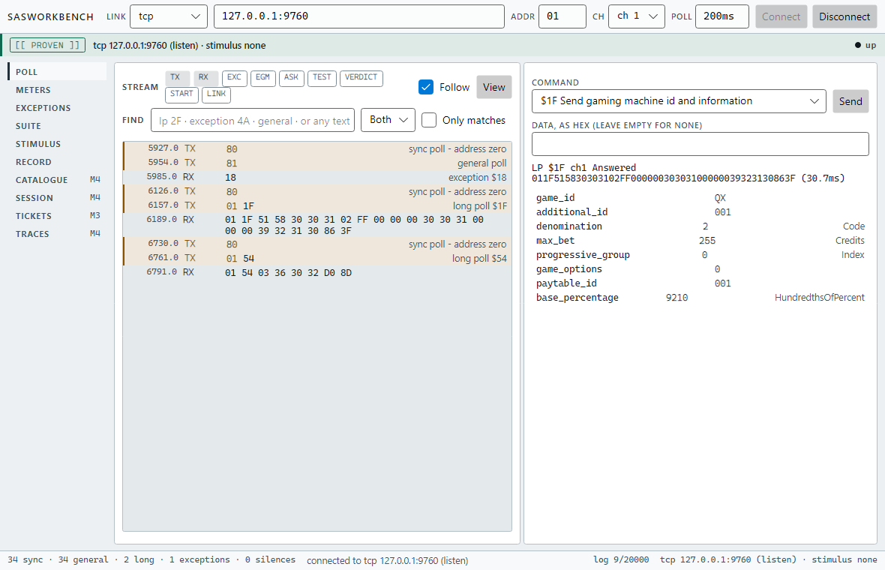
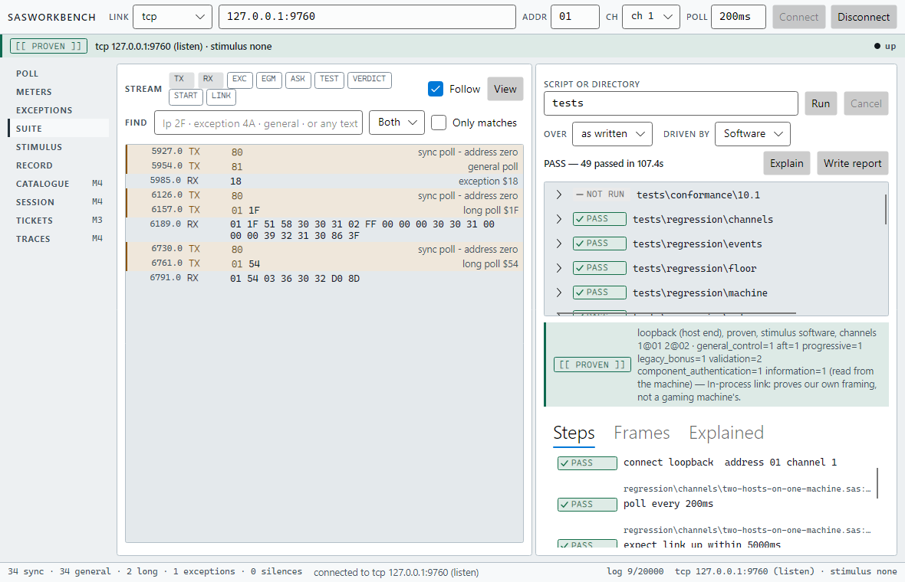
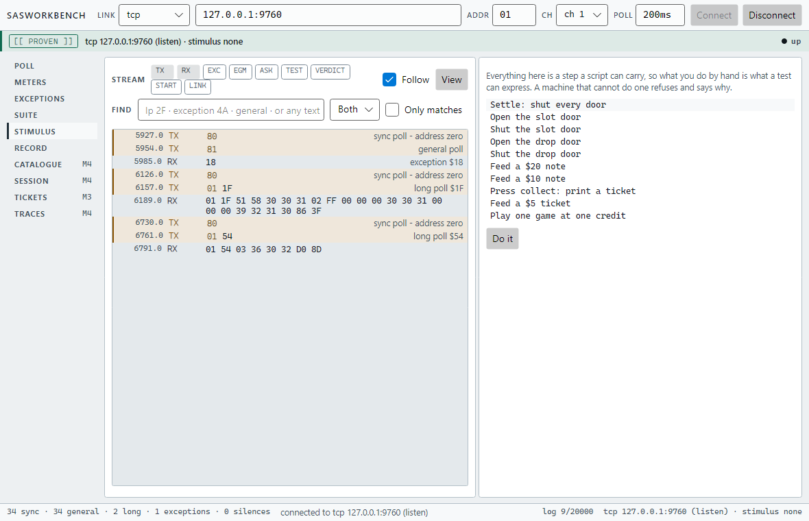
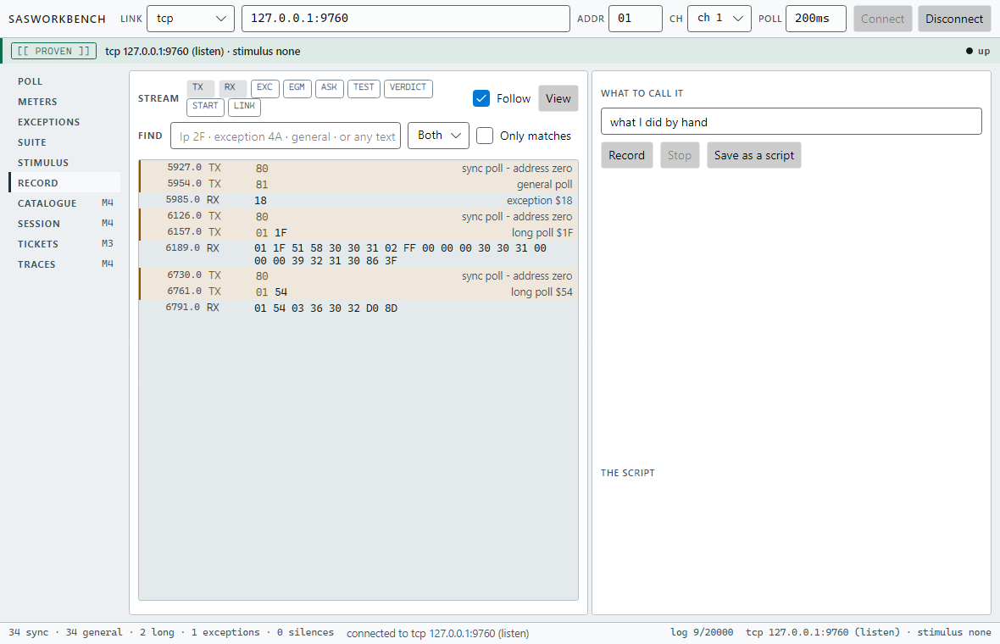
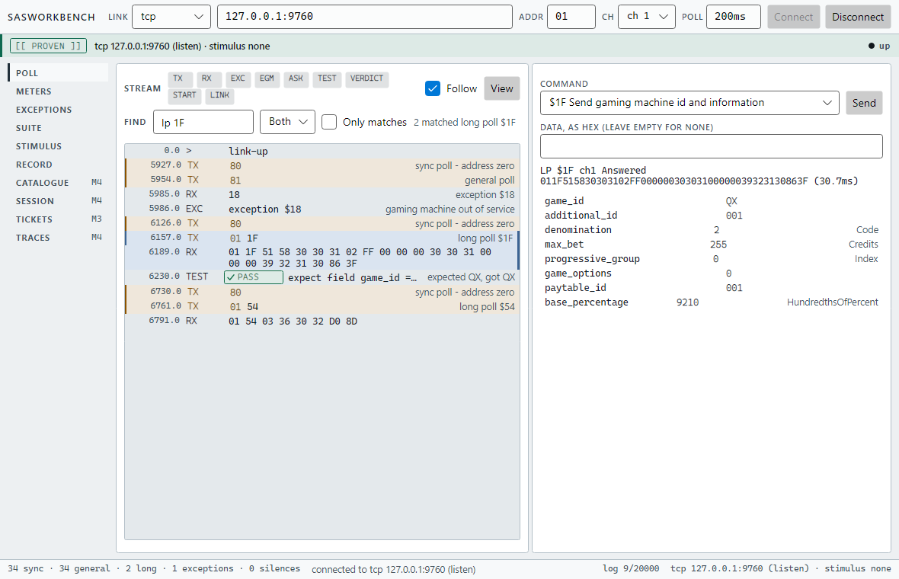

**SasWorkbench**

**User Guide**

Document 303-0XX, version 1.2

**Document revision history**

| Version | Date | Comments | Author |
| --- | --- | --- | --- |
| 1.0 | 29/10/2026 | First issue. Describes SasWorkbench 0.2.1. | Alessio Brizi |
| 1.1 | 31/10/2026 | Describes SasWorkbench 0.2.2: the `when` condition of `host send lp` and `sasctl nvram denomination`; the release state is corrected. | Alessio Brizi |
| 1.2 | 09/11/2026 | Describes SasWorkbench 0.2.3: the `host warm up`, hand pay, power cycle and memory fault steps, more manual stimuli, and `sasctl nvram games`. | Alessio Brizi |

# About this document

## Purpose

This guide explains how to use SasWorkbench 0.2.3 to test a gaming machine over the SAS protocol.
It covers installation, the serial and TCP links, running the suites, the reports, the window and
reading a recorded run, byte by byte.

The guide also describes the first measurement made on a Quixant board, on 29/10/2026. With 0.2.0
that measurement failed, and it led to two fixes to the serial transport in 0.2.1. With version 0.2.1,
on the same day, the same test passed. One of the two causes is confirmed by the data; the other is
inferred and has not been measured, as the chapter "The first measurement on a board" explains.

## Audience

The guide is written for the company's engineers and testers who use SasWorkbench in two ways:

- against the demo machine, on the same PC, over a TCP link;
- against a Quixant board running QSP, over a serial port.

The reader already knows long polls, general polls and SAS exceptions. You do not need to know the
SasWorkbench source code.

## What it does not cover

The guide does not explain the SAS protocol. For the meaning of a command, a field or an exception,
the IGT SAS 6.02 specification is the reference.

The guide does not explain QSP or the machine's audit menu. For these topics see the guides 303-030
and 303-033.

The guide does not explain how to write SasWorkbench code or how to prepare a release.

## How to read the guide

If you are using SasWorkbench for the first time, read the chapters from "What SasWorkbench is" to
"First steps" in order. Then go on to "Running the suites".

If you work on a board, also read "The serial link" and "The first measurement on a board" before
you trust a result.

If you need to understand why a test failed, go to "Reading a recorded run" and to
"Troubleshooting".

The appendices are references to consult: the commands and options, the script language, the
capabilities a test can require, the outcomes and the reports.

## Conventions

### Byte notation

A hexadecimal byte is written with the dollar sign: `$1F` is long poll 31 decimal. In commands and
scripts the same byte is often written as `1F`.

SAS uses a ninth bit, the wakeup bit, which marks the address byte. In command output SasWorkbench
writes every byte with its ninth bit in front, separated by a dot:

| Notation | Meaning |
| --- | --- |
| `1.81` | byte `$81` with the wakeup bit at 1: an address |
| `0.1F` | byte `$1F` with the wakeup bit at 0: data |
| `1.80` | synchronisation poll: general poll of address zero |

A sequence such as `1.01 0.1F` is therefore long poll `$1F` to address `$01`: the first byte
carries the wakeup bit, the second does not. In this guide a byte written this way is also called a
symbol.

### Durations and times

Durations are written as SasWorkbench accepts them: `200ms`, `5s`, `2m`. A number with no unit is in
milliseconds. In the output, times are in milliseconds, with one decimal place.

### Text on the screen

Command names, options, window labels, messages and file names stay in English, exactly as the
program prints them. For example: `sasctl run`, `--stimulus none`, `Connect`, POLL.

Window labels in capitals are written without quotation marks (POLL, SUITE). Buttons and text to
type are written in a fixed-width font (`Send`, `127.0.0.1:9760`).

The output examples are copied from real runs. Where a line was longer than the page it has been
shortened or split, and the point where text is missing is marked with `...`. The paths of the run
folders are shortened.

## What is verified

This guide always distinguishes between what has been measured and what has not.

The serial link of 0.2.1 was tested on 29/10/2026 on a Quixant IQ-2 board, on port COM6, an
on-board UART served by the `serial.sys` driver. On that port the link check passes and the long
polls get replies. The chapter "The first measurement on a board" gives the numbers before and after
the fix.

These have not been measured yet:

- a USB-serial adapter;
- other types of serial port, for example a UART dedicated to SAS.

The reports and the window of 0.2.3 still mark the serial link as UNVERIFIED. Their caveat sentence
says that only the on-board UART of the IQ-2 has been measured, and SasWorkbench cannot tell that
port from a USB adapter. The test of 29/10 concerns one board, one port and one configuration.

%%PAGEBREAK

# What SasWorkbench is

## A scriptable SAS host

SasWorkbench is a SAS 6.02 host. It does what a floor system does: it sends general polls and long
polls to a machine, reads the replies and decodes them field by field. In addition it makes
assertions: it compares what the machine replies with what a script expects, and writes an outcome.

SasWorkbench has two interfaces, in the same folder:

- `sasctl`, the command-line program, which runs the scripts and writes the reports;
- `SasWorkbench.exe`, the window, to send requests by hand, watch the traffic and run a
  suite.

SasWorkbench also contains a software gaming machine. It is used to test SasWorkbench itself,
quickly and without hardware.

## What it is not

SasWorkbench is not a sniffer. It does not listen to the traffic between another host and a
machine: it is the host itself, and it talks only to the machine it is connected to.

The software machine is not the thing under test. Both ends of a run against it are SasWorkbench
code, so a PASS only says that the two ends agree with each other. The `sasctl` help puts it this
way: "It is a fixture for fast tests, not the thing under test."

## The links

SasWorkbench reaches a machine in three ways.

| Link | `sasctl run` option | What it connects |
| --- | --- | --- |
| loopback | `--loopback` | the software machine, in the same process |
| tcp | `--tcp <host:port>` | a machine that calls the host over TCP, for example the demo |
| serial | `--serial <port>` | a machine on a serial port, for example a board |

On the TCP link each SAS symbol travels as a word that also carries the ninth bit. The
`sasctl probe` command describes this as "nine-bit symbols, one word per symbol".

On the serial link the ninth bit travels as the parity bit. The chapter "The serial link" explains
how.

## What a link is worth

Every report says which link it was obtained on and what that link is worth. This information is
called the provenance line. The value is the link's claim about how faithfully it carries SAS,
wakeup bit included. It is one of two:

| Value | Meaning | Where you see it |
| --- | --- | --- |
| PROVEN | the link carries SAS faithfully, wakeup bit included | loopback, tcp |
| UNVERIFIED | the link has not been measured: treat a PASS as unproven | serial |

PROVEN does not say what the run proves about the machine. The caveat sentence that comes with each
value says that. For loopback it is "In-process link: proves our own framing, not a gaming
machine's.": the link is faithful, but the other end is the software machine. For serial it is
"Measured only on a Quixant IQ-2's on-board UART (serial.sys, 19200 baud); USB adapters are
unmeasured, so treat a pass over one as untested."

In 0.2.3 serial still carries the UNVERIFIED label, even after the test of 29/10/2026 on an
on-board UART. The section "What is verified" explains why.

The provenance line appears in the console at the end of a run, in every report and in the window.
This is a real example, from the console of a loopback run:

```
  over loopback (host end), proven, stimulus software, channels 1@01 · general_control=1
  aft=1 progressive=1 legacy_bonus=1 validation=1 component_authentication=1 information=1
  (read from the machine) - In-process link: proves our own framing, not a gaming machine's.
```

The line gives the link, its value, the stimulus used, the address per channel (`1@01`), which
channel each category belongs to, and where this information comes from: read from the machine or
declared by the test.

Never cite a loopback run as a test on a machine. The provenance line exists to prevent that.

## The test trees

The scripts are text files with the `.sas` extension, in the `tests/` folder of the repository.
They are divided into three trees.

| Tree | What it tests | Tests |
| --- | --- | --- |
| `tests/regression/` | the behaviour of SasWorkbench itself: link, channels, meters, tickets, polling | 50 in 21 files |
| `tests/conformance/` | cases from the GSA conformance toolkit corpus, revision 1.2 | 3 in 3 files |
| `tests/validation/` | cases written from the EGM test documents, revision 1.00, and two targeted topics | 229 in 36 files |

Inside `tests/validation/`, the folder `egm-test-scripts-v1.00/` contains 181 tests in 28 files.

The numbers in the table come from `sasctl run <tree> --list` on version 0.2.3.

The folder `tests/regression/wire/` contains a single test: the link comes up and the machine
identifies itself. It is the first test to run on a new link.

## Version 0.2.3 and its status

This guide describes SasWorkbench 0.2.3. Compared with 0.2.2, these things change in 0.2.3:

- a script can make the machine owe a hand pay with `egm handpay <cents>` or
  `egm handpay jackpot <cents>`, reset it with `egm handpay reset`, and ask for a power cycle with
  `egm power cycle` or a memory fault with `egm memory fault <kind>` (Appendix B, "Stimuli");
- the `manual` stimulus also offers the main door, the service button, hand pays, power cycles and
  memory faults; the `software` stimulus offers hand pays; the `qpm` stimulus offers a cash-out hand
  pay and its reset when the demo declares the buttons for them (Appendix C);
- `host warm up <duration>` lets a machine that has just started report its start-up exceptions,
  once per machine in a run, and many sequenced cases start with it (Appendix B, "Polling");
- long poll `$80` can be written with named fields (`with progressive_group=… level=… amount=…`);
  during a sequence, `host send lp ... to 00` sends a long poll that may be broadcast, such as
  `$80`, and a message `to` an address that the host does not poll passes only if no machine
  answers (Appendix B, "Sending messages");
- `host send sync` first discards any bytes that a late reply left on the line, and the log records
  them;
- `sasctl nvram games` lists the games' denominations in a fixture, and `sasctl nvram games enable`
  switches on those that the accounting unit divides; `sasctl nvram` refuses an option that the
  action does not read, before it reads or writes anything (section "qpm and nvram");
- the fixtures `golden` and `secure-enhanced` are in memory arrangement 19, for the demo built on
  QSP v2.3.6.34, count in 5 cents and have their games on; the arrangement-15 copies, for a demo
  built on QSP v2.3.6.1, are in `fixtures/nvram/arrangement-15/`;
- the software machine keeps an exception queue 64 deep, applies the implied NACK and the loop
  break, can hold a hand pay, and reports a base percentage of 9211; after a hand pay reset it
  reports exception `$52` only once its long poll `$1B` reading has been acknowledged;
- in `tests/validation`, the queue, implied-acknowledgement and synchronisation cases and the
  secure-enhanced ticket cases now have their steps written; a case written only as notes is
  skipped with the reason `no steps are written yet; the case holds only its notes`.

0.2.2 changed these things, compared with 0.2.1:

- `host send lp` can close with a condition, `when <capability> == <value>`: if the capability has
  another value, nothing is sent and the step is not an assertion (Appendix B, "Sending messages");
- `sasctl nvram denomination` rewrites a fixture so that it counts in another accounting
  denomination, and `sasctl nvram show` prints the `accounting unit` of the machine's memory and of
  the fixture (section "qpm and nvram");
- `sasctl nvram` reads and writes the memory of the demo built on QSP v2.3.6.1, memory arrangement
  15; the fixtures `golden` and `secure-enhanced` are in this arrangement and count in 5 cents, and
  the arrangement-7 copies are in `fixtures/nvram/arrangement-7/`;
- an unexpected failure inside polling no longer ends the program: polling stops, the link goes
  `down`, the pending poll ends `NotSent` with a reason that starts
  `polling stopped after an unexpected`, and `sasctl` prints the details on the error output;
- the ticket redemption cases of `tests/regression` send `$4C` only to a machine in
  `secure_enhanced` validation, and the last case closes its ticket with a `$71` refusal, so the
  next case finds no ticket left pending;
- in the same way, cases 10.7.2, 10.7.3, 10.7.8 and 10.7.18 set the validation identifier with
  `$4C` first, and AD-38, AD-39 and a two-host case of `tests/regression` send it with `when`;
  case 4.6 and the sequence case of `tests/regression` send a synchronisation poll first, and a
  general poll to another address between two general polls of their own.

0.2.1 changed the serial transport, compared with 0.2.0:

- before every parity change the line is drained onto the wire;
- a byte received with a parity error stays the byte that was received, instead of being replaced.

With 0.2.0 a board connected over serial seemed not to reply to long polls. With 0.2.1, on the same
board, it replies. The chapter "The serial link" explains the two changes and the reason for them.

0.2.1 also corrects some defects of the command line and of the window:

- `sasctl run` accepts the options before or after the paths, and reads all of them with `--list`
  too;
- `sasctl run` refuses `--out` without `--report` before it runs anything;
- a test that would open the same serial port or TCP address for two channels is skipped, with the
  reason, before any port is opened;
- in the window, `Follow` keeps the newest STREAM row in view, a strip says when STREAM is narrowed
  to one test, and the band shows no seal when there is no link;
- `sweep` asks long poll `$7B` with both ticket expiry dates at zero, so the request cannot change
  the expiry dates stored in the machine.

The board measurements in this guide were made with an earlier build of 0.2.1, before these
corrections. The serial transport has not changed since then, except for its caveat sentence.

SasWorkbench is published as a release on GitHub, each release with the Windows and Linux packages
and a `SHA256SUMS` file. Release 0.1.0 does not contain many of the functions
described here. To use the functions of 0.2.3, take release 0.2.3 or build it from source, as the
chapter "Installation" explains.

%%PAGEBREAK

# Installation

## Requirements

| Requirement | Detail |
| --- | --- |
| Operating system | Windows for the serial link. On Linux x64, loopback and TCP work. |
| .NET | .NET 10. To build you need the SDK; to run a package you need the runtime. |
| Repository | a copy of the SasWorkbench repository, with the `tests/` folder |

To check the installed version of .NET:

```
dotnet --version
```

The result must start with `10.`.

## Building from source

Open a prompt in the repository folder and build in Release:

```
dotnet build SasWorkbench.slnx --configuration Release
```

When the build finishes you find the two programs at these paths:

| Program | Path |
| --- | --- |
| `sasctl` | `src\SasWorkbench.Cli\bin\Release\net10.0\sasctl.exe` |
| the window | `src\SasWorkbench.Gui\bin\Release\net10.0\SasWorkbench.exe` |

A build without `--configuration Release` ends up in `bin\Debug\net10.0` instead of
`bin\Release\net10.0`. It works the same way, but it is easy to confuse the two copies: always use
the same one.

You can also start `sasctl` without looking for the executable:

```
dotnet run --project src/SasWorkbench.Cli -- <command> <options>
```

In the examples in this guide the program is called `sasctl`. Replace the name with the full path,
or add the folder to the `PATH`.

## From a release package

Every release carries two packages: `SasWorkbench-<version>-win-x64.zip` for Windows and
`SasWorkbench-<version>-linux-x64.tar.gz` for Linux x64. Each package contains the window and
`sasctl` in the same folder and requires the .NET 10 runtime. On Linux the serial link is refused;
loopback and TCP work.

Each release also carries a `SHA256SUMS` file. Do not use release 0.1.0 for the tests described in
this guide.

## The tests folder

The scripts are not inside the programs: they are files in the `tests/` folder. If you take
SasWorkbench to another PC, for example to the machine under test, take the `tests/` folder too.

The safest thing is to copy the whole repository. The commands in this guide start from the
repository folder and use relative paths such as `tests/regression/wire`.

The window looks for the `tests` folder starting from the folder of its executable and moving
upwards. If the folder is not there, the window's status line says so with
`No script or directory at 'tests'.`

## Checking the installation

Check the version:

```
sasctl --version
```

The reply is the version number alone:

```
0.2.3
```

Then ask `sasctl` what it can do in this environment:

```
sasctl probe
```

`probe` opens no link and does not prove that a machine replies. It prints four sections:

| Section | Content |
| --- | --- |
| `Protocol this build knows` | how many long polls, exceptions and meters the build knows, and how many it decodes |
| `Links` | the three links; for `serial`, the list of COM ports that Windows reports |
| `What a test may require` | the capabilities a test can require in this environment |
| `Not available yet, and why` | what `probe` cannot know, with the reason |

If `no ports on this machine` appears in the `serial` row, Windows sees no serial ports.

`probe` accepts only the stimulus options: `--stimulus`, `--egm-resources` and `--qpm-shm`. It does
not accept link options such as `--serial` or `--loopback`. If you write one, the program prints the
report anyway, then the warning `warning: '--serial' is not an option of 'sasctl probe'` and exits
with code 2.

%%PAGEBREAK

# The serial link

This chapter applies to tests on a board. Read it before you connect the cable.

## Line parameters

SasWorkbench always opens the serial port with these parameters. They cannot be changed.

| Parameter | Value |
| --- | --- |
| Speed | 19200 baud |
| Data bits | 8 |
| Parity | Mark for an address byte, Space for a data byte, changed byte by byte |
| Stop bits | 1 |
| Flow control | none |
| DTR and RTS | off |

The port opens with Space parity. A character on the wire takes 11 bits: start, eight data bits,
parity and stop. At 19200 baud a character lasts about 0.57 ms.

## The wakeup bit

SAS uses nine bits per character. The ninth bit, the wakeup bit, is 1 only on the address byte with
which the host opens a message. A PC serial port has eight data bits plus a parity bit.

SasWorkbench uses the parity bit as the ninth bit:

- for a byte with the wakeup bit it sets Mark parity, that is a parity bit always at 1;
- for a data byte it sets Space parity, that is a parity bit always at 0.

So the port changes parity within a message. Long poll `$1F` is only two bytes, `1.01 0.1F`, with no
CRC: byte `01` leaves with Mark parity, then the port switches to Space and `1F` leaves. Other long
polls also carry a two-byte CRC, with Space parity: for example long poll `$01` on the wire is
`1.01 0.01 0.51 0.08`. A general poll `1.81` is a single byte with Mark parity.

On receive the ninth bit is not needed: a machine never sets the wakeup bit in its replies.

This scheme works only if every byte leaves the port with the parity it should have. An adapter that
collects the writes and sends them together breaks the scheme. The fault shows up as a machine that
never replies.

## Windows only

The serial link works only on Windows. On other systems the .NET serial library discards Mark and
Space parity without reporting errors. The wakeup bit would never reach the machine.

For this reason SasWorkbench refuses serial outside Windows, with this message:

```
Serial SAS is refused on this platform: mark and space parity are discarded without
error here, so the wakeup bit would never reach the gaming machine. Use the TCP transport,
or run the serial link on Windows.
```

Outside Windows, use the TCP link.

## The ports

`sasctl probe` lists the COM ports that Windows reports. Run `probe` before and after you connect
an adapter: the new port is the adapter's.

Names from COM10 upwards work, for example `--serial COM12`.

A port can be opened by only one program at a time. If the port is already open, the test is
skipped with a reason such as `Cannot open COM6: Access to the path 'COM6' is denied.`

### USB adapters

With a USB-serial adapter, changing parity byte by byte is not reliable in general. No adapter has
been measured with SasWorkbench yet. The only measured case is the on-board UART of the test on
29/10/2026.

The advice that follows comes from the project's research and is not verified. If you must use an
adapter:

- choose a genuine FTDI adapter, for example FT232R or FT232H;
- set its Latency Timer to 1 ms, then close and reopen the port;
- avoid adapters with CH340, PL2303 or CP210x chips, and those that use the CDC driver
  `usbser.sys`.

The Latency Timer of an FTDI adapter is in the Windows registry, under the key
`HKLM\SYSTEM\CurrentControlSet\Enum\FTDIBUS\<id>\0000\Device Parameters`, value `LatencyTimer`.
The default value is 16 ms.

The Latency Timer shortens the time it takes the machine's replies to reach the PC. It does not
decide the order of the bytes on transmit: on its own it does not guarantee that every byte leaves
with the right parity.

### On-board UARTs

The test on 29/10/2026 used two ports of the same IQ-2 board, COM5 and COM6, served by the Windows
`serial.sys` driver and connected to each other with a cable. COM5 was the QSP SAS port, COM6 the
SasWorkbench port.

On COM6, 0.2.0 did not work and 0.2.1 works. It is the only port on which the SasWorkbench serial
link has been measured. Quixant boards do not all have the same type of port: some have a UART
dedicated to SAS. What this guide says about the test applies to that port of that board.

## What changes in 0.2.1

0.2.1 changes two behaviours of the serial transport.

| Behaviour | 0.2.0 | 0.2.1 |
| --- | --- | --- |
| Parity change | after flushing the write buffer, without waiting for the byte to leave on the wire | after the driver queue is empty, plus two character times |
| Byte received with a parity error | replaced with `?`, that is `$3F` | kept as it was received |

### Draining before the parity change

0.2.0 already flushed the write buffer before every parity change. However, it did not wait for the
driver queue to empty, nor for the byte to leave the UART. After the address byte of a long poll the
port therefore switched to Space while the address could still be in the UART. In all probability
the address left with the wrong parity: a machine that receives the address without the wakeup bit
does not recognise it as an address and does not reply. This cause is inferred, not measured on the
wire.

With 0.2.1, before every parity change, SasWorkbench carries out these steps:

1. it flushes the write buffer, as 0.2.0 did;
2. it waits for the driver's transmit queue to be empty, for at most 100 ms;
3. it waits another two character times, about 1.15 ms at 19200 baud;
4. it changes the parity and writes the next byte.

The driver queue empties when the UART has taken the byte, not when the byte is on the wire. The two
character times cover a byte still in the UART register and a byte being sent.

The drain depends on the parity the port is in, not on the message. Before every byte SasWorkbench
compares the parity needed with the current one, and waits only if they differ. For example, the
synchronisation poll that follows a long poll finds the port in Space, must switch to Mark, and so
waits. The general poll that follows a synchronisation poll finds the port already in Mark and
leaves without waiting.

### The byte with a parity error

After a general poll the port stays in Mark parity, because the message is a single byte with the
wakeup bit. The machine's reply has the ninth bit at 0. Read in Mark parity, each of its bytes
therefore has a parity error.

With 0.2.0, .NET replaced every byte with a parity error with the character `?`, that is `$3F`. That
is why every reply to a general poll read `3F`, and SasWorkbench reported it as exception `$3F`.
With 0.2.1 the replacement is off and the byte stays as it was received.

### How it was verified

The fix is verified in two ways.

The first is four new unit tests. They check that the line is drained before every parity change,
that a message that needs no parity change is not drained, that the port is created with the
replacement off, and that one character lasts eleven bit times. The serial tests pass, 7 of 7.

The second is the test on the board. On 29/10/2026 the same IQ-2 board was tested with
version 0.2.1, on the same ports used with 0.2.0.

| Test on the board | 0.2.0 | 0.2.1 |
| --- | --- | --- |
| Link check | FAIL, exit 1 | PASS, exit 0 |
| Reply to a general poll | `3F` | `00`, no exception queued |
| Sweep: replies / silences / unreadable | 7 / 78 / 0 | 76 / 9 / 0 |

For comparison, the demo over TCP on 17/10 had given 77 / 8 / 0 in the same sweep.

The test on the board confirms the cause of the `3F` replies. For the long polls it confirms that the
two fixes work together, not which of the two was needed: 0.2.1 introduced them together.

0.2.3 still marks the serial link as UNVERIFIED. The caveat sentence names the one port measured,
the on-board UART of the IQ-2, and says that USB adapters have not been measured.

## Settings on the machine

Two settings are held in the machine's memory. They are changed from its audit menu, not from the
SAS link:

- the SAS address of each channel;
- the channel that each SAS category belongs to.

The QSP audit menu is described in the guides 303-030 and 303-033.

For a test with a single host on a single port, proceed as follows:

1. set the address of channel 1, usually `01`;
2. assign all the categories to channel 1;
3. use the same address in SasWorkbench, with `--address 01`.

A serial port is one channel. A host on channel 2 needs a second port and a second cable.

## The per-category gates

SAS divides some long polls and some exceptions into seven categories. Each category belongs to
one channel only. The machine's library applies two rules:

- a long poll of a category not assigned to the channel gets no reply: the machine stays silent, it
  does not send a NACK;
- an exception of a category not assigned to the channel does not reach the host on that channel.

A channel without a category also reports the bits of that category as zero in the reply to long
poll `$A0`, which describes the enabled functions.

The silence of a long poll can therefore be a machine setting, not a fault. Before you look for a
link problem, check which channel the command's category belongs to.

The following table gives the output of `sasctl catalogue channels` in 0.2.3. The data are read
from the machine's library.

| Category | Gated long polls | Filtered exceptions | `$A0` bits cleared |
| --- | --- | --- | --- |
| `general_control` | `$03 $04 $05 $06 $07 $0A $0B $94 $A8` | none | none |
| `aft` | `$72 $73 $74 $75 $76` | `$66 $69 $6A $6B $6C $6D $6E $6F` | byte 0: `$02`<br>byte 1: `$40` |
| `progressive` | `$80 $85 $86 $87` | `$56` | byte 2: `$02` |
| `legacy_bonus` | `$2E $8A $8B $90` | `$7C` | byte 0: `$05` |
| `validation` | `$4C $4D $57 $58 $70 $71 $7B $7C $7D` | `$3F $57 $67 $68` | byte 0: `$F0` |
| `component_authentication` | `$6E` | `$8E $8F` | byte 1: `$10` |
| `information` | `$2C $4F $8E $8F $A4 $AA` | none | none |

In all, 38 of 124 long polls are gated and 16 of 122 exceptions are filtered. All the other commands
get a reply on every open channel.

For example, long poll `$3D` (cashout ticket information) has no gate. A host on a channel without
the `validation` category still receives the real validation number and amount of the ticket.

A category assigned to a channel with no address reaches no host. The machine's menu does not let
you create one, but a configuration written in another way can.

%%PAGEBREAK

# First steps

This chapter takes you from a new installation to a first PASS. Run the commands from the
repository folder.

## What the environment offers

Run `sasctl probe`, as described in "Checking the installation". On a board or on a PC with an
adapter, check that the port you will use appears in the `serial` row.

On 29/10/2026, on the IQ-2 board, `probe` in 0.2.0 listed the ports from COM1 to COM6.

## The link-only check

The first test on a new link is always `tests/regression/wire`. It contains a single test:

```
test "the link comes up and the machine identifies itself" {
  tag @wire-only

  host connect loopback address 01
  host poll every 200ms

  host expect link up within 5s

  host send lp 1F
  host expect field game_id == QX
  host expect field base_percentage of lp 1F >= 7500
  host expect field sas_version of lp 54 == 602
}
```

The test makes five checks:

- the link comes up within 5 seconds;
- long poll `$1F` gets a reply;
- the `game_id` field is `QX`;
- the `base_percentage` field is at least 7500;
- long poll `$54` reports SAS version 602.

The script says `host connect loopback`. The `--serial`, `--tcp` and `--loopback` options of
`sasctl run` replace the link of every `host connect`, so the same script serves for every link.

On a board, with port COM6 and address 01, the command is:

```
sasctl run tests/regression/wire --serial COM6 --address 01 --report html,junit,jsonl
```

The reports go into a new folder under `runs/`. The expected result is PASS, with exit code 0. This
is the console of a successful run, in loopback, with the report path shortened:

```
  PASS  the link comes up and the machine identifies itself (0.6s, 5 assert(s))

  over loopback (host end), proven, stimulus software, channels 1@01 · ... - In-process
  link: proves our own framing, not a gaming machine's.
  PASS  1 passed in 0.7s

  wrote ...\run.html
  wrote ...\run.junit.xml
  wrote ...\run.jsonl
```

On the IQ-2 board, with 0.2.1, the same test passed in 0.6 seconds.

The values `QX`, 7500 and 602 are those of the software machine and the demo. A machine with a
different identifier fails the steps on `game_id` or `base_percentage` even with a healthy link.
In that case look at the steps `expect link up` and `send lp 1F`: if they pass, the link works.

### If the link does not come up

Check in this order:

1. the port exists: `sasctl probe` lists it;
2. no other program holds the port open;
3. the adapter, if there is one, changes parity byte by byte (see "USB adapters": no adapter has been measured);
4. the address in `--address` is the one set in the machine;
5. the machine is switched on, has finished starting up and has left the audit menu;
6. the SasWorkbench version is 0.2.1 or later: with 0.2.0, on the board tested on 29/10, the long polls got no reply.

In some QSP configurations the SAS port is activated only when you leave the audit menu.

A link that is `Up` says only that the machine replies to general polls. With 0.2.0 the board showed
as `Up` even though every reply read `3F`. Always check the first long poll as well.

## Against the demo over TCP

On the TCP link the machine calls the host. SasWorkbench listens on an address and a port, and the
machine connects. `sasctl run` always listens: it has no option to call the machine.

The address used by the demo is `127.0.0.1:9760`. It is also the window's default value.

The demo must be a build prepared to speak SAS over TCP with SasWorkbench. The operating notes of
the SasWorkbench project describe how to prepare it. Two points matter for this guide:

- the demo must be built in Release: a Debug build requires a licence that the development key does
  not contain, and the machine goes into licence lock and does not accept money;
- the demo, once started, calls the host and retries until it finds it.

For the first check, proceed as follows:

1. start the demo;
2. run `sasctl run tests/regression/wire --tcp 127.0.0.1:9760 --address 01`;
3. check that the result is PASS.

If the machine does not connect within 10 seconds, every test is skipped with a reason like this:

```
no gaming machine connected to tcp 127.0.0.1:9760 (listen) within 10s
```

A demo that is slow to start needs more time: use for example `--wait-for-machine 30s`.

Against the demo, and only against the demo, the stimulus can be `qpm`. With `qpm` SasWorkbench
drives the demo's simulated peripherals: doors, buttons, banknotes and tickets. The chapter
"Running the suites" explains the stimuli.

## Against the software machine

The software machine needs no hardware or other programs. You use it with `--loopback` and with the
`software` stimulus:

```
sasctl run tests/regression --loopback --stimulus software
```

Without `--stimulus software` every test in loopback is skipped.

Loopback is used to check SasWorkbench and the scripts. It says nothing about a real machine.

%%PAGEBREAK

# Running the suites

## The run command

`sasctl run` runs one script, or all the scripts under a folder:

```
sasctl run <path> [<path> ...] [options]
```

You can give several paths in the same command. The full list of options is in Appendix A.

The paths can go before or after the options; the examples in this guide write them first. An
option without a value, such as `--loopback` or `--list`, never takes the word that follows it, so
`sasctl run --loopback tests/regression` runs `tests/regression` over loopback.

An option that the command does not read is not ignored. The command runs anyway, then prints a
warning such as `warning: '--serail' is not an option of 'sasctl run'`. The warning changes the exit
code only if the command would have exited with 0: in that case it exits with 2. A run with failures
stays at 1, and a run with all its tests skipped stays at 3.

## The link options

The link options replace what the scripts write, in every `host connect` step. In this way the same
suite runs on every link without changing the files.

| Option | Effect |
| --- | --- |
| `--loopback` | the software machine, in the same process |
| `--tcp <host:port>` | listens on this address and waits for the machine to call |
| `--serial <port>` | opens this serial port |
| `--address <hh>` | the poll address, in hexadecimal |
| `--channel <1-4>` | the channel to use |

You can choose only one link. With two or more the command replies with this error:
`error: choose one of --tcp, --serial or --loopback, not several.`

The options do not change the multi-address rounds (`addresses`) written in the scripts.

A test with two hosts, one per channel, has two `host connect` steps. With `--serial` both point to
the same port, and one port carries one channel. The test is then skipped before any port is
opened, with this reason:

```
channels 1 and 2 would both open serial port COM6, and one link carries one channel; give each
channel a link of its own
```

With `--tcp` the same happens for the TCP address. On 29/10 three tests in `tests/regression` were
in this case.

Two options set the timing:

| Option | Effect | Default value |
| --- | --- | --- |
| `--poll <duration>` | interval between general polls | `200ms` |
| `--wait-for-machine <duration>` | how long to wait for the machine to call, over TCP | `10s` |

## The stimulus

Many tests must make something happen on the machine: insert a banknote, open a door, press the
cashout button. What does this is the stimulus, chosen with `--stimulus`.

| Stimulus | Who acts on the machine | Where it is used |
| --- | --- | --- |
| `none` | nobody. It is the default value. | everywhere; it is the choice for a board with nobody present |
| `manual` | a person, whom the console asks for each action | a board or the demo, with someone in front of the machine |
| `software` | the software machine | only with `--loopback` |
| `qpm` | the demo's simulated peripherals | only with the demo |

### none

With `none` nobody acts on the machine. A test that declares that it needs a stimulus is skipped,
with the name of what is missing. All the other tests run.

It is the right choice for a suite left running on a board with nobody present. Even with `none`,
however, some tests send commands that change the machine: read "On a board" later in this chapter.

### manual

With `manual` the console asks a person to carry out the action, and waits:

```
  Please do this on the machine, then confirm: <step>
  done? [y/N] (giving up in 120s)
```

There are three possible answers:

- `y` followed by Enter: the action is done and the test continues;
- any other answer: the action is refused, and the step is skipped with the reason
  `a person declined or could not carry out '<step>'`;
- no answer within the time: the console writes `nobody answered.` and the step is skipped
  with the reason `nobody answered within 120s, so '<step>' did not happen`.

The default waiting time is 2 minutes. You change it with `--ask-for`, for example `--ask-for 5m`.
Only an answer typed after the question appears counts: lines typed before it are ignored.

The `manual` stimulus offers these actions: banknote, ticket, game, closing all the doors (settle),
the slot door (`door.slot`, also called the main door, `door.main`), the cashout and service buttons
(`button.collect`, `button.service`), a hand pay, a jackpot hand pay and its reset, a power cycle and
a memory fault. For a power cycle the console asks the person to cut the machine's power, restore it
and wait until it has booted: confirm only then. A memory fault prompt adds a line that starts with
`How:`: it says how to cause the fault and, for the faults a QSP machine never raises, to answer `N`.

### software

With `software` the software machine acts: banknotes, tickets, games, the cashout button, eight
doors, hand pays, a change of the accounting denomination and real-time events. It is used only in
loopback.

### qpm

With `qpm` SasWorkbench writes into the shared memory region of the demo's simulated peripherals.
It requires `--egm-resources`, the demo's `Resources` folder, where the demo declares its doors and
its buttons. You change the shared region with `--qpm-shm`, if it is not in the usual place.

With `qpm` a hand pay is a banknote followed by the cashout button, and its reset is the reset
keyswitch, if the demo declares those buttons. Appendix B, "Stimuli", says what the host sends
around them.

The two options make sense only with `qpm`. With another stimulus the command replies
`error: --qpm-shm and --egm-resources only mean something with --stimulus qpm.`

> On a board never use `--stimulus qpm`, `sasctl qpm` or `sasctl nvram`. These commands write into the shared region of the simulated peripherals and into the demo's memory file. On a board the demo is not there, and the memory file at the default path, `C:\ProgramData\quixant\launchpad\nvram.bin`, may be the one of the machine under test.

Even the safe commands write a file on the PC that runs them. Every `sasctl probe`, and every
`sasctl run` that opens a link, creates the folder `C:\ProgramData\qpm_simulator\wallet` if it is
missing. It is the folder where the simulated printer places the tickets, and loopback runs place
there the tickets printed by the software machine. `--list` does not create it.

### When a stimulus is not possible

If a stimulus step cannot be carried out, the step is skipped and the next assertion usually fails.
For this reason every test that uses a stimulus declares the capability it needs with `requires`.
The test is then skipped before it starts, with a clear reason. Appendix C lists the capabilities.

## Choosing the tests

### The tags

Every test can carry tags, written in the script with `tag`. Two options use them:

| Option | Effect |
| --- | --- |
| `--tag <name>` | runs only the tests with this tag |
| `--skip-tag <name>` | skips the tests with this tag |

The name is written with or without `@`. Each option accepts only one tag.

These are the most used tags in the test trees of 0.2.3:

| Tag | Tests that carry it |
| --- | --- |
| `@egm-test-scripts` | 181 |
| `@needs-stimulus` | 115 |
| `@needs-a-person` | 99 |
| `@chapter-10`, `@chapter-4`, `@chapter-11`, `@chapter-3` | 72, 60, 25, 24 |
| `@accounting-denomination` | 44 |
| `@destructive` | 25 |
| `@needs-configuration` | 18 |
| `@wire-only` | 17 |
| `@channel2` | 8 |
| `@finding` | 2 |

For example, `--tag wire-only` runs only the tests tagged `@wire-only`, such as the link check.

### On a board

The `@destructive` tag marks the 25 tests that change the machine heavily: memory or meter resets,
power cycles, hand pays. They are all in `tests/validation`. Almost all of them require a person at
the machine, with `--stimulus manual`, or a capability that no environment offers, so with
`--stimulus none` they are skipped. On a board, exclude them anyway:

```
sasctl run tests/validation/egm-test-scripts-v1.00 --serial COM6 --skip-tag destructive
```

`--skip-tag destructive` does not make the run harmless. Some tests remain that send commands that
change the machine:

- case 4.30.2 carries the `@wire-only` tag and sends long poll `$01` (stop play) and then `$02`
  (start play); on 29/10 it did so on the board too;
- the tests on real-time events send `$0E`, but only if the run offers
  `stimulus.real_time_events`;
- the tests on ticket redemption send `$71`, but only if the run offers `stimulus.ticket`.

Before a run on a board, list the tests with `--list`, then read in the scripts which commands they
send: `--list` shows the tests, not the commands.

### Listing without running

`--list` reads the scripts, applies the link options and the tags, and lists the tests that would
run. It opens no link. For each test it prints the name, the tags and the required capabilities:

```
sasctl run tests/conformance --list

tests/conformance\10.1\10.1.1-standard-validation.sas
  10.1.1 standard validation configuration  @wire-only
      requires egm.validation == standard
      requires decoder.lpA0
...
3 test(s) in 3 file(s)
```

`--list` is also the fastest way to find a syntax error in a script: an error stops the command
with the file and the line, and exit code 2.

With `--list` you can keep the other options of `run`: `--list` reads and checks them all, then
lists the tests and stops. For example `sasctl run tests/regression --list --stimulus software`
lists the tests and exits with code 0.

If no test matches the tags, the command replies
`error: no tests matched. Nothing was run, which is not a pass.` and exits with code 3.

## The reports

Without `--report`, `sasctl run` prints the results on the console and writes no file. With
`--report` it writes one or more reports into the folder given by `--out`.

| Format | File | What it is for |
| --- | --- | --- |
| `html` | `run.html` | a page to read, which also contains the full log |
| `junit` | `run.junit.xml` | the XML format that build servers read |
| `md` | `run.md` | Markdown, to paste into a note |
| `jsonl` | `run.jsonl` | the full log, one JSON object per line |
| `extended` | `run.log` | the log explained packet by packet |

The formats are separated by a comma: `--report html,junit,jsonl`. Without `--out` the folder is
`runs/<date>-<time>`, for example `runs/20261029-103633`. `--out` without `--report` is refused
before the run, with `error: --out says where reports go, but no --report says which to write.` and
exit code 2.

Always ask for at least `jsonl`. It is the log from which the other commands read a run: `explain`,
`find`, `replay`, `record` and `transactions`. The `extended` report can also be obtained later,
from `run.jsonl`, with `sasctl explain`.

Appendix E describes the content of each format.

## The exit codes

| Code | Meaning |
| --- | --- |
| 0 | every test that ran passed |
| 1 | at least one test failed |
| 2 | the program could not do what was asked |
| 3 | nothing was tested: every test was skipped |

Code 2 covers three cases: an error in the command line or in a script, a run in which at least one
test ended in error (ERROR), and an unread option in a command that would otherwise have exited
with 0.

Code 3 is not a success. A suite that could not test anything must not look like a suite that
tested everything. For example, a loopback run without `--stimulus software` exits with 3.

Some commands always exit with 3 when all goes well, because they make no assertions: `sweep`,
`events` and `import`. For them 3 is the normal result.

In PowerShell the exit code of the last command is in `$LASTEXITCODE`.

## Reading the summary

During the run the console prints one line per test, with the outcome, the name, the duration and
the number of assertions. For a failed test it also prints the failed steps, with file and line,
expected value and value obtained.

At the end it prints the provenance line, which starts with `over`, and the summary:

```
  PASS  1 passed in 0.7s
```

The summary counts the tests by outcome: `passed`, `failed`, `skipped`, `errored`. After the
failures, `(N labelled a finding)` can appear, as explained later.

The outcome of the run follows fixed rules:

1. no test run: SKIP;
2. at least one test in error: ERROR;
3. otherwise, at least one test failed: FAIL;
4. otherwise, no test passed: SKIP;
5. otherwise: PASS.

Appendix D explains how the outcome of a step and of a test is calculated.

## Skips and their reasons

A skip always has a reason. The reason names what was missing, with the same names that
`sasctl probe` prints.

A test declares the capabilities it needs with `requires`. If one is missing, the test is skipped
at the first missing capability, with a reason in one of these three forms:

```
stimulus.bill: this environment provides no 'stimulus.bill'
<capability>: '<capability>' is 'x', not 'y'
<capability>: '<capability>' is available but its value is unknown, and the test needs 'y'
```

The second form appears when the capability is there but has another value, for example a machine
in a validation style different from the one required. The third appears when the capability is
there but its value is not known.

A `when` condition of `host send lp` reports another value in the same words after `not sent:`,
such as `not sent: 'egm.validation' is 'standard', not 'secure_enhanced'`, and it does not skip the
test: see "Sending messages" in Appendix B.

Two capabilities are asked of the machine after the link has come up: `egm.validation` and
`egm.accounting_denomination`. If the machine does not reply, the reason says so with a sentence
like this:

```
egm.validation: the machine did not answer the enabled-features poll (Silent), so what it
is cannot be read off this link
```

Other reasons come from the link:

| Reason | What it means |
| --- | --- |
| `no gaming machine connected to tcp ... within 10s` | over TCP the machine did not call in time |
| `Cannot open COM6: ...` | the serial port cannot be opened |
| `Cannot listen on ...` | the TCP address cannot be opened for listening |

A test written only as notes, still to be written, is skipped with the reason
`no steps are written yet; the case holds only its notes`.

In the run of `tests/regression` on the board on 29/10, with `--stimulus none`, the most frequent
skips were these three, with 17, 5 and 4 tests, the same with 0.2.0 and with 0.2.1:

```
stimulus.bill: this environment provides no 'stimulus.bill'
stimulus.ticket: this environment provides no 'stimulus.ticket'
stimulus.real_time_events: this environment provides no 'stimulus.real_time_events'
```

Some capabilities are not offered by any environment in 0.2.3, for example `stimulus.note_fault`
and `host.chirp`. The tests that require them are always skipped. Others, such as
`stimulus.handpay` and `machine.power_cycle`, are offered only by some stimuli: with
`--stimulus none` the tests that require them are skipped. Appendix C lists them.

## What to expect from tests/regression on a board

`tests/regression` is written for the software machine and for the demo. Many of its expectations
describe those two machines, not any machine. On a board some of the tests fail even with a healthy
link, and these failures are not defects of the board.

On 29/10, on the IQ-2 board with 0.2.1 and `--stimulus none`, `tests/regression` gave 9 tests
passed, 8 failed and 33 skipped. The failures came from differences such as these:

- the board has neither channel 2 nor machines at addresses 02 to 04;
- on the board all the categories were on channel 1, so long poll `$57` got a reply;
- the board has four games, not one;
- the board's accounting denomination has code 1, not 2;
- the board's reply to long poll `$4F` has a different length and different values.

Before you report a failure of `tests/regression` on a board, read the failed step and ask
yourself whether the expectation describes the software machine or the demo.

## The @finding case and the two conformance gates

A test in `tests/conformance`, case 10.1.4, fails on purpose. The case asks that, on a channel
without the `validation` category, the machine ignores long poll `$3D` or replies with the
validation number and amount at zero. The machine's library instead replies with the real values.
The failure is therefore a result about the library, not a defect of SasWorkbench, and the test
carries the `@finding` tag.

The tag changes only the wording of the summary. A full run of `tests/conformance` with
`--loopback --stimulus software` ends in FAIL, code 1, and the summary says
`1 failed (1 labelled a finding)`. This is the expected result.

To keep the tag honest, two runs are used, the two conformance gates:

```
sasctl run tests/conformance --loopback --stimulus software --skip-tag finding
sasctl run tests/conformance --loopback --stimulus software --tag finding
```

The first must exit with code 0. The second must exit with code 1. If the second passes, the result
is no longer true and the tag must be removed.

## Real-time events

The tests that turn on real-time exception reporting require the `stimulus.real_time_events`
capability. The `software` stimulus and the `--real-time-events` option offer it. With the other
stimuli, without the option, those tests are skipped with the reason
`stimulus.real_time_events`.

The `--real-time-events` option allows the tests to turn it on. Turning it on changes the way the
machine replies to every following general poll, even after the end of the run. Whoever uses the
machine after you finds it changed.

On a board, do not add `--real-time-events` unless you need it.

### A reply with an event

If an exception is queued, a machine with real-time reporting can reply to a long poll with the
event instead of with the reply. The outcome of the long poll is then `AnsweredWithEvent`, and the
step fails. It is not a machine fault.

Before a long poll, empty the exception queue, with `host forget exceptions` in the script or by
letting the general polls read the exceptions.

## The fixed times

Some times are fixed in 0.2.3. Only three can be changed from the command line.

| Time | Value | Changed with |
| --- | --- | --- |
| Reply window of a message | 200 ms | cannot be changed |
| Silence that closes a reply | 20 ms | cannot be changed |
| Interval between general polls | 200 ms | `--poll` |
| Wait for the call over TCP | 10 s | `--wait-for-machine` |
| Wait for a person, with `manual` | 2 min | `--ask-for` |
| Default window of `within` in the scripts | 5 s | `within` in the script |

A reply that does not arrive within 200 ms of sending is not read: the long poll has no reply.

Before every general poll and every long poll SasWorkbench sends a synchronisation poll, that is a
general poll of address zero, followed by a pause of 20 ms. The chapter "Reading a recorded run"
shows it on the wire.

%%PAGEBREAK

# The other commands

As well as `run` and `probe`, `sasctl` has other commands. This chapter says what each one is for,
when to use it and what it does on a board. Appendix A lists all the options.

| Command | Opens a link | Changes the machine | On a board |
| --- | --- | --- | --- |
| `sweep` | yes | no, except `--framing` | yes |
| `floor` | yes | no | yes |
| `events` | yes | yes | no |
| `replay` | yes | no | yes |
| `import` | no | no | the board is not needed |
| `transactions` | no | no | the board is not needed |
| `record` | no | no | the board is not needed |
| `find` | no | no | the board is not needed |
| `explain` | no | no | the board is not needed |
| `log` | no | no | the board is not needed |
| `catalogue` | no | no | the board is not needed |
| `egm` | yes | no | the board is not needed |
| `qpm`, `nvram` | no | yes | never |

## sweep

`sweep` asks the machine every command in the catalogue that can be asked, and records what comes
back. It makes no assertions: it is used to obtain real bytes for every reply, and to check a layout
against those bytes.

A command that changes the machine is not sent. 0.2.3 asks 85 of the 124 commands in the catalogue
and withholds 39. Among those withheld are `$01` (stop play), `$02` (start play), `$0E` (real-time
events), `$21` (ROM signature) and the commands that move money.

To see the plan without opening a link:

```
sasctl sweep --list
```

The output lists each withheld command with the reason, then each command asked. This is an
extract, with the spaces reduced:

```
The sweep asks 85 of the catalogue's 124 commands and withholds 39.
...
  $01  Shutdown                                   stops play on the machine
  $02  Startup                                    starts play on a machine that may have ...
...
ASKED
  $0F  decoded    Send meters
  $10  decoded    Send total cancelled credits
...
```

On a board:

```
sasctl sweep --serial COM6 --address 01 --out runs/sweep
```

`sweep` exits with code 3, because it tests nothing. At the end it counts the replies, the silences,
the unreadable replies and the withheld commands. A silence is recorded as a silence: it is a fact
about the machine.

The `--framing` option makes a different measurement: it checks the CRC rule on the wire. It sends
`$01` and `$02`, which the normal sweep withholds, and sends `$02` last, so the machine stays in
play. On a board, use it only if you can stop and restart play.

## floor

`floor` measures what a polling round costs: a host that polls several addresses in turn on the
same line, as a floor system does. Without link options it uses software machines; with `--tcp` or
`--serial` it measures a real link.

On a real link `--addresses` says which addresses to poll, with ranges and lists: `01-64`, or
`01,05,09-0B`. The default value is `01`.

`--no-sync-polls` removes the synchronisation poll before each general poll. In principle this is
correct, but it is not verified against a real machine. The option is for comparing the two
measurements, not for changing the normal behaviour.

On a board, the check and the two comparisons are these:

```
sasctl floor --serial COM6 --addresses 01    --rounds 20                 --out runs\floor\1
sasctl floor --serial COM6 --addresses 01    --rounds 20 --no-sync-polls --out runs\floor\2
sasctl floor --serial COM6 --addresses 01-02 --rounds 20 --no-sync-polls --out runs\floor\3
```

In each output, read the line `answered at least one poll`. The check must give `1 of 1`. With
`0 of 1`, stop: the link does not work.

An address that never replies is named in the line `never answered`. On a real link it can be an
address with no machine, which `floor` says in its output. The command, however, exits with code 1.

## events

`events` turns on real-time exception reporting, makes the machine carry out the actions that
produce events and records what each event carries. It makes no assertions and exits with code 3.

`events` sends three commands that the sweep withholds: `$06`, to enable the banknote reader;
`$0E`, to turn on reporting; `$AA`, so that the machine plays on its own. At the end it turns off
reporting and automatic play, and says whether the machine confirmed. The banknote reader stays
enabled.

To act on the machine `events` uses the demo's simulated peripherals, like the `qpm` stimulus, with
the options `--egm-resources` and `--qpm-shm`. It is therefore used only with the demo. Do not use it
on a board.

`sasctl events --list` prints what would be triggered and what would not, without opening a link.

## replay

`replay` sends the host messages of a recording back to a machine, and compares the replies with
the recorded ones. The recording can be a `run.jsonl` or a trace from the conformance toolkit.

Two machines are never in the same configuration, so every difference is classified. Only the last
class turns a replay red:

| Class | Meaning |
| --- | --- |
| `AGREES` | same reply, byte for byte after the address |
| `CONFIGURATION` | a machine configured in a different way |
| `REVISION` | a machine of a different revision |
| `STATE` | the same type of machine, with a different history: meters, current state |
| `NOT COMPARABLE` | the recording has no reply to compare |
| `NOT REPLAYED` | the request was not sent |
| `DEFECT` | nothing explains the difference; a person is needed |

`replay` sends no command that changes the machine, with the same plan as the sweep, and does not
repeat the general polls. It sends each request twice, to measure which fields change on their own;
`--once` sends it only once. `sasctl replay --causes` prints the complete rules.

Example, against the demo:

```
sasctl replay runs/20260909-101500/run.jsonl --tcp 127.0.0.1:9760
```

On a full suite use `--test <word>`. During a suite the machine is reconfigured between one test
and the next, and a whole recording can describe several configurations.

## import

`import` reads the traffic recorded by other tools and writes the same log as a run: the traces and
the session log of the conformance toolkit, and the serial log of the old tester. The log is then
read with `explain` and with the other commands.

`import` opens no links and tests nothing: it ends like a skipped run, with code 3. If the
recording kept only eight bits per byte, the log says that the wakeup bit was never captured.

## transactions

`transactions` divides a recording into two levels:

- the exchange: a host message and the machine's replies; a reply is attributed to the poll whose
  address and command it repeats, never to the message that precedes it;
- the episode: several exchanges that are one thing, such as a ticket printed and read, a banknote
  accepted, a hand pay, a door opened and closed.

Five episodes are recognised: `CASHOUT TICKET`, `TICKET REDEMPTION`, `NOTE ACCEPTED`, `HANDPAY` and
`DOOR`. `sasctl transactions --rules` prints the rule for each one. Where the bytes do not allow two
episodes to be separated, the command says so: for example, two banknotes accepted a short time
apart cannot be told apart.

```
sasctl transactions runs/20260909-101500/run.jsonl --exchanges
```

## record

`record` turns a recorded session into a script. It does the same as the RECORD tool of the window,
but on a file that has already been written.

The host messages come back as script steps. A stimulus, on the other hand, cannot be seen in the
bytes, so it is reported as not recoverable. `sasctl record --caveats` prints the five limits of a
recording and what is written in their place. For example, a value chosen by the machine is never
written as an expected value, and a person's hesitation does not become a wait.

```
sasctl record runs/20260909-101500/run.jsonl --test cashout --out recorded
```

## find

`find` searches for messages in a `run.jsonl` and prints each match with its line number in the
file. In this way you can open the file in an editor and jump to the line.

| Option | Searches for |
| --- | --- |
| `--lp <hh>` | a long poll and its replies |
| `--exception <hh>` | an exception reported by the machine, by code or by name |
| `--poll sync\|general\|long` | the polls of one type |
| `--side host\|egm\|both` | the messages of one side |
| `--text <text>` | a message whose symbols or note contain the text |
| `--address <hh>` | the machine's address, to tell an ACK from an exception with the same value |

The chapter "Reading a recorded run" shows an example.

## explain

`explain` reads a `run.jsonl` and prints the explained log, the same as the `extended` report. With
`--out <file>` it writes it to a file. The chapter "Reading a recorded run" describes it line by
line.

## log

`log` manages a compressed container for long logs. A container is a single file with a readable
header, independent compressed blocks and a final index.

| Action | Effect |
| --- | --- |
| `sasctl log pack <run.jsonl>` | writes the container |
| `sasctl log unpack <file.saslog>` | turns it back into JSON lines identical to the original |
| `sasctl log header <file.saslog>` | says what the run was, without decompressing anything |
| `sasctl log slice <file.saslog> --from <s> --to <s>` | reads only the records of a time interval |

The canonical format remains `run.jsonl`. The container is useful when a session is long: according
to the help, a hundred machines on a line produce about 172,000 records in an hour.

## catalogue

`catalogue` prints what the build knows about the protocol, read from the headers of the machine's
library. Without arguments it prints the counts:

```
Catalogue, generated from the gaming machine library's own headers
  long polls   124
  exceptions   122
  meters       196

Of those, what this build can decode field by field
  replies      86 of 124
  events       10 exception payloads, and 2 the library names and never produces
  meters       40 readable by name
```

The subcommands, such as `channels`, `exceptions`, `layouts` and `readable-meters`, are listed in
Appendix A. They are the source of the names to use in scripts: names of exceptions, of fields and
of meters.

## egm

`egm` starts the software machine as a separate program, over TCP. It is used to test a host, this
one or another, without a build of the platform. It is not the machine under test.

By default it listens on `127.0.0.1:9760` at address `01`. With `--dial` the machine calls the host
instead of waiting for it.

Since `sasctl run` always listens, for a run against `egm` start the machine with `--dial`, in
another console window:

```
sasctl egm --tcp 127.0.0.1:7200 --dial
sasctl run tests/regression/wire --tcp 127.0.0.1:7200
```

The machine stops with Ctrl+C and prints how many general polls and long polls it received.

## qpm and nvram

`qpm` drives the demo's simulated peripherals by hand: doors, buttons, key, banknotes, audit menu.
`nvram` saves and restores the demo's configured memory, and writes variants of it with a different
validation style, a different division of the channels, a different accounting denomination or its
games switched on.

Both work only with the demo. `nvram` refuses to save or restore while a machine is running. It also
reports when a memory and the demo build do not match, because they cannot be used together.

`sasctl nvram denomination <amount>` rewrites a fixture so that it counts in another accounting
denomination. The amount is written `0.05`, `0,05` or `5c`; an amount that long poll `$1F` cannot
report, such as `7c`, is refused with exit code 2. The command writes only the fixture, over itself
or to `--out`, and never the machine's memory: `sasctl nvram restore` puts the fixture on the
machine. With the arrangement-15 fixtures, QSP v2.3.6.1 applies the unit only when the demo's configuration enables
`Sas.AccountingDenomination.Enable` and the unit divides the denomination of every enabled game;
otherwise it reports in cents. To check, read the `accounting unit` line of `sasctl nvram show`;
then restore the fixture, start the demo, and long poll `$1F` must report the code that
`nvram denomination` printed, for example `$02` for 5 cents. The repository fixtures `golden` and
`secure-enhanced` count in 5 cents.

`sasctl nvram games` lists, for each game of a fixture, its denominations and whether each is on
from the menu and from the host. `sasctl nvram games enable` switches on every denomination that the
accounting unit divides, and writes the fixture over itself or to `--out`. It reads only memories in
arrangement 19. Then restore the fixture, start the demo, and check that long poll `$56` lists the
games. In the repository fixtures the games are already on; the memory as it was saved by hand,
with four of its denominations off, is in `fixtures/nvram/arrangement-19-as-saved/`.

The fixtures `golden` and `secure-enhanced` are in memory arrangement 19, for the demo built on QSP
v2.3.6.34. The copies for a demo built on QSP v2.3.6.1, arrangement 15, are in
`fixtures/nvram/arrangement-15/`, and those for arrangement 7 in `fixtures/nvram/arrangement-7/`.

Each `nvram` action reads only its own options. Any other option, or an argument after an action
that takes none, stops the command before it reads or writes anything, with exit code 2 and the
usage. `sasctl nvram --help` prints the usage. For example:

```
sasctl nvram show --bogus

error: 'nvram show' takes --nvram and --fixture, not --bogus. Nothing was done.
```

> On a board never use `sasctl qpm` or `sasctl nvram`. By default `nvram` writes to the file `C:\ProgramData\quixant\launchpad\nvram.bin`, which on a board can be the memory of the machine under test.

`sasctl probe` and `sasctl run`, on the other hand, create the tickets folder, as the chapter
"Running the suites" explains.

%%PAGEBREAK

# The window

The window is for working by hand: sending a long poll and reading its fields, watching the
traffic, making something happen on the machine, running a suite and recording a session as a
script.

## Starting

Start `SasWorkbench.exe`. After a build from source it is in
`src\SasWorkbench.Gui\bin\Release\net10.0\`. The program has no command-line options.

The window opens at 1180 x 760 pixels and does not shrink below 900 x 600. The light or dark theme
follows the Windows theme. The window has no keyboard shortcuts.

## Layout

From top to bottom the window has five bands:

1. the header band, with the link;
2. the provenance line, which says what the link is worth;
3. the manual requests band, visible only when a person must do something;
4. the body;
5. the footer.

From left to right, the body has the rail with the tools, the STREAM column with the traffic, and
the chosen tool.



The figures in this chapter are composed by a program that draws the window off screen. The labels
and the layout are the real ones. Some values are examples: the counters and the log line in the
footer, for example, could not appear together in a real session.

The footer shows the session counters, in the form
`34 sync · 34 general · 2 long · 1 exceptions · 0 silences`, the status line, the number of events
in the session log with its limit (`log 9/20000`) and the link again.

## The header band

The fields of the band, from left to right:

| Field | Content | Default value |
| --- | --- | --- |
| `LINK` | the link: `loopback`, `tcp` or `serial` | `loopback` |
| field with no label | the TCP address or the serial port | `127.0.0.1:9760` |
| `ADDR` | the poll address, from `00` to `7F` | `01` |
| `CH` | the channel | `ch 1` |
| `POLL` | the general poll interval | `200ms` |
| `Connect` / `Disconnect` | opens or closes the link | |

### The address field

With `tcp` the field accepts `address:port`, an address alone (with port 9760) or `:port`. The
window always listens: the machine calls. A wrong value produces
`'<value>' is not an endpoint. Expected something like 127.0.0.1:7200.`

With `serial` the field accepts a port name, such as `COM3`. The speed is always 19200 baud. An
empty field produces `A serial link needs a port name.`

### ADDR, CH and POLL

`ADDR` accepts values up to `7F`. Two characters are always read as hexadecimal: `10` is 16. A value
with `0x` is hexadecimal; a value of one or three digits is decimal. A wrong value produces
`'<value>' is not a poll address. Expected 00 to 7F.`

`CH` offers `ch 1`, `ch 2`, `ch 3` and `ch 4`. Channels 2 to 4 are marked as unknown, and
`Connect` refuses them with
`channel 2: this build has never opened channel 2, so it claims nothing about it`.

`POLL` accepts a duration with `ms`, `s` or `m`. A number with no unit is in milliseconds.

### Connect

`Connect` is active when the window is not connected. After connecting, the status line says
`connected to <link>`, and the active button becomes `Disconnect`.

## The provenance line

The provenance line shows a seal, the link with the stimulus, a caveat sentence and the state of
the link: `down`, `synchronising` or `up`.

| Link | Text | Seal |
| --- | --- | --- |
| loopback | `loopback (host end) · stimulus software` | `[[ PROVEN ]]` |
| tcp | `tcp 127.0.0.1:9760 (listen) · stimulus none` | `[[ PROVEN ]]` |
| serial, on Windows | `serial COM3 @ 19200 · stimulus none` | `[[ UNVERIFIED ]]` |
| none | `no link` | no seal |

The UNVERIFIED seal is in italics, on an amber hatched background. Its caveat sentence is
`Measured only on a Quixant IQ-2's on-board UART (serial.sys, 19200 baud); USB adapters are unmeasured, so treat a pass over one as untested.`

Without a link the band has a neutral background and shows no seal: only the text `no link` and the
state `down`.

Outside Windows, `Connect` refuses serial with the message given in the chapter "The serial link".

## The rail tools

The rail on the left is the only way to move from one tool to another. The active tools are POLL,
METERS, EXCEPTIONS, SUITE, STIMULUS and RECORD.

The rail also shows CATALOGUE, SESSION, TICKETS and TRACES, disabled and marked with a development
milestone: `M3` for TICKETS, `M4` for the others. They are not present in this build.

### POLL

POLL sends a long poll by hand and shows its reply.

| Element | Function |
| --- | --- |
| `COMMAND` | the long poll, chosen from the commands in the catalogue, in the form `$1F Send gaming machine id and information` |
| `DATA, AS HEX (LEAVE EMPTY FOR NONE)` | the bytes after the command, in hexadecimal |
| `Send` | sends the long poll |

The default command is `$1F`. In the data field, spaces and hyphens are ignored. A value that is not
hexadecimal produces `'<value>' is not hex data.`

The data are the bytes that follow the command byte, including the length byte if the command has
one. Do not write the address, the command or the CRC: the window adds them.

`Send` is active only with the link open. Without a link the button is disabled.

After sending, the window shows a reply line and the decoded fields. In the figure the line is:

```
LP $1F ch1 Answered 011F515830303102FF00000030303100000039323130863F (30.7ms)
```

The line gives the long poll, the channel, the outcome, the bytes of the reply and the response
time. Below it, each field has a name, a value and a unit. The unit is written as in the library,
for example `Credits` or `HundredthsOfPercent`.

If the build has no layout for the reply, the window shows `not decoded` with the reason
`this build has no layout for the reply to $XX`. If the long poll did not get an `Answered` reply,
it shows `no reply` and, as the reason, the explanation or the outcome, for example `Silent`. If
decoding fails it shows `could not decode` with the reason.

### METERS

METERS reads all the meters that the build can read by name, with the button
`Read every meter this build can read`. Each row shows the meter name, the long poll it was read
from, the value and the unit. If a meter cannot be read, the value is a dash and the problem appears
in the unit column.

### EXCEPTIONS

EXCEPTIONS lists the exceptions received, most recent first. Each row shows the code, such as `$4A`,
the name, the meaning and the time in milliseconds. A code that the build does not know is marked
`not in the catalogue`.

### SUITE

SUITE runs a script or a folder of scripts from the window.



| Element | Function | Default value |
| --- | --- | --- |
| `SCRIPT OR DIRECTORY` | the script or folder to run | `tests` |
| `Run` / `Cancel` | starts or cancels the run | |
| `OVER` | the link: `as written`, `loopback`, `tcp`, `serial` | `as written` |
| `DRIVEN BY` | the stimulus: `None`, `Manual`, `Qpm`, `Software` | `Software` |
| `ASK FOR` | the wait for a person, only with `Manual` | `2m` |
| `MACHINE FILES` | the demo's `Resources` folder, only with `Qpm` | |

`as written` uses the link written in the scripts. `tcp` and `serial` use only the text of the
address or port field in the header band. `ADDR`, `CH` and `POLL` in the band do not count for the
run: the address and channel written in the scripts apply.

`Run` closes the interactive link, carries out the run and then reopens the link. At the end the
window shows a summary like the console's, for example `PASS` followed by
`49 passed in 107.4s`. `Cancel` writes `cancelling…`, then
`run cancelled; the tests that had already finished are in the stream`.

The tree shows folders, files and tests. Each test has the outcome, the name, the tags and the
required capabilities. A test that has not run shows `NOT RUN`. A folder shows the worst outcome
among its tests.

When you select a test with an outcome, three tabs show the details:

| Tab | Content |
| --- | --- |
| `Steps` | each step, with outcome, description, expected and obtained value, file and line |
| `Frames` | the test's messages: time, direction TX or RX, bytes, note |
| `Explained` | the explained log of the test |

Selecting a test also narrows the STREAM column to the messages of that test, with 250 ms of margin
before and after. A strip above the rows says so, with the text `Narrowed to <test> ±250 ms`. To go
back to the whole session press `Whole session` on the strip, or select a folder or a file in the
tree instead of a test.

### STIMULUS

STIMULUS makes something happen on the machine by hand. Each action is also a step that a script can
contain, so what you do by hand can be written in a test.



The actions are these:

| Action | Effect |
| --- | --- |
| `Settle: shut every door` | closes all the doors |
| `Open the slot door` / `Shut the slot door` | opens or closes the slot door |
| `Open the drop door` / `Shut the drop door` | opens or closes the drop door |
| `Feed a $20 note` / `Feed a $10 note` | inserts a banknote |
| `Press collect: print a ticket` | presses the cashout button |
| `Feed a $5 ticket` | inserts a ticket |
| `Play one game at one credit` | plays one game at one credit |

Choose an action and press `Do it`. The window replies with `<action>: done`, or with
`<action>: <reason>` if the machine cannot do it. With no action chosen it replies
`choose something first`. Without a link it replies
`connect first: a machine nobody is polling reports nothing`.

The stimulus used is the one chosen in `DRIVEN BY` of the SUITE tool at the time of `Connect`.

### RECORD

RECORD records what you do by hand and writes it as a script.



1. Write a name in `WHAT TO CALL IT`. The default value is `what I did by hand`.
2. Press `Record`. The status line says that from now on everything is written.
3. Work with POLL and STIMULUS.
4. Press `Stop`. The window says how many steps, assertions, episodes and caveats it has recorded.
5. Check the script in `THE SCRIPT` and the list of caveats.
6. Press `Save as a script`.

The script is written as `runs/recorded-<date>-<time>.sas`. If you did nothing during the
recording, the window replies
`nothing was done while that was recording, so there is no script`.

The caveats are the same as those of `sasctl record --caveats`: what a recording cannot capture is
stated, not guessed.

## The STREAM column

STREAM shows the session's traffic, one message per row. Each row has the time, the lane, the
channel (only if different from 1), the outcome, the bytes or the text and a note. Transmitted rows
have an amber bar on the left.

The column shows at most 4000 rows. Beyond that, the oldest are removed from the view without
warning; they remain in the session log.

The session log in turn holds at most 20000 events, as the footer shows. When it goes over that
limit it removes the oldest, and the column says so with `<n> earlier events were dropped`.

### The lanes

The buttons next to STREAM turn the lanes on and off:

| Lane | Content | On at start-up |
| --- | --- | --- |
| `TX` | host messages | yes |
| `RX` | machine messages | yes |
| `EXC` | exceptions | no |
| `EGM` | actions carried out on the machine | no |
| `ASK` | requests to a person | no |
| `TEST` | test assertions | no |
| `VERDICT` | outcome of a test, marked `=` | no |
| `START` | start of a test, marked `>` | no |
| `LINK` | state of the link, marked `LNK` | no |

With the `Follow` check box ticked, the column keeps the newest row in view as rows arrive. Untick it
to stop on a row and read it.

### View

The `View` button opens two choices.

`TIMESTAMPS MEASURED FROM` chooses where the time of each row is measured from:

| Choice | The time is measured from |
| --- | --- |
| `SinceTestStart` | the start of the test. It is the default value. |
| `SincePreviousPoll` | the previous poll: you read the period of the round |
| `SincePreviousMessage` | the previous message: you read how long the machine took to reply |
| `WallClock` | the clock |

`WAKEUP BIT` chooses how to show the ninth bit:

| Choice | Appearance |
| --- | --- |
| `Colour` | the address byte in bold, in the wakeup colour. It is the default value. |
| `FlagDigit` | each byte with the ninth bit in front, such as `1.80` |

### FIND

The FIND row searches the column. It accepts forms such as `lp 2F`, `exception 4A`, `general`, or any
text. Next to it are the side (`Both`, `Host`, `Machine`) and the `Only matches` check box.

With `Only matches` off, the rows found stay in their place, marked by a blue bar on the right. With
the check box on, only the rows found remain. The result is `<N> matched <search>` or
`nothing matched <search>`.



## Manual requests

With `DRIVEN BY` set to `Manual`, when a step asks a person for an action a band appears below the
provenance line. The band shows `DO THIS`, the request, the time remaining and the buttons `Done`
and `Cannot`.

If nobody replies in time, the band disappears and the step is skipped. The `ASK` lane records each
request and its reply.

## Report and Explain

After a run the SUITE tool offers two buttons:

- `Explain` fills the `Explained` tab with the explained log of the last run;
- `Write report` writes an HTML report into a folder such as `runs/2026-10-29-103633/run.html` and
  says where it wrote it.

`Write report` always writes HTML and nothing else. For the other formats use
`sasctl run --report`. Before a run the button replies `run something first`.

## Known limits of the window

| Limit | What to do |
| --- | --- |
| `Write report` writes only HTML | use `sasctl run --report` |
| Channels 2 to 4 are refused | use channel 1 |
| There are no keyboard shortcuts | use the mouse |

%%PAGEBREAK

# Reading a recorded run

This chapter explains how to read a run that has already been carried out, down to the single byte.
The complete example is the first run on the IQ-2 board, carried out with 0.2.0, because it shows
clearly how you recognise a link fault in a trace.

## The run.jsonl log

With `--report jsonl` a run writes `run.jsonl`. Each line of the file is a JSON object with a
`kind` field, whose value is one of four types:

| `kind` | One line for | Main fields |
| --- | --- | --- |
| `run` | the run, in the first line | `verdict`, `exitCode`, `passed`, `failed`, `skipped`, `errored`, `provenance`, `capabilities` |
| `test` | each test | `name`, `file`, `line`, `verdict`, `assertions`, `skipReason`, `tags`, `requires` |
| `step` | each step | `description`, `verdict`, `isAssertion`, `expected`, `actual`, `reason`, `atMs` |
| `wire` | each message on the wire | `direction`, `channel`, `address`, `atMs`, `symbols`, `note` |

This is a real `wire` line, long poll `$1F` of the run on the board, split over three lines for the
page:

```
{"kind":"wire","test":"the link comes up and the machine identifies itself",
"sequence":7,"direction":"Transmit","channel":1,"address":1,"atMs":574.5371,
"symbols":"1.01 0.1F","note":"long poll $1F"}
```

The `symbols` field uses the same notation as this guide: `1.01` is the address with the wakeup
bit, `0.1F` is the command.

The log is the source of every other reading. `explain`, `find`, `replay`, `record` and
`transactions` read this file, and the `run.html` report contains a copy of it.

## The explain command

```
sasctl explain runs/<folder>/run.jsonl
sasctl explain runs/<folder>/run.jsonl --out runs/<folder>/run.log
```

`explain` does not repeat the run and captures nothing new. It rewrites the log in readable form,
and the same run always produces the same text. If an explanation turns out to be wrong, SasWorkbench
is corrected and the same run is read again.

## The structure of the output

The output has three levels.

The header describes the whole run:

| Line | Content |
| --- | --- |
| `started` | start time, in UTC and in local time |
| `duration` | duration |
| `verdict` | outcome and summary |
| `carried over` | the provenance line |
| `provided` | the capabilities that the environment offered |

Then, for each test, there is a section that starts with `TEST <n> of <N>`, the outcome and the
name. The section has four parts:

| Part | Content |
| --- | --- |
| `WHAT THIS CASE IS` | file and line, start time, tags, required capabilities, number of steps |
| `WHAT THE SCRIPT DID` | each step, with outcome, line, description, expected and obtained value |
| `WHAT CROSSED THE WIRE` | each packet, with its explanation and the decoded fields |
| `WHAT THIS CASE EXPLAINED, COUNTED` | how many packets of the test were explained |

At the end, `WHAT THE WHOLE RUN EXPLAINED, COUNTED` counts the packets of the whole run, divided
into five classes:

| Class | Meaning |
| --- | --- |
| `explained in full` | packet recognised and decoded |
| `known but not decoded` | known command, but the build does not have the layout of the reply |
| `layout did not fit` | the reply does not match the layout |
| `not a message at all` | bytes that do not form a SAS message |
| `not named at all` | unknown command |

A `known but not decoded` packet is never guessed. The count measures how much of the protocol the
build understands.

## The packet lines

Each packet in `WHAT CROSSED THE WIRE` has a line with five columns, followed by the explanation:

```
  #7     TX    $01     574.5ms  1.01 0.1F
        long poll $1F - Which machine this is and how it is configured.
```

| Column | Example | Meaning |
| --- | --- | --- |
| number | `#7` | position of the packet in the test |
| direction | `TX` | `TX` from the host, `RX` from the machine |
| address | `$01` | the machine that the message refers to; empty for a synchronisation poll |
| time | `574.5ms` | time since the link was opened in this test |
| symbols | `1.01 0.1F` | the bytes, each with its ninth bit |

For a decoded reply the fields follow, one per line: name, value with unit, and raw bytes in
hexadecimal. This is an extract of three fields, from a loopback run:

```
          game_id                      = QX                     5158
          denomination                 = 2                      02
          base_percentage              = 9210 hundredths_of_percent 39323130
```

Lines that start with `**` are diagnostic notes on a packet that does not add up.

## Synchronisation polls

Before every general poll and every long poll SasWorkbench sends `1.80`, a general poll of address
zero. No machine replies. The poll resynchronises every machine on the line.

In a trace, therefore, every host message is preceded by a line like this:

```
  #0     TX             65.9ms  1.80
        synchronisation poll - a general poll of address zero, which resynchronises ...
```

`sasctl floor --no-sync-polls` removes these polls, to compare the two measurements. Within a
script, `host poll sequence` suspends them and leaves the line to the script.

## The outcomes of a poll

Every long poll and every general poll has an outcome. In the trace and in the steps the outcome
appears in a line like this:

```
LP $1F ch1 Silent - (206.9ms) - The machine did not answer.
```

The line gives the type (`LP` for a long poll, `GP` for a general poll), the command, the channel,
the outcome, the time and an explanation. The main outcomes are these:

| Outcome | Meaning |
| --- | --- |
| `Answered` | the long poll received a reply |
| `Acknowledged` | the long poll received an ACK |
| `Silent` | no reply within 200 ms |
| `Rejected` | the machine rejected the command |
| `AnsweredWithEvent` | the machine replied with a queued event instead of with the reply |
| `Exception` | the general poll received an exception |
| `NoActivity` | the general poll received `00`: no exception queued |

Only `Answered` and `Acknowledged` count as success for a long poll. Appendix D lists all the
outcomes.

## Complete example: the run of 29/10 with 0.2.0

The run is the link check on the IQ-2 board, with SasWorkbench 0.2.0, on port COM6. The command
was:

```
sasctl run tests/regression/wire --serial COM6 --address 01 --report html,junit,jsonl
```

The log was read with `sasctl explain`. The blocks that follow are extracts from its output: some
lines are omitted and the longer explanations are shortened.

### The header

```
  started        2026-10-29 09:36:33Z  (local 10:36:33)
  duration       2.3s
  verdict        FAIL - 0 passed, 1 failed in 2.3s
  carried over   serial COM6 @ 19200, unverified, stimulus none - Serial timing has never
                 been measured against an adapter; treat a pass as untested.
```

The header already says four things. The run went through port COM6 at 19200 baud. The link is
marked `unverified`. No stimulus acted on the machine. The outcome is FAIL, with exit code 1.

### What the script did

```
WHAT THE SCRIPT DID
  PASS     :7  connect serial COM6 address 01 channel 1
  PASS     :8  poll every 200ms
  PASS    :10  expect link up within 5000ms
        expected  Up
        actual    Up
  FAIL    :12  send lp 1F to 01
        expected  a reply
        actual    LP $1F ch1 Silent - (206.9ms) - The machine did not answer.
  FAIL    :13  expect field game_id of lp 1F Equal QX
        expected  expect field game_id of lp 1F Equal QX
        actual    LP $1F ch1 Silent - (195.4ms) - The machine did not answer.
  FAIL    :14  expect field base_percentage of lp 1F AtLeast 7500
        ...
        actual    LP $1F ch1 Silent - (194.7ms) - The machine did not answer.
  FAIL    :15  expect field sas_version of lp 54 Equal 602
        ...
        actual    LP $54 ch1 Silent - (195.6ms) - The machine did not answer.
```

The number after the colon is the script line. The link shows as `Up`: the machine replies to the
general polls. Long poll `$1F`, however, gets no reply.

The field assertions on lines 13 and 14 find no reply to read. For this reason each one sends long
poll `$1F` again, and each one gets no reply. Line 15 sends long poll `$54`, with the same outcome.
In all: four long polls, no replies.

### What crossed the wire

This is an extract of the first eleven packets, without the `layout read from` lines:

```
  #0     TX             65.9ms  1.80
        synchronisation poll - a general poll of address zero, ...
  #1     TX    $01     108.6ms  1.81
        general poll of the machine at $01 - asks it for the next exception it has queued ...
  #2     RX    $01     135.9ms  0.3F 0.3F
        2 byte(s) from the machine that do not stand as a SAS message, ...
        ** not a message: too few bytes to hold an address, a command and a check sequence ...
        ** the reply is addressed $3F and the machine being polled is $01
  #3     TX            330.0ms  1.80
        synchronisation poll - ...
  #4     TX    $01     360.7ms  1.81
        general poll of the machine at $01 - ...
  #5     RX    $01     405.4ms  0.3F
        exception $3F validation_id_not_configured - Validation ID not configured
  #6     TX            541.5ms  1.80
        synchronisation poll - ...
  #7     TX    $01     574.5ms  1.01 0.1F
        long poll $1F - Which machine this is and how it is configured.
  #8     TX            782.0ms  1.80
        synchronisation poll - ...
  #9     TX    $01     810.7ms  1.81
        general poll of the machine at $01 - ...
  #10    RX    $01     856.1ms  0.3F
        exception $3F validation_id_not_configured - Validation ID not configured
```

Read them in order.

1. `#0` is the synchronisation poll, `1.80`. Nobody replies.
2. `#1` is the general poll of machine `$01`: a single byte, `1.81`, with the wakeup bit.
3. `#2` is two `3F` bytes that do not form a SAS message: `explain` marks them as `not a message at all`.
4. `#3` and `#4` are another synchronisation poll and another general poll.
5. `#5` is a single `3F` byte. `explain` reads it as exception `$3F`, `validation_id_not_configured`.
6. `#6` and `#7` are the synchronisation poll and long poll `$1F`: the address `1.01` with the wakeup bit, then the command `0.1F`.
7. `#8` is the next synchronisation poll, 207 ms after the long poll. Nothing arrived between the two: long poll `$1F` is `Silent`.
8. From `#9` onwards the pattern repeats. Every general poll receives `3F`, and every long poll gets no reply.

The test has 24 packets. The last ones are two more long polls `$1F` (`#12`, `#17`) and long poll
`$54` (`#22`), all without a reply.

### Why 3F is not a machine exception

Byte `$3F` is the character `?`. It is the character that 0.2.0 put in place of every byte received
with a parity error. Four facts say that here `3F` is that character, not an exception:

- after a general poll the port stays in Mark parity, and the machine's reply, with the ninth bit at
  0, arrives with a parity error;
- every reply to a general poll recorded on the board with 0.2.0 reads `3F`: 5 of 5 in this run,
  372 of 372 in the `tests/regression` suite, 76 of 76 in the validation suite;
- a machine does not report the same exception at every poll, hundreds of times in a row;
- with 0.2.1, on the same board, the reply to the same general poll is `00`: no exception
  queued.

The two bytes of packet `#2` are also `3F`: they are bytes that arrived with a parity error and were
replaced in the same way.

### Why the long poll gets no reply

Long poll `1.01 0.1F` requires a parity change after the first byte. 0.2.0 changed the parity
without waiting for the address byte to leave the UART. In all probability the address left without
the wakeup bit, and the machine did not recognise it as an address.

This cause is inferred: it was not measured on the wire with a logic analyser. 0.2.1 changed the
timing of the parity change and the byte replacement together. The fact that the board now replies
is consistent with this cause, but does not separate it from the other. The cause of the `3F`
bytes, on the other hand, is confirmed: with 0.2.1 the same general polls read `00`.

### The same test with 0.2.1

With 0.2.1 the same test on the same board passes. This is an extract, without some `expected` and
`actual` lines:

```
WHAT THE SCRIPT DID
  PASS     :7  connect serial COM6 address 01 channel 1
  PASS     :8  poll every 200ms
  PASS    :10  expect link up within 5000ms
  PASS    :12  send lp 1F to 01
        expected  a reply
        actual    LP $1F ch1 Answered 011F515830303101FF00000030303100000039323130F8E7 (58.1ms)
  PASS    :13  expect field game_id of lp 1F Equal QX
  PASS    :14  expect field base_percentage of lp 1F AtLeast 7500
  PASS    :15  expect field sas_version of lp 54 Equal 602
```

On the wire the general poll receives `00`, and long poll `$1F` receives a complete reply. This too
is an extract: some packets, some fields of the reply and the `layout read from` lines are missing.

```
  #1     TX    $01      79.2ms  1.81
        general poll of the machine at $01 - ...
  #2     RX    $01     122.8ms  0.00
        no exception - the machine has nothing queued to report
  ...
  #4     TX    $01     277.3ms  1.01 0.1F
        long poll $1F - Which machine this is and how it is configured.
  #5     RX    $01     335.7ms  0.01 0.1F 0.51 0.58 0.30 0.30 0.31 0.01 0.FF 0.00 ...
        reply to long poll $1F - Which machine this is and how it is configured.
          game_id                      = QX                     5158
          denomination                 = 1                      01
          base_percentage              = 9210 hundredths_of_percent 39323130
```

The field assertions on lines 13 and 14 now read the reply already received and do not send the
long poll again. The test has 9 packets instead of 24.

## Searching with find

`find` prints the messages that match a criterion, with the line number in `run.jsonl`. On the run
with 0.2.0:

```
sasctl find runs/hw-01-wire/run.jsonl --lp 1F

     17: [    574.54ms] TX 1.01 0.1F                        long poll $1F  (the link ...
     22: [   1023.05ms] TX 1.01 0.1F                        long poll $1F  (the link ...
     27: [   1458.80ms] TX 1.01 0.1F                        long poll $1F  (the link ...

3 of 24 message(s) matched long poll $1F in runs/hw-01-wire/run.jsonl
```

The three lines are three sends of long poll `$1F`. There is no RX line: the command never received
a reply.

```
sasctl find runs/hw-01-wire/run.jsonl --exception 3F --address 01

     15: [    405.45ms] RX 0.3F                             exception $3F validation_id_...
     20: [    856.06ms] RX 0.3F                             exception $3F validation_id_...
     25: [   1292.31ms] RX 0.3F                             exception $3F validation_id_...
     30: [   1727.67ms] RX 0.3F                             exception $3F validation_id_...

4 of 24 message(s) matched exception $3F validation_id_not_configured in runs/hw-01-wire/...
```

`--address` is used to tell an ACK from an exception with the same value.

`--text` searches only in the symbols and in the note saved in the log, not in the explanation that
`explain` prints. For example, on this run `--text validation` finds nothing, even though `explain`
writes `validation_id_not_configured`.

Without criteria, `find` lists all the messages in the run.

%%PAGEBREAK

# Troubleshooting

This chapter collects the known problems in one table per topic. For each symptom it gives the
probable cause and what to do.

First of all, check the version with `sasctl --version`. Many symptoms of the serial link disappear
from 0.2.1 on.

## Serial link

| Symptom | Probable cause | What to do |
| --- | --- | --- |
| `expect link up` fails | wrong or busy port, different address, machine not ready, unsuitable adapter | follow the list "If the link does not come up" in the chapter "First steps" |
| After a Save on the Network page of the audit menu no general poll gets a reply, and after 5 s the link goes `down` | with `"start network": "audit exit"` in the machine's configuration, the machine does not answer until the audit menu is closed; on 29/10/2026 the silence lasted 37 s | close the audit menu: the replies resume and the exceptions queued in the meantime arrive. It is silence from the machine, not a broken link |
| Every reply to a general poll reads `3F`, reported as exception `$3F` | build earlier than 0.2.1: a byte with a parity error was replaced with `?` | use 0.2.1 or later; with 0.2.1 a machine with no exceptions queued replies `00` |
| The link is `Up` but almost every long poll is `Silent` | build earlier than 0.2.1 | use 0.2.1 or later; 0.2.1 was verified on 29/10/2026 on port COM6 of an IQ-2 |
| With 0.2.1 or later every long poll is still `Silent` | a port that does not change parity byte by byte, for example a USB adapter | try the port used on 29/10, the only measured case; a genuine FTDI with the Latency Timer at 1 ms is unverified advice |
| Only some long polls are `Silent`, always the same ones | the command's category is not assigned to the channel | check `sasctl catalogue channels` and assign the category in the audit menu |
| Skip `Cannot open COM6: Access to the path 'COM6' is denied.` | another program holds the port open | close the other program |
| Skip `channels 1 and 2 would both open serial port COM6, ...` | a test with two hosts, one per channel, run with `--serial` on one port | tests with two hosts need two ports |
| `Serial SAS is refused on this platform: ...` | the system is not Windows | use Windows, or the TCP link |

## TCP link

| Symptom | Probable cause | What to do |
| --- | --- | --- |
| Skip `no gaming machine connected to tcp ... within 10s` | the demo is not started, calls a different address, or is slow to start | start the demo, check the address, use `--wait-for-machine 30s` |
| Skip `Cannot listen on <address>: <code>.` | the address cannot be opened for listening, for example because it is already in use | close the program that uses it, for example the window connected on the same port |
| `sasctl egm` and `sasctl run` do not find each other | both are listening | start `sasctl egm` with `--dial` |
| The demo does not accept banknotes and goes into licence lock | demo built in Debug | build the demo in Release |

## Outcomes and exit codes

| Symptom | Probable cause | What to do |
| --- | --- | --- |
| Exit code 3 | every test was skipped | read the skip reasons; in loopback add `--stimulus software` |
| Code 3 from `sweep`, `events` or `import` | these commands make no assertions | it is the normal result |
| Code 2 with all tests passed | an option that the command does not read | read the warning `warning: '--...' is not an option of ...` |
| Code 2 and no test run | error in the command line or in a script | read the `error:` message, which gives the file and line |
| `error: --out says where reports go, but no --report says which to write.` | `--out` without `--report` | add `--report`, for example `--report html,jsonl` |
| Skip `<capability>: this environment provides no '<capability>'` | a stimulus or a function is missing | choose the right stimulus; some capabilities do not exist in 0.2.3 (Appendix C) |
| Outcome `AnsweredWithEvent` | an exception queued, with real-time reporting active | empty the queue with `host forget exceptions` before the long poll; do not leave reporting on |

## Test failures

| Symptom | Probable cause | What to do |
| --- | --- | --- |
| Failures of `tests/regression` on a board | expectations written for the software machine and for the demo | read the failed step; see "What to expect from tests/regression on a board" |
| Failures on units: meters or amounts that differ by a factor | the machine's accounting denomination is not the one that the test assumes | check the denomination in the audit menu and the test's `machine accounting denomination` declaration; on the demo, `sasctl nvram show` prints the `accounting unit` stored in the memory, and long poll `$1F` gives the unit in force |
| The `send lp` step fails with `AnsweredWithEvent` | exception queued | see the earlier row on `AnsweredWithEvent` |
| `1 failed (1 labelled a finding)` in `tests/conformance` | case 10.1.4 fails on purpose | it is the expected result; see "The @finding case" |
| On the demo, after a test with a ticket, every cashout locks up in hand pay and the machine refuses banknotes and tickets | a ticket printed and not read back: the machine stops using the printer | have the ticket read back in every test that prints one; to unlock the machine, work on the machine itself is needed |

## Window

| Symptom | Probable cause | What to do |
| --- | --- | --- |
| `No script or directory at 'tests'.` in the status line | the `tests` folder is not above the program folder | write the full path in `SCRIPT OR DIRECTORY` |
| `channel 2: this build has never opened channel 2, ...` | the window opens only channel 1 | use `ch 1` |
| `Send` is disabled | the link is not open | press `Connect` |
| STREAM shows only a few messages, under the strip `Narrowed to ...` | a test is selected in SUITE | press `Whole session` |

%%PAGEBREAK

# The first measurement on a board

On 29/10/2026 SasWorkbench was used for the first time against a Quixant board, through a serial
port. The test was done twice on the same day: first with version 0.2.0, then with 0.2.1. This
chapter gives the results and what can be concluded from them.

## The test bench

| Item | Detail |
| --- | --- |
| Board | Quixant IQ-2 |
| Machine software | QSP 2.3.5.57, with a test configuration |
| Machine port | COM5, the QSP SAS port |
| Host port | COM6, used by SasWorkbench |
| Port type | on-board UART, `serial.sys` driver |
| Connection | a cable between COM5 and COM6, on the same board |
| Address and channel | address `01`, all categories on channel 1 |
| Stimulus | `none`: nobody acted on the machine |
| SasWorkbench | 0.2.0 built from source; then 0.2.1 built from source and copied next to 0.2.0 |

On 29/10 both versions were local builds; neither had yet been published as a release.

There are five tests:

1. `sasctl probe`, to find the ports;
2. the link check, `sasctl run tests/regression/wire`;
3. the read-only sweep, `sasctl sweep`;
4. four `sasctl floor` measurements, with and without synchronisation polls, the last one after a power cycle;
5. the two suites `tests/regression` and `tests/validation/egm-test-scripts-v1.00`, with `--stimulus none`.

The two suites were meant for overnight runs, and their folders are called `night-regression` and
`night-m7`. On 29/10 they were run during the day: with 0.2.0 they took about three and a half
minutes in all.

## The results

With 0.2.0 `sasctl probe` listed the ports from COM1 to COM6. For 0.2.1 there is no recorded
`probe` result.

| Test | 0.2.0 | 0.2.1 |
| --- | --- | --- |
| Link check | FAIL, exit 1 | PASS, exit 0, in 0.6 s |
| Reply to general polls | always `3F` | always `00` |
| Long polls `$1F` and `$54` | `Silent`, 4 sends of 4 | `Answered`; `game_id` is `QX` |
| Sweep: replies / silences / unreadable / withheld | 7 / 78 / 0 / 39 | 76 / 9 / 0 / 39 |
| `floor`, one machine, with synchronisation | 1 of 1, median 75.5 ms | 1 of 1, median 74.9 ms |
| `floor`, one machine, without synchronisation | 1 of 1, median 208.5 ms | 1 of 1, median 209.2 ms |
| `floor`, addresses 01-02, without synchronisation | 1 of 2, median 254.7 ms | 1 of 2, median 254.1 ms |
| `floor`, addresses 01-02, without synchronisation, after a power cycle | not run | 1 of 2, median 254.4 ms |
| `tests/regression`: passed / failed / skipped | 1 / 16 / 33, exit 1 | 9 / 8 / 33, exit 1 |
| `egm-test-scripts-v1.00`: passed / failed / skipped | 0 / 9 / 172, exit 1 | 9 / 1 / 171, exit 1 |

For comparison, the demo over TCP on 17/10 had given 77 / 8 / 0 / 39 in the same sweep.

### With 0.2.0

With 0.2.0 every reply to a general poll read `3F`: 5 of 5 in the link check, 372 of 372 in
`tests/regression` and 76 of 76 in the validation suite. The other recorded replies were replies to
long polls: 29 in `tests/regression` and 2 in the validation suite.

The sweep got a reply from 7 commands of 85: `$16`, `$1F`, `$2D`, `$2F`, `$34`, `$83` and `$84`, in
45-61 ms. The replies seem random, and they include requests of more than one byte.

In the suites almost every failure said `The machine did not answer.` The only test that passed in
`tests/regression` checks that a command of a category not assigned to the channel gets no reply.
It passed because the machine did not reply anyway.

In the `floor` measurements, the replies counted as "answered" are `3F` replies.

### With 0.2.1

With 0.2.1 every reply to a general poll reads `00`: no exception queued. The link check passes.

The sweep gets a reply from 76 commands of 85. Nine commands stay silent: `$4D`, `$6E`, `$70`,
`$95`, `$96`, `$97`, `$98`, `$99` and `$A4`.

In `tests/regression` the 8 failures come from expectations written for the software machine and
for the demo, not from defects of the board:

- the board has neither channel 2 nor machines at addresses 02 to 04;
- all the categories are on channel 1, so long poll `$57` gets a reply;
- the board has four games, not only one;
- the board's accounting denomination has code 1, not 2;
- the reply to long poll `$4F` has 6 bytes and `percent_full` at 0, not 2 bytes and 255.

In the validation suite only one case fails, 10.3.2. The machine, in standard validation, rejects
long poll `$7B` with `81`. The rejection is right: the case sent the long poll with a length byte of
zero, which the machine cannot read. The case has been corrected since, and has not yet been run
again on the board.

### The measurements without synchronisation polls

The first three `floor` measurements gave the same picture with both versions.

With the synchronisation poll before every general poll, the machine replied to all 21 general polls
of the measurement.

Without synchronisation polls, with a single address, the machine replied to only one general poll
out of 21. The line `answered at least one poll` still says `1 of 1`, because a single reply counts
the machine as present. The median of the round, about 209 ms, is close to the reply window of
200 ms: almost every round ended in a wait.

Without synchronisation polls but with two alternating addresses, `01` and `02`, the machine at
address `01` replied to 20 general polls, with both versions. At address `02` there is no machine,
and `floor` reports it as `never answered $02`.

The fourth measurement repeats the third straight after a power cycle of the board. It was done only
with version 0.2.1. The result is the same: `1 of 2`, median 254.4 ms over 20 rounds, `$02` never
answered, and the machine at address `01` replied to all 20 general polls. After the power cycle,
however, the replies were not `00`: 15 of 20 were real exceptions, for example `$17` (power
applied), `$18` (power lost), `$82`-`$85` (entering and leaving the menus) and `$99` (slot door
access with the machine powered off). The other 5 were `00`.

## The diagnosis

0.2.0 had two problems in the serial transport, described in the chapter "The serial link":

- it left to .NET the replacement of bytes received with a parity error, so every reply to a general
  poll became `3F`; this cause is confirmed, because with 0.2.1 the same general polls read `00`;
- it changed the parity without waiting for the previous byte to leave the UART, so the address
  byte of a long poll probably left without the wakeup bit; this cause is inferred and has not been
  measured on the wire.

0.2.1 changes the two behaviours together. On the same board, with the same ports and the same
cable, the link check passes, the general polls read `00` and the sweep gets 76 replies instead
of 7. The result says that the two fixes work together; it does not say which of the two made the
long polls reply.

## What these results say and what they do not say

The results of 0.2.0 say nothing about QSP. They measure a SasWorkbench defect.

The results of 0.2.1 say that the SasWorkbench serial link works on port COM6 of this IQ-2 board, a
UART served by `serial.sys`, with this configuration.

They say nothing about:

- a USB-serial adapter, never measured;
- other types of port, for example a UART dedicated to SAS;
- a second channel, which was not connected on the board;
- the parts of the machine that require a stimulus, skipped with `--stimulus none`.

A failure on a board must be read step by step before it is reported as a QSP defect. The most
frequent case is an expectation written for another machine.

## What remains to be measured

1. A USB-serial adapter, if one has to be used.
2. Other types of serial port, if they have to be used.
3. The suites with `--stimulus manual`, with a person at the machine, for the tests that are skipped today.

%%PAGEBREAK

%%APPENDIX Appendix A - sasctl command reference

This appendix lists every command and every option of `sasctl` 0.2.3. The descriptions come from
the text of `sasctl --help`, and for `nvram` also from `sasctl nvram --help`. A duration is written
as `200ms`, `5s` or `2m`.

**General options**

| Form | Effect |
| --- | --- |
| `sasctl`, `sasctl --help`, `sasctl -h`, `sasctl help` | prints the full help |
| `sasctl --version`, `sasctl -v` | prints the version number |

An option is written `--name value`, `--name=value` or `--name` on its own. An option without a
value takes as its value the word that follows it, if that word does not start with `--`: write the
paths before the options. An option that the command does not read produces a warning after the
command has finished; the exit code becomes 2 only if it would have been 0. An unknown command
produces `error: '<command>' is not a command.` and the help.

**run command**

`sasctl run <path> [<path> ...] [options]` runs one script, or every script under a
folder.

| Option | Effect | Default |
| --- | --- | --- |
| `--tcp <host:port>` | reaches the machine over TCP, listening; replaces the link in the scripts | |
| `--serial <port>` | reaches the machine on a serial port, such as `COM12` | |
| `--loopback` | uses the software machine in the same process | |
| `--address <hh>` | poll address in hexadecimal; replaces the one in the scripts | |
| `--channel <1-4>` | the channel to use | |
| `--poll <duration>` | general poll interval | `200ms` |
| `--stimulus <name>` | `none`, `manual`, `software` or `qpm` | `none` |
| `--real-time-events` | allows the tests to turn on real-time reporting | off |
| `--ask-for <duration>` | how long to wait for a person on a manual step before it is skipped | `2m` |
| `--wait-for-machine <duration>` | how long a link waits for the machine to call | `10s` |
| `--egm-resources <dir>` | the demo's resources folder (only with `qpm`) | |
| `--qpm-shm <file>` | the shared region of the peripherals (only with `qpm`) | usual place |
| `--report <formats>` | `html`, `junit`, `md`, `jsonl`, `extended`, separated by commas | none |
| `--out <dir>` | where to write the reports; needs `--report` | `runs/<date>-<time>` |
| `--tag <name>` | runs only the tests with this tag | |
| `--skip-tag <name>` | skips the tests with this tag | |
| `--list` | lists the tests that would run and stops | |
| `--quiet` | prints only the summary | |

**probe command**

`sasctl probe [options]` says what the environment can and cannot do. It opens no links.

| Option | Effect |
| --- | --- |
| `--stimulus <name>` | adds the capabilities of this stimulus |
| `--egm-resources <dir>` | with `--stimulus qpm`, the demo's resources folder |
| `--qpm-shm <file>` | with `--stimulus qpm`, the shared region of the peripherals |

**catalogue command**

`sasctl catalogue [what]` lists the protocol that the build knows. It can also be written
`catalog`.

| Argument | What it prints |
| --- | --- |
| none | a count per type |
| `long-polls` | every long poll that the machine's library implements |
| `exceptions` | every exception that a machine can report |
| `channels` | the seven categories that a channel can have, and what each one decides |
| `meters` | every meter, and which ones can be read by name |
| `readable-meters` | every meter that a script can name, the command it is read from and the commands it is not read from |
| `layouts` | the replies that the build decodes, field by field |
| `undecoded` | the commands that it does not decode, and what prevents it |
| `events` | what an exception carries after its code |
| `diff` | the comparison with two descriptions of SAS written by others |

| `diff` option | Effect |
| --- | --- |
| `--legacy <file>` | the configuration file of the old tester |
| `--toolkit <dir>` | the conformance toolkit folder, with its poll, reply and event models |
| `--all` | prints every code, not only those on which there is disagreement |

`diff` only reads: it does not change the other tools' files and copies nothing from them.

**egm command**

`sasctl egm [options]` starts the software machine as a separate program, over TCP.

| Option | Effect | Default |
| --- | --- | --- |
| `--tcp <host:port>` | waits for a host at this address, or calls it with `--dial` | `127.0.0.1:9760` |
| `--dial` | calls the host instead of waiting for it | |
| `--address <hh>` | the address that the machine answers to | `01` |

**qpm command (demo only)**

`sasctl qpm <action> [options]` drives the peripherals of a running demo by hand. It accepts
`--egm-resources` and `--qpm-shm` like `run`. It refuses a machine that is not running.

| Action | Effect |
| --- | --- |
| `status` | what the machine is and which lights it has on |
| `settle` | closes every door and reconnects the banknote reader |
| `audit open`, `audit close` | opens or closes the configuration menu; also opens the main and logic doors |
| `door <name> open`, `door <name> close` | opens or closes a door |
| `press <button>` | presses and releases a button |
| `hold <button> on`, `hold <button> off` | turns a key and leaves it turned |
| `bill <cents>` | offers a banknote to the reader |

**nvram command (demo only)**

`sasctl nvram <action> [options]` saves or restores the demo's configured memory, and writes
variants of a fixture.

| Action | Effect |
| --- | --- |
| `status` | what the memory contains, and what has been saved |
| `show` | how each one is configured, side by side |
| `save` | saves the machine's memory as a fixture |
| `restore` | writes a saved fixture back onto the memory |
| `validation <style>` | rewrites a fixture in `standard`, `secure_enhanced` or `system` validation |
| `channels "<plan>"` | rewrites a fixture with the machine divided among several hosts, such as `"1@01 2@02 validation=2"` |
| `denomination <amount>` | rewrites a fixture counting in another accounting denomination, such as `0.05` or `5c` |
| `games` | lists the games' denominations in a fixture, and whether each is on |
| `games enable` | rewrites a fixture with every denomination that the accounting unit divides switched on |

| Option | Effect | Default |
| --- | --- | --- |
| `--fixture <file>` | the saved memory | `fixtures/nvram/golden.nvram.gz` |
| `--nvram <file>` | the machine's memory, if it is not in the usual place; only `status`, `show`, `save` and `restore` | `C:\ProgramData\quixant\launchpad\nvram.bin` |
| `--out <file>` | where `validation`, `denomination`, `channels` and `games enable` write | over the fixture |

Unlike the other commands, `nvram` refuses an option that the action does not read before it does
anything, with exit code 2. `sasctl nvram --help` prints the usage of every action. `sasctl --help`
does not list `games`.

**find command**

`sasctl find <file> [options]` finds messages in a `run.jsonl`, with the line number.

| Option | Effect | Default |
| --- | --- | --- |
| `--lp <hh>` | a long poll, in both directions: the command and its reply | |
| `--exception <hh>` | a reported exception, by code or by name | |
| `--poll sync\|general\|long` | the polls of one type | |
| `--side host\|egm\|both` | the messages of one side | `both` |
| `--text <text>` | a message whose symbols or note contain the text | |
| `--address <hh>` | the machine's address, to tell an ACK from an exception with the same value | |

**explain command**

`sasctl explain <file> [options]` reads a `run.jsonl` and prints the explained log, packet by
packet.

| Option | Effect |
| --- | --- |
| `--out <file>` | writes the log to a file instead of to the screen |

**import command**

`sasctl import <path> ... [options]` reads the traffic recorded by another tool.

| Option | Effect | Default |
| --- | --- | --- |
| `--out <dir>` | where to write the log | `runs/<date>-<time>-import` |
| `--limit <n>` | stops after n messages, and writes this in the log | |
| `--report <formats>` | which reports to write | `jsonl,extended` |

**sweep command**

`sasctl sweep [options]` asks the machine every command that can be asked.

| Option | Effect | Default |
| --- | --- | --- |
| `--tcp <host:port>` | over TCP, listening unless `--dial` is given | |
| `--dial` | calls the machine instead of waiting for it | |
| `--serial <port>` | on a serial port | |
| `--address <hh>` | poll address | `01` |
| `--list` | prints what would be asked and what would not, and stops | |
| `--framing` | measures the CRC rule on the wire instead of the sweep; sends `$01` and `$02` | |
| `--out <dir>` | where to write the log | `runs/<date>-<time>-sweep` |
| `--report <formats>` | which reports to write | `jsonl,extended` |

**events command (demo only)**

`sasctl events [options]` turns on real-time reporting, triggers the events and records what they
carry.

| Option | Effect | Default |
| --- | --- | --- |
| `--tcp <host:port>` | over TCP, listening unless `--dial` is given | |
| `--dial` | calls the machine instead of waiting for it | |
| `--serial <port>` | on a serial port | |
| `--address <hh>` | poll address | `01` |
| `--list` | prints what would be triggered and what would not, and stops | |
| `--seconds <n>` | how long to watch after the machine starts | `45` |
| `--note <cents>` | the banknote to offer to the reader | `2000` |
| `--egm-resources <dir>` | the demo's resources folder | |
| `--qpm-shm <file>` | the shared region of the peripherals | usual place |
| `--out <dir>` | where to write the log | `runs/<date>-<time>-events` |
| `--report <formats>` | which reports to write | `jsonl,extended` |

**transactions command**

`sasctl transactions <file> [options]` divides a recording into exchanges and transactions. It
reads a `run.jsonl` or a capture from another tool.

| Option | Effect |
| --- | --- |
| `--exchanges` | prints every exchange, not only the episodes |
| `--limit <n>` | reads only the first n packets of each session |
| `--address <hh>` | the machine's address, to tell an ACK from an exception with the same value |
| `--rules` | prints how each level is divided, and stops |

**replay command**

`sasctl replay <file> [options]` sends the host messages of a recording back to a machine and
classifies the differences.

| Option | Effect | Default |
| --- | --- | --- |
| `--tcp <host:port>` | over TCP, listening unless `--dial` is given | |
| `--dial` | calls the machine instead of waiting for it | |
| `--serial <port>` | on a serial port | |
| `--loopback` | against the software machine | |
| `--address <hh>` | poll address | `01` |
| `--limit <n>` | replays only the first n distinct requests | |
| `--packets <n>` | reads only the first n packets of the recording | |
| `--test <word>` | replays only the tests of the run whose name contains the word | |
| `--once` | sends each request only once instead of twice | |
| `--causes` | prints what can be concluded from a difference, and stops | |
| `--out <dir>` | where to write the log | `runs/<date>-<time>-replay` |
| `--report <formats>` | which reports to write | `jsonl,extended` |

**record command**

`sasctl record <file> [options]` turns a recorded session into a script.

| Option | Effect | Default |
| --- | --- | --- |
| `--out <dir>` | where to write the script | |
| `--name <text>` | the name of the test | the name of the case |
| `--test <word>` | only the tests of the run whose name contains the word | |
| `--address <hh>` | the machine's address, to tell an ACK from an exception with the same value | |
| `--caveats` | prints what a recording cannot capture, and stops | |

**floor command**

`sasctl floor [options]` puts a group of machines, software or real, on a line and measures what a
polling round costs.

| Option | Effect | Default |
| --- | --- | --- |
| `--machines <n>` | how many software machines to start, from 1 to 127 | `8` |
| `--channels <1-4>` | how many ports per machine, with one line and one host per channel | `1` |
| `--tcp <host:port>` | measures a real link over TCP, listening unless `--dial` is given | |
| `--dial` | calls the machine instead of waiting for it | |
| `--serial <port>` | measures a real serial link | |
| `--addresses <round>` | which addresses to poll on a real link, such as `01-64` or `01,05,09-0B` | `01` |
| `--out <dir>` | where to write the log of the round | |
| `--rounds <n>` | how many complete rounds to measure | `10` |
| `--poll <duration>` | interval between polls | `0` |
| `--no-sync-polls` | does not send the synchronisation poll before each general poll | |

**log command**

`sasctl log <action> [options]` packs a run into a container and reads it back.

| Action | Effect |
| --- | --- |
| `pack <run.jsonl>` | writes the container |
| `unpack <file.saslog>` | turns it back into JSON lines |
| `header <file.saslog>` | says what the run was, without decompressing anything |
| `slice <file.saslog>` | reads only the records of a time interval |

| Option | Effect | Default |
| --- | --- | --- |
| `--out <file>` | where to write (`pack`, `unpack`, `slice`) | |
| `--block <bytes>` | how much uncompressed text goes into a block | `1048576` |
| `--from <seconds>` | start of the interval, in seconds from the start of the run (`slice`) | |
| `--to <seconds>` | end of the interval (`slice`) | |

%%PAGEBREAK

%%APPENDIX Appendix B - The script language

This appendix describes the script language of SasWorkbench 0.2.3. The examples come from the
scripts in the `tests/` folder of the repository, except where stated otherwise.

**Structure of a file**

A script is a text file with the `.sas` extension. The basic rules are these:

- one statement per line;
- `#` starts a comment, except inside quotation marks;
- double quotation marks group several words; there are no escape sequences;
- keywords are not case-sensitive; operators are written exactly.

Each test is a block:

```
test "the link comes up and the machine identifies itself" {
  tag @wire-only
  host connect loopback address 01
  ...
}
```

The closing brace stands alone on a line. Blocks do not nest. A name of several words without
quotation marks keeps only the first word.

There are no file-level settings. Statements written outside a block become an extra test, with the
name of the file. A `tag` on its own outside a block is ignored.

**Test statements**

These three statements can be written anywhere in the block:

| Statement | Effect | Example |
| --- | --- | --- |
| `tag @a @b` | the test's tags; also `tags`, with commas, with or without `@` | `tag @accounting-denomination @destructive` |
| `requires k1, k2` | required capabilities | `requires host.poll_sequence, stimulus.door.slot` |
| `requires k == v` | a capability with a value, not case-sensitive | `requires egm.validation == standard` |
| `note "<text>"` | a note for the reader; it always passes and is not an assertion | `note "read every meter this build can read by name"` |

**Loading errors**

The first wrong line stops loading with a message in the form `file:line: message`, and `sasctl`
exits with code 2. Use `sasctl run <file> --list` to check a script without opening links.

**Value formats**

| Value | Form | Examples |
| --- | --- | --- |
| Duration | number with `ms`, `s` or `m`; a number alone is in milliseconds; decimals allowed | `200ms`, `5s`, `2m` |
| `within <duration>` | waiting window; ends the line; default 5 s | `within 2s` |
| Address | two characters: hexadecimal; with `0x`: hexadecimal; otherwise decimal | `10` is 16 |
| Code | `$1F`, `0x1F`, or two characters read as hexadecimal | `$1F`, `1F` |

**Link and host**

| Statement | Example |
| --- | --- |
| `host connect loopback\|tcp <ip:port>\|serial <port> address <hh> [channel <1-4>]` | `host connect tcp 127.0.0.1:9781 address 01 channel 1` |
| `host connect ... addresses <round> [channel <1-4>]` | `host connect loopback addresses 01-64 channel 1` |
| `host channel <1-4>` | `host channel 2` |
| `host machine <hh>` | `host machine 25` |
| `host expect link up\|down\|synchronising [within <d>]` | `host expect link up within 5s` |

`address` or `addresses` is mandatory: a host that does not know the address receives only silence.
A round is written with ranges and lists, such as `01-04` or `01,05,20-24`. A range goes from low to
high; a list such as `05,01` is accepted, and the round follows the written order. A repeated address
and address `00` are refused. A `host connect` on a new channel opens a second host.
`host machine` chooses a machine of the current round.

**Polling**

| Statement | Effect | Example |
| --- | --- | --- |
| `host poll every <d>` | starts the general polls at fixed intervals | `host poll every 200ms` |
| `host poll sequence` | stops the timer and the synchronisation polls: the line belongs to the script | `host poll sequence` |
| `host wait <d>` | waits | `host wait 2s` |
| `host warm up <d>` | lets the general polls run for `<d>`, once per machine in a run | `host warm up 20s` |

Only the first `host poll every` of a test sets the interval. A `host poll every` after
`host poll sequence` gives the line back to the round. `host poll sequence` waits for the poll
already on the line to end, so the next message on the line is the script's.

`host warm up` lets a machine that has just started report its start-up exceptions before a case
that needs an empty queue. The time counts from the first warm-up of that machine in the run, so
only the first case waits; the later ones go straight on. Put it after `host expect link up` and
before `host forget exceptions`: if the link is not up, the step fails with
`the machine is not answering, so it cannot warm up; put 'host expect link up' before this step`.

**Sending messages**

| Statement | Example |
| --- | --- |
| `host send lp <hh> [data <hex>] [to <hh>] [when <capability> == <value>]` | `host send lp 0E data 01` |
| `host send lp <hh> with <field>=<value> ... [to <hh>] [when <capability> == <value>]` | `host send lp A0 with game_number=0` |
| `host send gp [draws <exception>\|nothing\|silence] [to <hh>]` | `host send gp draws slot_door_opened` |
| `host send sync` | `host send sync` |
| `host expect no reply to lp <hh> [data <hex>]` | `host expect no reply to lp 74 data FF000000` |

`data` is the bytes that follow the command byte. If the command has a length byte, you write it
yourself. Do not write the address, the command or the CRC: the CRC is added by SasWorkbench.

`with` requires a layout with request fields, and calculates the `length` field itself. The values
are decimal, `$hex`, `0x` or library names.

`host send lp` is already an assertion: it passes only with the outcome `Answered` or
`Acknowledged`. Every other outcome makes it fail, including `Rejected`, `Silent`,
`AnsweredWithEvent`, `BadCheckSequence`, `WrongAddress` and `NotSent`. `host expect no reply`
passes only with `Silent`.

`host send gp` and `host send sync` are used only after `host poll sequence`. `host send sync` first
discards any bytes that a late reply left on the line, and the log records them with the note
`left on the line by an answer that came too late`.

`to <hh>` sends the message to another machine of the round, as in `host send lp 1F to 04`.

After `host poll sequence`, `to` can also name an address that the host does not poll, or `00` for a
long poll that may be broadcast, such as `$7E`, `$80` or `$86`. The step then passes only if no
machine answers. This example, written for the purpose, passes on the software machine:

```
host poll sequence
host send lp 80 with progressive_group=1 level=1 amount=1000 to 00
host send lp 7E to 7F
```

`to 00` with any other long poll is a loading error.

`when <capability> == <value>` closes the line of a `host send lp`, in any form, after any `to`:

```
host send lp 4C with validation_id=1 sequence_number=1 when egm.validation == secure_enhanced
```

Only `==` is accepted, and the comparison is not case-sensitive. A capability that is asked of the
machine (Appendix C) is asked when the test starts, as for `requires`. The condition decides the
step:

- same value: the message is sent, and the step is the usual assertion;
- another value: nothing is sent, and the send is said to be held; the step is PASS, its value
  obtained reads `not sent: '<capability>' is '<x>', not '<y>'`, and it is not an assertion;
- value not known, because the machine did not answer or the environment does not offer the
  capability: the step fails, with expected value `to know whether <condition>`, value obtained
  `it could not be told` and the reason.

The ticket redemption cases of `tests/regression` use it to send `$4C` only to a machine in
`secure_enhanced` validation, which keeps its ticket acceptor off until a host sets its validation
identifier. A send held by its `when` is not the long-poll outcome `NotSent` listed above, which
makes the step fail.

**Example: AFT registration**

This example registers the machine for AFT with long poll `$73`. It comes from a test run on
29/10/2026 on an IQ-2 board, with asset number 1, a test registration key and POS ID 1:

```
host send lp 73 data 1D000100000000112233445566778899AABBCCDDEEFF0123456701000000
host wait 1s
host send lp 73 data 1D010100000000112233445566778899AABBCCDDEEFF0123456701000000
host wait 1s
host send lp 73 data 01FF
```

In `data` the first byte is the length, `1D`. Then come the registration code, the asset number in
four bytes with the lowest byte first, the registration key in 20 bytes and the POS ID in four
bytes. The code is `00` in the first line, which initialises the registration, and `01` in the
second, which registers the machine. The third line, with code `FF`, reads the registration status.

Send the initialisation at full length too. The machine reads the asset number from it as well, so
the short form `data 0100` leaves the machine in status `80`, not registered, and the registration
that follows does not take place. On the board the full form gave status `00`, then `01`,
registered.

This build has no layout for the reply to `$73`, so the status cannot be asserted with
`host expect field`. Read it in the reply, in the `Frames` tab or with `sasctl explain`: it is the
byte after the length.

**Exceptions**

| Statement | Example |
| --- | --- |
| `host expect exception <name\|code> [within <d>]` | `host expect exception bill_accepted_20 within 5s` |
| `host expect no exception <name\|code> [within <d>]` | `host expect no exception slot_door_opened within 2s` |
| `host forget exceptions [within <d>]` | `host forget exceptions within 2s` |

`host expect exception` looks for an exception not yet used, received since the start of the test
on the current channel and machine, and consumes it. `host expect no exception` waits for the whole
window.

`host forget exceptions` waits for three poll intervals to pass without new exceptions, but no
longer than the `within` window. Then it forgets the exceptions received, only for the current
channel and machine.

An exception is named with the library name (`SlotDoorOpened`), with the name with underscores
(`slot_door_opened`) or with the code (`$11`). The list is in `sasctl catalogue exceptions`.

There are also some aliases, which `sasctl catalogue exceptions` does not list:

| Alias | Exception in the catalogue |
| --- | --- |
| `bill_accepted_1`, `_2`, `_5`, `_10`, `_20`, `_50`, `_100` | `usd_1_bill_accepted`, `usd_2_bill_accepted` and so on |
| `slot_door_open` | `slot_door_opened` |

For example `bill_accepted_20` is exception `$4A`, which the catalogue calls `usd_20_bill_accepted`.

**Meters**

| Form | Example |
| --- | --- |
| `host expect meter <name> += <n> [within <d>]` | `host expect meter total_bill_in += 20 within 2s` |
| `host expect meter <name> == <n> [within <d>]` | `host expect meter credits == 0 within 5s` |
| `host expect meter <name> unchanged [within <d>]` | `host expect meter bills_20 unchanged within 2s` |

The operators are `+=`, `+>=`, `==`, `>=` and `<=`. The starting values are taken at the start of the
test, before every stimulus step and at every change of channel or machine.

`total_bill_in` is in whole currency units: a 2000-cent banknote makes it rise by 20. The aliases
`total_bill_in`, `coin_in`, `coin_out`, `credits` and `jackpot` exist. The other names are in
`sasctl catalogue readable-meters`.

**Fields**

| Form | Example |
| --- | --- |
| `host expect field <field> [of lp <hh>] <op> <value>` | `host expect field base_percentage of lp 1F >= 7500` |
| `host expect field <field> of lp <hh> == ticket.<field>` | `host expect field validation_number of lp 3D == ticket.validation_number` |
| `host expect field <field> of event <exception> <op> <value> [within <d>]` | `host expect field country_code of event bill_accepted == 37 within 5s` |

The operators are `==`, `!=`, `>=`, `<=`, `>` and `<`. A value is a number, `$hex`, a library name,
`ticket.<field>` or a text; a text is compared only with `==` and `!=`.

Without `of lp`, the assertion binds to the nearest `host send lp` that precedes it in the test. If
the test does not yet have a reply to that long poll, the assertion sends it.

On a long-poll field you do not write `within`. With `>=`, `<=`, `>` or `<` the script does not
load: the message is `'<field>' holds text, which can only be compared with == or !=`, and `sasctl`
exits with code 2. With `==` or `!=` the script loads, but `within` becomes part of the expected
value and the comparison fails during the run.

A field is written as `group[n].member` when the reply has repeated groups. The field names are in
`sasctl catalogue layouts` and `sasctl catalogue events`.

**Stimuli**

Each stimulus step requires a capability. If nobody can carry it out, the step is skipped and the
next assertion fails: always write the corresponding `requires`.

| Statement | Capability | Example |
| --- | --- | --- |
| `egm bill insert <cents>` | `stimulus.bill` | `egm bill insert 2000` |
| `egm ticket insert amount=<c> validation=<digits> [system=<0-99>] [type=<name>]` | `stimulus.ticket` | `egm ticket insert amount=2000 validation=1234567890123456` |
| `egm ticket insert <file>` | `stimulus.ticket` | |
| `egm play games=<n> [bet=<credits>] [win=<credits>]` | `stimulus.play` | `egm play games=1 bet=2 win=0` |
| `egm press <button>` | `stimulus.button.<button>` | `egm press collect` |
| `egm door <name> open\|close` | `stimulus.door.<name>` | `egm door slot open` |
| `egm settle` | `stimulus.settle` | `egm settle` |
| `egm handpay <cents>` | `stimulus.handpay` | `egm handpay 2000` |
| `egm handpay jackpot <cents>` | `stimulus.handpay.jackpot` | `egm handpay jackpot 150000` |
| `egm handpay reset` | `stimulus.handpay.reset` | `egm handpay reset` |
| `egm power cycle` | `machine.power_cycle` | `egm power cycle` |
| `egm memory fault <kind>` | `machine.memory_fault` | `egm memory fault cmos-lost` |
| `egm set accounting denomination <N>c\|code <hh>` | `stimulus.accounting_denomination` | |

The path of `egm ticket insert <file>` is relative to the current folder, not to the script's
folder.

The kind of `egm memory fault` names the exception the fault should raise: `cmos-recovered` ($31),
`cmos-lost` ($32), `cmos-bad-device` ($33), `eeprom-data` ($34), `eeprom-bad-device` ($35),
`eprom-changed` ($36), `eprom-bad-checksum` ($37), `partitioned-eprom-changed` ($38),
`partitioned-eprom-bad-checksum` ($39). `clear` asks the operator to clear the fault ($3A). Only the
`manual` stimulus offers a power cycle or a memory fault.

`egm handpay <cents>` puts a note of that value on the machine and cashes out with no device able to
pay, so the machine owes a cancelled-credit hand pay. With `--stimulus qpm` the host first sends
long poll `$7B` clearing "use printer as cash-out device", and `egm handpay reset` turns the reset
keyswitch and then sends `$7B` setting it again; the step fails if the machine does not accept
`$7B`. A jackpot can be asked for from the software machine or from a person (`manual`), not
through `qpm`. A machine that queues its hand pays, the software machine included, reports
exception `$52` only after the host has read long poll `$1B` and the next poll has acknowledged the
reading, so read it before the reset.

**Tickets**

| Statement | Example |
| --- | --- |
| `egm expect ticket printed within <d>` | `egm expect ticket printed within 20s` |
| `egm expect ticket <field> <op> <value>` | `egm expect ticket amount_cents >= 2000` |

In `egm expect ticket printed` the word `within` is mandatory. The fields of a ticket are
`validation_number`, `validation_type`, `amount_cents`, `ticket_number`, `pool_id`, `expiration`,
`validation_system_id`, `printed_at`, `asset_number`, `location`, `address1`, `address2`, `redeemed`
and `note`.

**Declarations about the machine**

These statements describe the machine that the test assumes. They do not act on the machine.

| Statement | Example |
| --- | --- |
| `machine accounting denomination <N>c\|code <hh>` | `machine accounting denomination 10c` |
| `machine player denominations <N>c ...` | |
| `machine channel <1-4> address <hh>\|addresses <round> [owns <category> ...]` | `machine channel 2 address 02 owns validation` |

`machine accounting denomination` adds the requirement `egm.accounting_denomination == <N>c`. On
the software machine it builds the machine in that unit. `machine player denominations` requires
the accounting denomination declaration.

The categories of `owns` are `general_control`, `aft`, `progressive`, `legacy_bonus`, `validation`,
`component_authentication` and `information`. `address 00` indicates a channel with no address.

**What the language does not have**

The language has no loops or variables. It has no statement for a manual step: an action done by a
person is a stimulus, carried out with `--stimulus manual`.

**Scripts in YAML**

SasWorkbench also accepts `.yaml` or `.yml` files. A file contains a single test, or a `tests:`
list. Each test has `name`, `requires`, `tags` and `steps`. Each entry of `steps` is a line of the
language, read on its own. This example comes from the unit tests of the repository, and is
equivalent to the same test written in a `.sas` file:

```
name: a note is accepted
requires:
  - stimulus.bill
steps:
  - host connect loopback address 01
  - host poll every 20ms
  - host expect link up within 2s
  - egm bill insert 2000
  - host expect exception bill_accepted_20 within 5s
  - host expect meter total_bill_in += 20 within 2s
```

YAML has three limits:

- an assertion on a field must have `of lp`, because each line is read on its own;
- `machine channel` is ignored without warning;
- `machine player denominations` is refused.

**Common errors**

| Error | Message or effect |
| --- | --- |
| `host connect` without an address | `host connect needs 'address <address>' or 'addresses <round>': a host that does not know the machine's address gets silence, ...` |
| wrong exception name | `'slot_door_ajar' is not an exception this build knows. Write its name, such as slot_door_opened, or its code, such as $11` |
| block not closed | `this 'test' block is never closed with '}'` |
| incomplete `egm` statement | `expected: egm ticket insert <file>, or egm ticket insert amount=<cents> ...` |
| `when` written with `=`, or before `to` | `'when egm.validation = standard' is not a condition. Expected 'when <capability> == <value>' at the end of the step, after any 'to <address>', such as 'when egm.validation == secure_enhanced'` |
| `within` on a long-poll field | with `>=`, `<=`, `>` or `<`: `'<field>' holds text, which can only be compared with == or !=`; with `==` or `!=` the comparison fails during the run |
| `machine_status == 40` | 40 is read as decimal; for the hexadecimal code write `$40` |
| stimulus without `requires` | the step is skipped and the next assertion fails without a clear reason |
| two-channel test with `--serial` or `--tcp` | both `host connect` steps point to the same link, and the test is skipped with `channels 1 and 2 would both open ...` |

The first five messages were obtained with `sasctl run <file> --list` on files written for the
purpose. The skip of the last row was obtained with `sasctl run` on a two-channel test of
`tests/regression`. The other effects come from reading the code and from the runs of 29/10.

%%PAGEBREAK

%%APPENDIX Appendix C - The capabilities a test can require

A test declares with `requires` the capabilities it needs. Before running it, SasWorkbench checks
that the environment offers them. If one is missing, the test is skipped at the first missing
capability, with a reason in one of the forms described in "Skips and their reasons".
`sasctl probe` lists the capabilities of the environment.

**Always offered**

| Capability | Meaning |
| --- | --- |
| `transport.loopback` | the loopback link |
| `transport.tcp` | the TCP link |
| `transport.serial` | the serial link; only on Windows and only if ports exist; the value is the list of ports |
| `channel.1` | channel 1; the other channels are not offered by the basic environment |
| `host.poll_sequence` | the host can put an exact sequence of polls on the line |
| `decoder.lp<hh>` | the build decodes the reply to long poll `<hh>`, for example `decoder.lpA0` |
| `decoder.event<hh>` | the build decodes the content of exception `<hh>`, for example `decoder.event4F` |

**Offered by the run**

| Capability | When |
| --- | --- |
| `transport.<type>` | the link in use in the run |
| `printer.wallet` | the folder `C:\ProgramData\qpm_simulator\wallet`, where the simulated printer places the tickets, exists or can be created; the run creates it if it is missing |
| `stimulus.real_time_events` | with `--real-time-events`, or with the `software` stimulus |
| `channel.<n>` | on the software machine, for the channels that the test declares |

**Offered by the stimulus**

| Stimulus | Capabilities |
| --- | --- |
| `none` | `stimulus` = `none` |
| `manual` | `stimulus.bill`, `stimulus.ticket`, `stimulus.play`, `stimulus.settle`, `stimulus.door.slot`, `.main`, `stimulus.button.collect`, `.service`, `stimulus.handpay`, `.jackpot`, `.reset`, `machine.power_cycle`, `machine.memory_fault` |
| `software` | `stimulus.bill`, `stimulus.ticket`, `stimulus.play`, `stimulus.settle`, `stimulus.button.collect`, `stimulus.door.slot`, `.main`, `.card_cage`, `.logic`, `.cashbox`, `.stacker`, `.drop`, `.belly`, `stimulus.handpay`, `.jackpot`, `.reset`, `stimulus.real_time_events`, `stimulus.accounting_denomination`, `machine.accounting_denomination` |
| `qpm` | always `stimulus.settle`, `stimulus.bill` and `stimulus.bill.<cents>`; `stimulus.ticket` if the ticket reader folder can be created; the doors and buttons that the demo declares in its resources; `stimulus.handpay` if it declares a cashout button and `stimulus.handpay.reset` if it declares a reset keyswitch, both with the value `printer_withdrawn`; never `stimulus.play` or `stimulus.handpay.jackpot` |

The value of the `stimulus` capability is the name of the stimulus in use, so a test can write
`requires stimulus == none`.

**Asked of the machine**

Two capabilities are asked of the machine after the link has come up, and only if a test requires
them or a `when` names them. If the machine does not reply, a test that requires them is skipped
with a sentence such as `egm.validation: the machine did not answer the enabled-features poll (...)`,
while a send whose `when` names them fails.

| Capability | Where it comes from | Values |
| --- | --- | --- |
| `egm.validation` | long poll `$A0` | `standard`, `system`, `secure_enhanced` |
| `egm.accounting_denomination` | long poll `$1F` | `<cents>c`, for example `5c` |

**Capabilities skipped on 29/10, and in 0.2.3**

Any other key can be written, but no environment offers it, and the tests that require it are always
skipped. These keys were among the most frequent skips in the tests of 29/10; the last column says
which of them 0.2.3 offers:

| Capability | Tests skipped in the validation suite on 29/10 | In 0.2.3 |
| --- | --- | --- |
| `stimulus.handpay` | 21 | offered by `manual`, `software` and, with a cashout button, `qpm` |
| `host.validation_sequence` | 10 | not offered |
| `machine.power_cycle` | 9 | offered by `manual` |
| `machine.memory_fault` | 7 | offered by `manual` |
| `stimulus.service_button` | 6 | the tests now require `stimulus.button.service`, offered by `manual`, and by `qpm` if the demo declares a service button |
| `stimulus.note_fault` | 6 | not offered |
| `host.chirp` | 5 | not offered |
| `stimulus.printer_fault` | 5 | not offered |
| `machine.restricted_credits` | 5 | not offered |

The counts come from the run of the `egm-test-scripts-v1.00` suite with 0.2.0 and
`--stimulus none`. They have not been measured again with 0.2.3.

%%PAGEBREAK

%%APPENDIX Appendix D - Outcomes and exit codes

**Outcome of a step**

| Outcome | Meaning |
| --- | --- |
| PASS | the step did what it had to do, or the assertion is true |
| FAIL | the assertion is false |
| SKIP | the step could not be carried out, with a reason |
| ERROR | something went wrong inside the step; the test stops |

These are assertions: `host send lp`, `host send gp draws`, `host send sync`, `host expect no reply`,
`host expect exception`, `host expect meter`, `host expect field` and `host expect link`.

These are not assertions: `note`, `host connect`, the waits, the polling modes,
`host forget exceptions`, the stimuli, the changes of channel or machine and `egm expect ticket`.

A `host send lp` held by its `when` is not an assertion either: nothing is sent and the step passes.
A test whose sends are all held, with no other assertion, therefore ends in SKIP: no assertion
passed (rule 3 of "Outcome of a test").

`egm expect ticket` does not count as an assertion, but it can fail. A test that checks only a
ticket therefore ends in SKIP even when the ticket matches, because no assertion passed.

**Outcome of a test**

The rules apply in this order:

1. at least one step in error: ERROR;
2. otherwise, at least one step failed: FAIL;
3. otherwise, no assertion passed, or at least one step skipped: SKIP;
4. otherwise: PASS.

A test also ends in ERROR if a ticket check finds no printed ticket, or if an unexpected
error occurs inside a step.

A test with no `host connect` at all ends in SKIP if it lacks a capability that it declares, and in
ERROR otherwise.

**Outcome of a run**

1. no test: SKIP;
2. at least one test in error: ERROR;
3. otherwise, at least one test failed: FAIL;
4. otherwise, no test passed: SKIP;
5. otherwise: PASS.

The `@finding` tag changes only the wording of the summary, not the outcome or the exit code.

**Exit codes**

| Code | Run outcome | Meaning |
| --- | --- | --- |
| 0 | PASS | every test that ran passed |
| 1 | FAIL | at least one test failed |
| 2 | ERROR, or no run | the program could not do what was asked |
| 3 | SKIP | nothing was tested: every test was skipped |

Code 2 also appears for an error in the command line or in a script. An option that the command does
not read changes the code to 2 only for a command that would have exited with 0: a run with failures
stays at 1, and a run that was all skipped stays at 3. Code 3 also appears when no test matches the
tags.

**Outcomes of a long poll**

| Outcome | Meaning | Success |
| --- | --- | --- |
| `Answered` | the machine replied | yes |
| `Acknowledged` | the machine acknowledged a command that returns no data | yes |
| `Rejected` | the machine rejected the command, for example with the address with bit 7 set (`81` for address `01`) | no |
| `Silent` | no reply within 200 ms | no |
| `BadCheckSequence` | the reply has a wrong CRC | no |
| `WrongAddress` | the reply carries a different address | no |
| `NotSent` | the message was not sent | no |
| `AnsweredWithEvent` | with real-time reporting active and an exception queued, the machine replied with the event instead of with the reply | no |

**Outcomes of a general poll**

| Outcome | Meaning |
| --- | --- |
| `Exception` | the machine reported an exception |
| `NoActivity` | the machine replied `00`: no exception queued |
| `Silent` | no reply |
| `Unreadable` | the message received cannot be read as a reply to a general poll, for example a real-time event with an invalid marker, address or CRC |
| `Rejected` | the machine replied with its own address with bit 7 set |
| `Broadcast` | the poll was for address `00`, to which no machine replies: the silence is correct |
| `NotSent` | the poll was not sent |

%%PAGEBREAK

%%APPENDIX Appendix E - The reports

`sasctl run --report` writes the reports into the folder given by `--out`, with the name `run` and
one extension per format. The format names have some synonyms: `xml` for `junit`, `markdown` for
`md`, `json` for `jsonl`, `explain` for `extended`.

**html: run.html**

A single page, with no external files, that follows the browser's light or dark theme. It contains:

- the outcome of the run, the summary and the start time;
- `What this run was carried over`: the provenance line, with the link, its value, the stimulus, the
  channels and the caveat;
- `Tests`: one panel per test, with outcome, name, number of assertions, duration, file and line,
  and tags; when opened, it shows the table of steps (`Line`, `Step`, `Expected`, `Actual`) and the
  log of the test's messages;
- `What this environment provides`: the capabilities of the environment.

The page also contains a complete copy of `run.jsonl`. It is the report to read first.

**junit: run.junit.xml**

The XML format that build servers read. Each script file is a `testsuite`, and each test a
`testcase`. The provenance line is written as properties of the suite: `transport`, `fidelity`,
`stimulus`, `channels`, `channelsRead` and `caveat`. The steps of each test are in `system-out`.

A skipped test is written as `skipped`, with its reason, and never as passed. A build server shows
the two differently.

**md: run.md**

A summary in Markdown, to paste into a note. It contains the outcome, a provenance table (`Link`,
`Weight`, `Stimulus`, `Channels`, `Polling`, `Caveat`), a table of the tests, the section
`What did not pass` with the failed or skipped steps of each test, and the capabilities of the
environment.

**jsonl: run.jsonl**

The complete log, one JSON object per line, with the four types `run`, `test`, `step` and `wire`
described in the chapter "Reading a recorded run". It is the source of every other report and of the
commands `explain`, `find`, `replay`, `record`, `transactions` and `log`.

Always ask for this format for a run that you want to keep.

**extended: run.log**

The explained log, the same text that `sasctl explain` prints: the header, then for each test
`WHAT THIS CASE IS`, `WHAT THE SCRIPT DID`, `WHAT CROSSED THE WIRE` and the counts. It is a reading
of `run.jsonl`, not a second recording, so it can also be obtained after the run.
